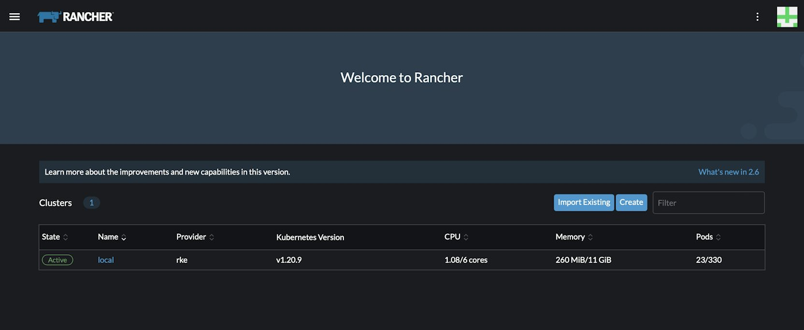

In the most recent classes of the [Up & Running: Rancher course](https://community.suse.com/courses/5804003), I demonstrated how to provision both a single node and a highly available (HA) Kubernetes cluster on your local machine. However, it's equally important to understand how to carry this out in a cloud environment if your Rancher server will be managing K8s clusters in the cloud.

In practice, an optimal approach would be to make use of Infrastructure as Code (IaC). If you're completely new to IaC, you can read through an excellent resource by [Nwani Victory](https://community.suse.com/members/7079891) who elaborates on the benefits of IaC in [his article](https://community.suse.com/posts/managing-rancher-resources-using-pulumi-as-an-infrastructure-as-code-tool).

In this short post, I want to share some resources that make use of Terraform to automatically provision the necessary infrastructure to run Kubernetes in the cloud. Once your cluster is up and running, you can proceed to install Rancher using [helm](https://helm.sh/).

###

### Provision Hosted Clusters (EKS, GKE, AKS)

Hosted clusters are a popular solution for running Kubernetes in a production environment. They offer users the chance to focus on the worker plane while the respective cloud provider assumes ownership, security, and optimization of the control plane and the data plane of your K8s cluster.

This [GitHub project](https://github.com/SUSE-Rancher-Community/provision-hosted-clusters-eks-gke-aks-with-terraform) contains the relevant source code and a README.md file that outlines a step-by-step approach to provision hosted Kubernetes clusters in AWS, GCP, or Azure with Terraform. One cluster can then be used as the Rancher server to manage the other downstream clusters.

Link: <https://github.com/SUSE-Rancher-Community/provision-hosted-clusters-eks-gke-aks-with-terraform>

In a previous Kubernetes Master Class session, I dealt with how to manage hosted clusters with Rancher. If you missed it, you can watch the replay below.Play Video

###

### Bootstrap RKE Kubernetes Cluster in AWS Environment

If you want to have full ownership of the different planes in the K8s architecture, you can use a CNCF-certified Kubernetes distribution like RKE.

This [GitHub project](https://github.com/LukeMwila/bootstrap-rke-cluster-in-aws) contains the source code and steps to bootstrap a HA RKE cluster in AWS with a private cluster endpoint.

Link: <https://github.com/LukeMwila/bootstrap-rke-cluster-in-aws>

The repository has a README.md file explaining the steps for installation and usage. If you need additional context on how to make use of it, you can also watch the video below as I walk through the usage of the project.Play Video

---

If you use any of the above material for testing purposes, remember to destroy the resources you create through Terraform to avoid incurring additional costs.

What next?

You can watch the replay in the course material section if you missed the most recent session. You can find the recording here:

<https://community.suse.com/posts/up-and-running-rancher-october-2021-installing-rancher-initial-setup-part-2>

### Be sure to join the next class where we'll be looking at cluster operations with Rancher!
