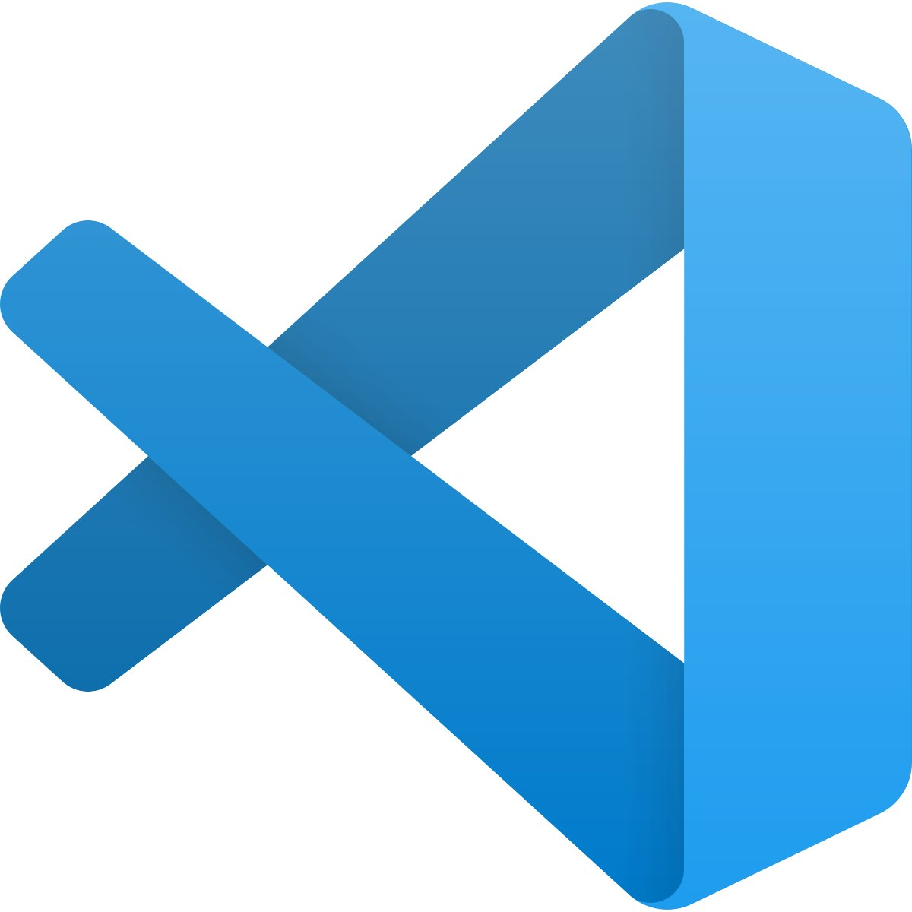
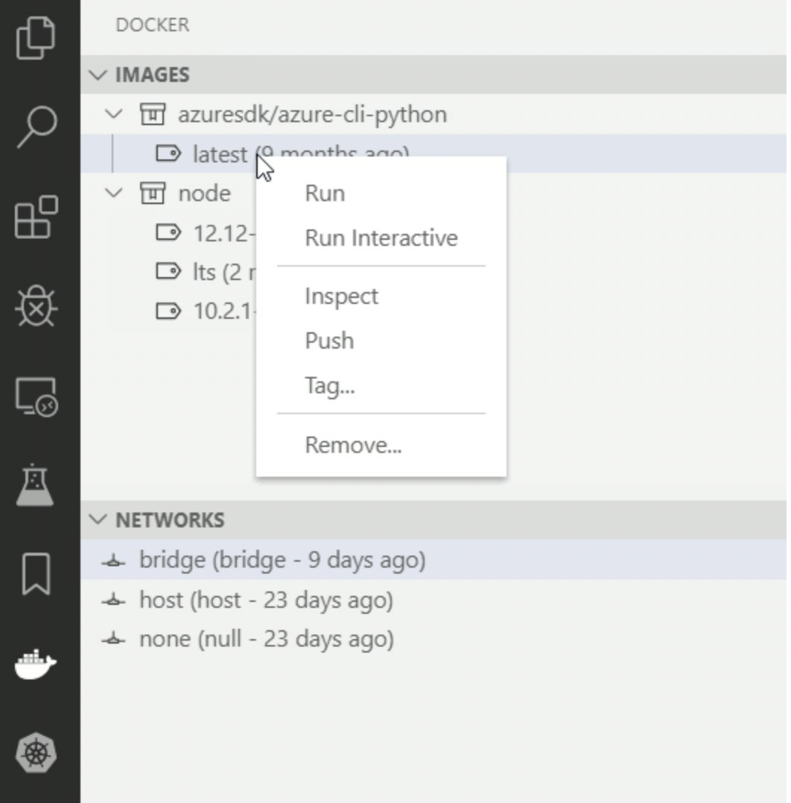
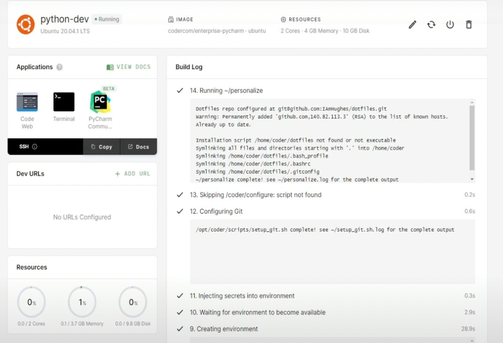
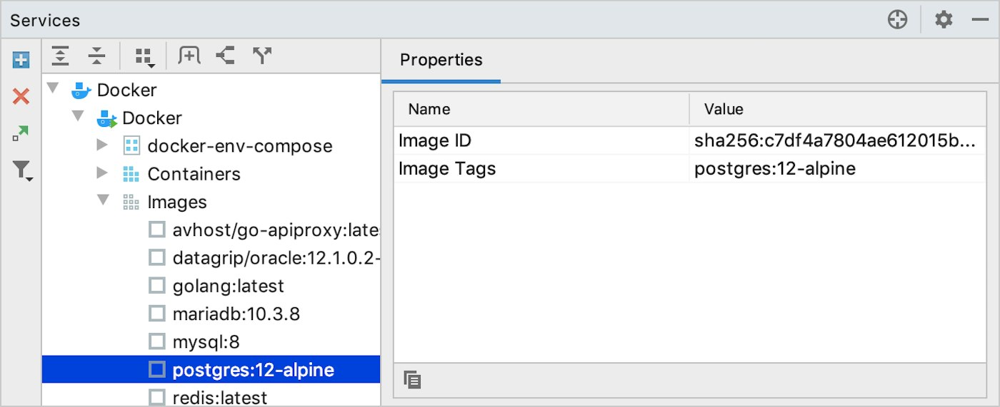

## What And whys of IDEs

Before we jump right in and start comparing IDEs, it is important to understand why you need an IDE in the first place. An Integrated Development Environment (IDE) is an application that makes your life easy when writing code. While you can write code in your favorite programming language in a simple text editor, IDEs come with a set of useful features that assist you in this process. These features range from things like formatting your code each time you make changes to creating custom snippets for your codebase.

It’s fair to mention an argument often given against IDEs. Each IDE typically has its own learning curve, which can be a problem - especially for new developers just getting started with a language or a framework. However, IDEs provide significant benefits, and it’s almost always worth the time investment to familiarize yourself with an IDE. Also, once you get the hang of one, switching to others is really not that difficult.

## What matters in an IDE?

In this article, we’ll compare some of the most popular IDEs out there. We will look at their IntelliSense features, plugins and extensions available and pricing options.

IntelliSense refers to a whole bunch of useful code editing features such as auto-completion, code suggestions and quick info across the codebase. You’ll use these things most often, so they are critical when comparing IDEs. Another important metric is the quality and quantity of available extensions and plugins. This also ties into community support because the larger the community around an IDE, the more likely it is to have quality add-ons.

While we will focus on the above-mentioned things, our primary metric for comparing IDEs would be Golang and container support. This is simply because we want to look at these IDEs from the perspective of development in the cloud native ecosystem, so things like Go support and integration with containers become the key criteria. So let the battle begin!

## [VS Code](https://code.visualstudio.com/)

VS Code is one IDE that probably doesn’t need much introduction. It is free, open source and highly customizable. It is maintained by the folks at Microsoft but being an open source project, it also sees a lot of external contributors. The beauty of VS Code lies in that it provides you with the bare minimum you need to get started and gives you a wide range of options to customize and add extensions for anything you want. This keeps it as lightweight as you’d like while ensuring that you don’t miss the features you need. It also comes with many useful features right out of the box, like built-in Git integration and debugging tools. With the official Golang extension installed, you get all the cool features like auto-completion, code information on hover, code navigation shortcuts, and much more. Certain areas where some users feel it lacks are debugging options and compatibility with some languages like Ruby on Rails. However, for the purpose of cloud-native development, these areas aren’t that problematic. With the official Docker extension installed, working with containers is also a breeze in VS Code. The extension provides a whole bunch of useful features like IntelliSense while writing Docker files, seeing all images and containers from within VS Code, interacting with the container via VS Code, and much more!

*Working With Images And Containers In VS Code*

## [Sublime Text](https://www.sublimetext.com/)

Sublime Text is another popular choice in lightweight IDEs and the awesome people at Sublime HQ make it. It is almost always compared to Atom, another IDE in this roundup. Sublime Text fans argue that it is faster and snappier than Atom. Why is that? This is partly because many core parts of Sublime Text were written in C++, which is much faster than JavaScript (which Atom was written in). In terms of Golang support, the official [sublime-build](https://github.com/golang/sublime-build) plugin provides integrations to execute common Go commands (like go run, go test, and go get) without leaving the editor. However, many developers tend to prefer VSCode or GoLand over Sublime when it comes to developing Kubernetes applications. Sublime Text is free to download. However, you need to buy a license for continued use. While there’s no official Docker plugin, limited integration with Docker is possible via community-made packages. But these fall behind, compared to VS Code’s Docker support.

## [Coder.com](https://coder.com/)

Next up, an IDE that is significantly different from others on this list. Coder tries to solve the problem of setting up a local development environment for each project. It does so by moving all the developer tools to the cloud. You can choose how many resources you want to give to this development machine you will be working on in the cloud much as you do with a virtual machine. Coder definitely has some really neat features packed in. It supports running VS Code and JetBrains’ IDEs from your browser. This means you get all the features those IDEs provide right from the browser. Pretty cool, no? Coder also removes the need for laptops and allows you to basically code from anything with an internet connection, even an iPad! But it’s got some downsides – it’s pricey, and because it’s still very new and experimental, it’s not ideal for large teams working on enterprise projects. However, it looks really promising and ideal for those looking to start or experiment.

*Development Environment In Coder*

## [Atom](https://atom.io/)

Atom is the one IDE that often comes up as an alternative to VSCode and Sublime Text. Just like VS Code (and unlike Sublime), Atom is also free and open source. It was developed in 2014 by GitHub using Node.js and HTML. Compared to Sublime, many developers find Atom a bit slow. But it’s the obvious choice if you’re not willing to pay for Sublime. Comparing it with VS Code, you’ll notice that when the number of plugins increases in Atom, it gets sluggish. VS Code also has more features to offer, so it is the better option. I think it is also important to mention that Atom is not truly an IDE but more of a highly modular text editor, so to write Go code you will have to take the time to find and install plugins to make it work like a true IDE. It also lacks container support like the one VS Code has with the Docker extension.

## [Eclipse](https://www.eclipse.org/)

Next up is an IDE famous for Java development: Eclipse, which the Eclipse Foundation develops. Using Go (or other languages, too) directly with Eclipse is inconvenient, but the GoClipse extension tries to make it easy by adding IDE functionality for Golang. Using this extension makes life a bit more convenient, but this is still the route developers seldom prefer. Other IDEs on this list tend to be the choice over Eclipse because they provide better support and are faster. However, Eclipse is the go-to for Java development. Since you probably won’t be writing Java code when developing stuff in the cloud native ecosystem, Eclipse falls behind most IDEs in this list.

## [GoLand](https://www.jetbrains.com/go/)

GoLand is an IDE built by the folks at JetBrains specifically for Go development. It won’t come as a surprise that an IDE built especially for a language outperforms almost every other IDE out there in terms of features. It comes with more reliable code completion and better auto-suggestions. It also has a better debugger compared to the VS Code. Its code format works without any hiccups and is very fast. Just like VS Code, GoLand comes with a handy Docker plugin that makes working with containers super convenient. The only downside to GoLand is that it is not free like VSCode. It isn’t really that cheap either if you’re looking to tinker with Go. But, then again, if you work primarily work with Go, then GoLand is without a doubt worth the price!

*Working With Docker In GoLand*

## And the winner is…

VS Code! VS Code is our top pick if you’re looking for an IDE for development in the cloud native ecosystem. It was a tough choice between GoLand and VS Code. Other IDEs didn’t really come close because of a lack of features, especially support for containers and Golang. Don’t get us wrong here, they are terrific IDEs –  it’s just that they lack the features you want when working in the cloud native space.

GoLand and VS Code had a tough neck-to-neck fight. We still think that there are some areas where GoLand is a better choice – such as enterprise teams working exclusively with Go. But then why VS Code, you might ask?

VS Code might not have that great IntelliSense and debugging options compared to GoLand, but they are still pretty great. Where it really takes the lead is in its flexibility. GoLand is built just for Go and struggles to do well if you switch your language. Other languages like Rust do seem to be making their impact in cloud native development and VS Code provides the flexibility to switch. To top all this off, VS Code is free and open source, so it takes away the crown jewel among IDEs and becomes our top pick!

