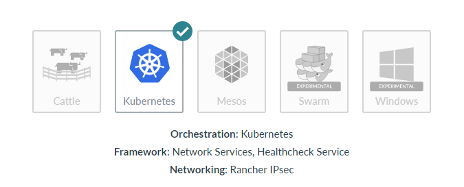
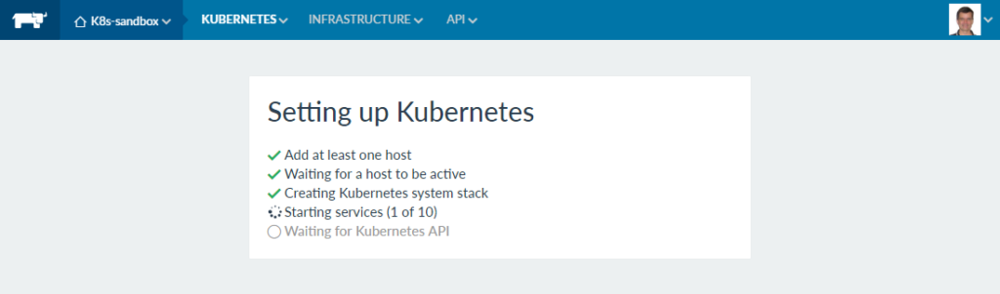
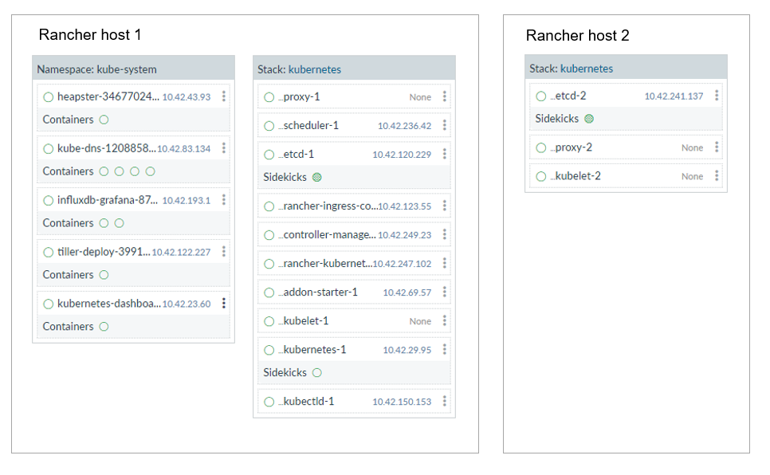
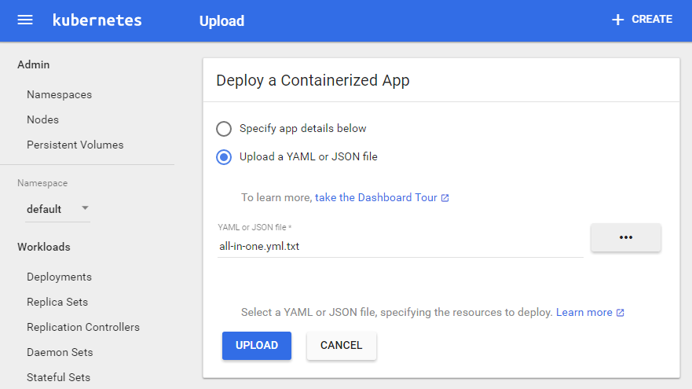
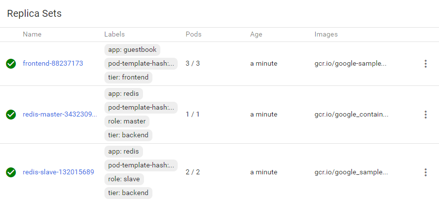
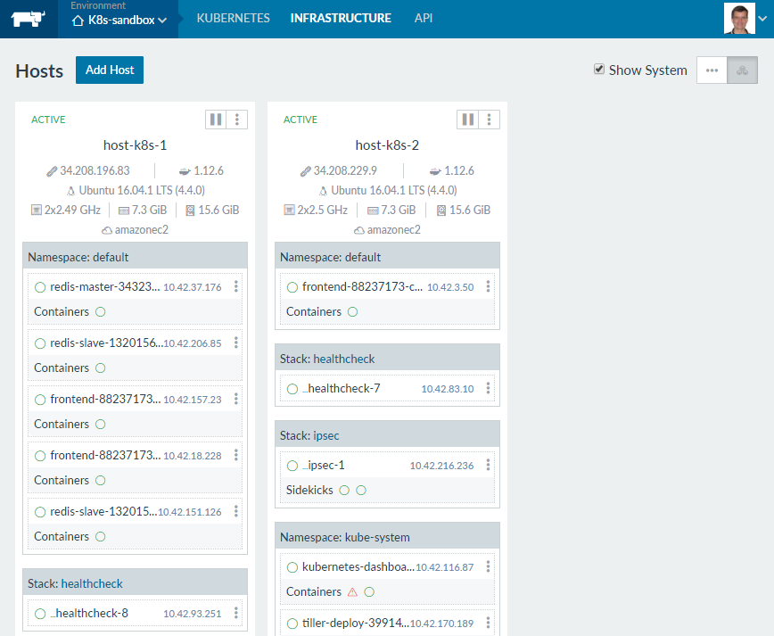
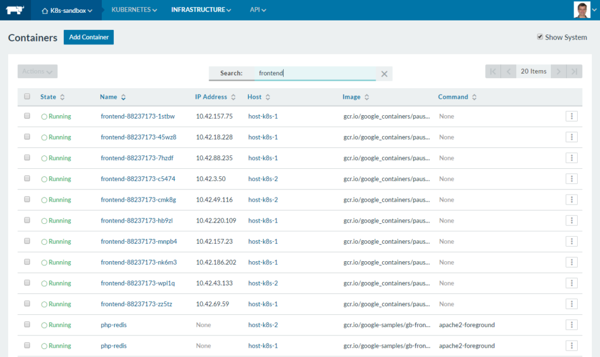

One of the first questions you are likely to come up against when
deploying containers in production is the choice of orchestration
framework. While it may not be the right solution for everyone,
Kubernetes is a popular scheduler that enjoys strong industry support.
In this short article, I’ll provide an overview of Kubernetes, explain
how it is deployed with Rancher, and show some of the advantages of
using Kubernetes for distributed multi-tier applications.

### About Kubernetes

Kubernetes has an impressive heritage. Spun-off as an open-source
project in 2015, the technology on which Kubernetes is based (Google’s
Borg system) has been managing containerized workloads at scale for over
a decade. While it’s young as open-source projects go, the underlying
architecture is mature and proven. The name Kubernetes derives from the
Greek word for “helmsman” and is meant to be evocative of steering
container-laden ships through choppy seas. I won’t attempt to describe
the architecture of Kubernetes here. There are already some excellent
posts on this topic including [this informative
article](https://rancher.com/comparing-rancher-orchestration-engine-options/)
by Usman Ismail. Like other orchestration solutions deployed with
Rancher, Kubernetes deploys services comprised of Docker containers.
Kubernetes evolved independently of Docker, so for those familiar with
Docker and *docker-compose*, the Kubernetes management model will take a
little getting used to. Kubernetes clusters are managed via a
*kubectl* CLI or the Kubernetes Web UI (referred to as the Dashboard).
Applications and various services are defined to Kubernetes using JSON
or YAML manifest files in a format that is different than
docker-compose. To make it easy for people familiar with Docker to get
started with Kubernetes, a [kubectl
primer](https://kubernetes.io/docs/user-guide/docker-cli-to-kubectl/)
provides Kubernetes equivalents for the most commonly used Docker
commands.

## A Primer on Kubernetes Concepts

Kubernetes involves some new concepts that at first glance may seem
confusing, but for multi-tier applications, the Kubernetes management
model is elegant and powerful. The basic workload unit in Kubernetes is
a *Pod*, a collection of one or more containers that reside on the same
cluster host. Pods are managed via *Replication Controllers* associated
with each application *Deployment*. Replication Controllers facilitate
horizontal scaling and ensure that Pods are resilient in case of host or
application failures. The Replication Controller is responsible for
ensuring the desired number of Pods are running on the cluster. If a
container goes down or a host becomes unavailable, Pods will re-start on
different hosts as necessary to maintain a target number of replicas. In
Kubernetes, the notion of a *Service* also has a different meaning than
in Docker. Services are essentially load balancers and front-ends to a
collection of Pods. A Services’ IP address remains stable and can be
exposed to the outside world, abstracting away the number of Pods as
well as virtual IP addresses that can change as Pods are scheduled to
different cluster hosts. This all sounds a little complicated, but
basically a Deployment described in a Kubernetes YAML file defines the
*Pods*, *Replica Sets* and *Services* that comprise an application (as
well as other things).

## Deploying Kubernetes on a Rancher Cluster

Kubernetes has a reputation for being difficult to install and configure
because it is comprised of many different components (*etcd*, *Tiller*,
*Heapster*, *Grafana* etc..). However, installing Kubernetes using
Rancher is impressively easy. You simply add a new environment via the
“Manage Environments” option in the Rancher UI, and select Kubernetes as
your orchestration template. Rancher will guide you through the process
of attaching local or cloud-resident Docker hosts and will install and
configure all the components for you. [](images/rancher_blog_fig1_kubernetes_orchestration.png)
Figure 1: Selecting Kubernetes orchestration in Rancher I
created a new environment in Rancher called *K8s-sandbox* for testing,
and as soon as I switched to the environmen, I was invited to add two
new hosts. I provisioned the Kubernetes environment on two *m3.large*
AWS instances. Bringing up the hosts, installing Docker, the Rancher
agent and all components of the Kubernetes environment takes a few
minutes, but the process is 100% automated. [](https://cdn.rancher.com/wp-content/uploads/2017/04/05120909/fig2_setting_up_kubernetes.png)
Figure 2 - Setting up Kubernetes This simplified view below
shows how Kubernetes components were deployed across my hosts. [](images/rancher_blog_fig3_host_deployments.png)
Figure 3 - How Kubernetes services are deployed Kubernetes
has the notion of *Namespaces*, and two Namespaces are provisioned out
of the box. A *kube-system* Namespace includes the components that
comprise Kubernetes as well as a *default* Namespace for Kubernetes
workloads. Once all the containers start, the Kubernetes dashboard
becomes accessible under the KUBERNETES pull-down in the Rancher UI. A
web accessible *kubectl* shell is provided as well for convenience.

## Deploying and Managing an Application with Kubernetes

To illustrate how a multi-tier application is deployed via Kubernetes, I
used the Kubernetes guestbook example available on GitHub (also used in
Rancher’s [Kubernetes
whitepaper](https://info.rancher.com/hubfs/Whitepapers/Rancher%20for%20Kubernetes.pdf)).
The example consists of a web front-end, a *redis* master for storage
([redis](https://redis.io/) is an open-source in-memory datastore) and a
replicated set of redis slaves. The application tiers are expressed as
three different Kubernetes deployments, but they are packaged as a
single YAML file
for convenience. You can either deploy the application as a single
Kubernetes command like the one below, or use the “Create” option in the
Kubernetes web UI to create the new application workload.

```
$ kubectl create -f examples/guestbook/all-in-one/guestbook-all-in-one.yaml
```

In my case, I uploaded the YAML file via the Kubernetes GUI exposed
through Rancher as shown: [](images/rancher_blog_fig4_deploy_app.png)
Figure 4 - Deploying an app through the Kubernetes dashboard
This application illustrates the key Kubernetes concepts described
earlier: Deployments, Replica Sets, Pods and Services. There are three
Deployments described in the YAML file (frontend, redis-master and
redis-slave) and named Replica Sets are created for each Deployment.
The frontend consists of three Pods. A single instance of a
redis-master is persisted by a redis-master Replica Set, and there are
two redis-slaves managed by a redis-slave Replica Set. [](images/rancher_blog_fig5_kubernetes_replicas.png)
Figure 5 - Replica sets exposed through the Kubernetes
dashboard From the Infrastructure view in Rancher, you can
see how the components of the application are deployed in the default
Namespace. You can see three frontends (the web-tier), a single
redis-master, and two redis-slaves consistent with the definition in the
application’s manifest file. [](images/rancher_blog_fig6_kubernetes_hosts.png)
Figure 6 - Kubernetes hosts as seen through the Rancher web
UI For fun, you can kill any of the containers that comprise
the application and watch Kubernetes restart them automatically in
accordance with the replication policy. A nice feature of Kubernetes is
its ability to auto-scale the number of Pods in a replication group to
meet target resource utilization thresholds. This is one of the reasons
that Kubernetes is known to be efficient in its use of infrastructure.
Despite the complexity of the framework, these kinds of “auto-pilot”
features allow relatively few administrators to manage large and complex
clusters. The kubectl command below implements an auto-scaling policy
for the application above such that Kubernetes will try and maintain a
target utilization of 80% CPU usage, scaling the number of Pods between
1 and 10 as needed to try and maintain this utilization.

```
> kubectl autoscale deployment frontend --max=10 –-cpu-percent=80
```

To force the web-tier of the service to scale up (even though there is
insufficient load to trigger the *autoscale* policy in my case), I can
manually scale up the frontend via the kubectl shell exposed in the
Rancher GUI as below.

```
> kubectl scale --replicas=10 rs/frontend-88237173
replicaset "frontend-88237173" scaled
```

After scaling the service, I see in the Rancher UI that seven new
frontend Pods have been started across the two cluster hosts. [](https://cdn.rancher.com/wp-content/uploads/2017/04/05121539/fig7_scaled_up_app.png)
Figure 7 - View in Rancher of scaled up front-ends

## Useful Features for Large Deployments

As someone whose experience with workload management is shaped by
working with Platform LSF (now IBM Spectrum LSF), Kubernetes feels
familiar. Like LSF, the CLI is large and exposes many scheduling and
cluster management features. Capabilities like cordoning off and
draining hosts may seem like “nice to haves” until you find yourself
managing a large cluster in production. In addition to supporting
applications as described above, Kubernetes also supports the notion of
Batch Jobs. Unlike persistent Deployments, Batch Jobs are meant for
workloads that run to completion. Jobs can be run in parallel, be
submitted via queues, and the notion of Cron Jobs (or time based jobs
familiar to Linux/UNIX folks) enable Kubernetes workloads to run
automatically on arbitrarily complex schedules. Kubernetes provides an
array of features including:

- *Pet Sets* (now Stateful Sets, as of Kubernetes 1.5) for
  applications that require stable persistent storage or predictable,
  ordered deployment or termination
- *Daemon sets* (for pods that need to be replicated on every node)
- *Container Lifecycle Hooks* (for building cluster-aware
  applications)
- *Guaranteed Scheduling* (for critical pods with SLA guarantees)
- *Persistent Volumes* (Providing an easy way to manage volumes across
  different storage platforms independent of Pods)

Scheduling features in Kubernetes are being enhanced at a rapid pace.
As an example, Kubernetes 1.5 supports opaque integer resources
(referred to as “consumable resources” by other workload schedulers)
used for modeling things like software licenses or consumable resources
like host GPUs. When Kubernetes is deployed on Rancher, other services
are automatically configured as well.

- *Heapster* is a facility that enables container cluster monitoring
  and performance analysis by aggregating monitoring and event data
  cluster wide. Heapster runs as a Pod and queries usage information
  from all cluster nodes
- Heapster supports pluggable storage frameworks, and *InfluxDB*, an
  open-source time-series database is configured by default in Rancher
  to store the gathered data
- *Grafana*, also runs as a Pod provides a flexible web-based visual
  interface for monitoring the Kubernetes cluster

## The Bottom Line

If you’re comfortable with Docker, and don’t want to face the learning
curve of a new scheduling environment, Kubernetes may not be the right
solution for you, but the great thing about Rancher is you have a
choice. You can deploy multiple environments and get a feel for each
orchestration solution. You might want to consider Kubernetes as your
orchestration framework in Rancher if you are:

- Managing a large environment where efficient use of infrastructure
  is crucial and you are willing to invest more time in workload and
  cluster administration.
- Anticipating specialized requirements like scheduling workloads
  other than Docker applications or the need to accommodate stateful
  services that need to be started up or shutdown in a particular
  order.
- Managing complex, multi-tier or horizontally scalable workloads and
  see benefits in grouping and managing containers as collections of
  logical units.

To learn more about Kubernetes on Rancher, you can download the eBook
[Deploying and Scaling Kubernetes with Rancher](https://info.rancher.com/deploying-scaling-kubernetes-ebook).
