[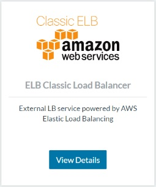](images/rancher_blog_ELB-Catalog-2.jpg)Rancher
ships with two types of catalog items to deploy applications; Rancher
certified catalog and community catalog, which enable the community to
contribute to the reusable pre-built application stack templates. One of
the recent interesting community catalog templates is the external load
balancer for AWS Classic Elastic Load Balancer, which keeps an existing
Load balancer updated with the EC2 instances on which Rancher services
that have one or more exposed ports and specific label. This blog post
will explain how to set up a Classic ELB and walk through the details of
launching a catalog template for ELB from the community catalog to
update the Classic ELB automatically.

### Classic Elastic Load Balancer

Elastic load balancer is an Amazon Web Service that automatically
distributes the incoming traffic to the across multiple Amazon EC2
instances, Elastic Load Balancer offers two types of load balancers:

- \*\*Classic Load Balancers: \*\*A simple load balancer that routes
  traffic to multiple backend EC2 instances, it routes traffic based
  on network or application level information, it offers many features
  including level 4 or level 7 load balancing which can either routes
  traffic based on just TCP protocol or using HTTP/HTTPS protocol and
  use level-7 features like X-Forwarded and sticky sessions.
- \*\*Application Load Balancers \*\*This kind of load balancing option
  routes traffic based on its content and operates on the application
  level, it allows to define set of routing rules to route the traffic
  to multiple services or containers, it offers many more features
  like layer-7 support, HTTP/2, Websockets, security features, and
  much more.

### ELB Catalog Template

This template is one of the community catalog template created by Jan B,
The template creates a service that manage an existing classic load
balancer with the EC2 instances that has Rancher services with exposed
ports and a label `io.rancher.service.external_lb.endpoint.`
[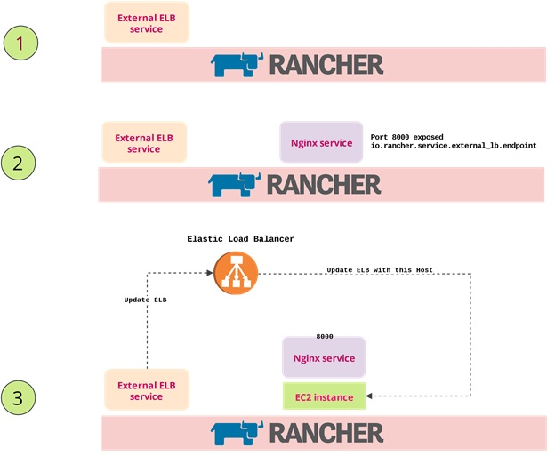](images/rancher_blog_ELB_Service-Schematic.jpg)
The catalog template uses some environment variables to modify the
service:

- **ELBV1\_AWS\_ACCESS\_KEY** The AWS access key that is used by the
  external ELB service to communicate with the Elastic Load Balancer.
- **ELBV1\_AWS\_SECRET\_KEY** The AWS secret key that is used by the
  external ELB service to communicate with the Elastic Load Balancer.
- \*\*ELBV1\_AWS\_REGION \*\*This optional option used to inform the
  service with the region where the ELB and the instances exist.
  Defaults to the region of the instance the service will be running
  on.
- \*\*ELBV1\_AWS\_VPCID \*\*The VPC for the load balancers and EC2
  instances in this Rancher environment. Defaults to the VPC of the
  instance the service will be running on.
- \*\*ELBV1\_USE\_PRIVATE\_IP \*\*This option is used to make the service
  update the ELB with the private IPs of the EC2 instances.

These options are used to set up the service, but before creating the
service the Classic ELB should exist first.

### Launching Classic ELB

Before creating the Classic load balancer, you should configure one or
more listeners for the ELB, the listener has a front-end and back-end,
both are configured with Port and Protocol. Elastic Load Balancing
supports the following protocols:

- HTTP
- HTTPS (secure HTTP)
- TCP
- SSL (secure TCP)

To start a Classic ELB, open Amazon EC2 console, and then from the
navigation bar select load balancers, then select **Create Load
Balancer:**
[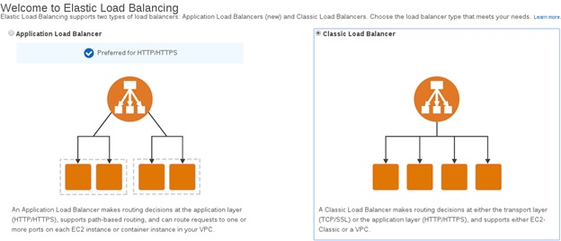](images/rancher_blog_CreateLB.jpg)
After that you must provide the basic configuration for the load
balancer, like the name, VPC, and listeners:
[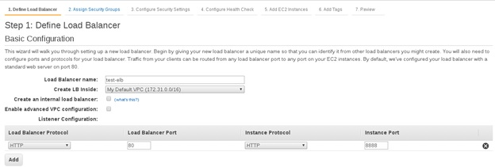](images/rancher_blog_BasicConfig.jpg)
You should also configure the security group and health checks for the
classic ELB, also you should skip adding the EC2 instances tab because
the external service on Rancher will update the Classic ELB for us.
[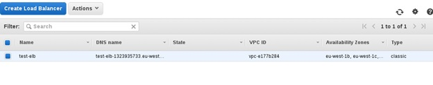](images/rancher_blog_Config2.jpg)

### Creating Rancher Environment

The [quick start
guide](https://docs.rancher.com/rancher/v1.2/en/quick-start-guide/)
provides detailed steps to set up Rancher platform on a Linux host with
at least 1GB of RAM, however you should add EC2 hosts to the Rancher
platform, you can achieve that by using the docker machine driver for
AWS:
[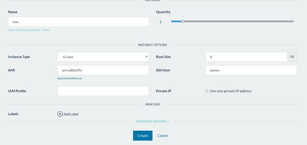](images/rancher_blog_Env1.jpg)
In this example, I will create two instances on AWS on the same region
as the classic ELB that created earlier.

[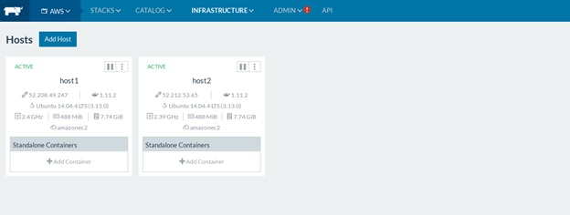](images/rancher_blog_AWS-instances.jpg)

### Creating ELB Catalog Service

From the catalog tab, search for “ELB”, and select the ELB Classic Load
Balancer catalog item:
[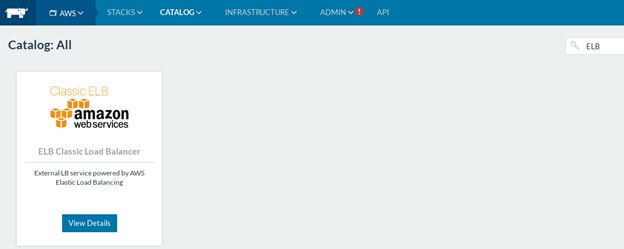](images/rancher_blog_ELB-Catalog.jpg)
The catalog should be configured with at least the AWS \*\*Key
ID \*\*and **Secret Key**. Click Launch:
[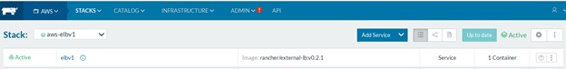](images/rancher_blog_Launch-ELB.jpg)

### **Testing: Nginx Service**

To test the external ELB, a service should be created with two
conditions: 1. Exposed ports that should match the classic ELB
listeners. 2. A label `io.rancher.service.external_lb.endpoint` That
should be set to the name of the elastic load balancer.
[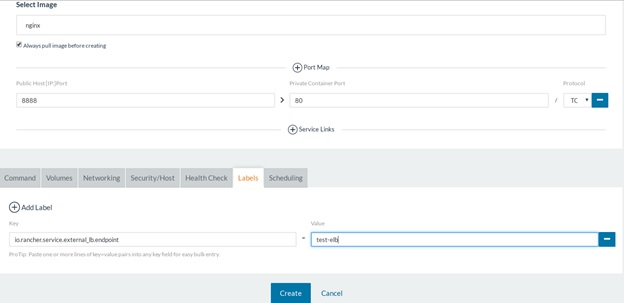](images/rancher_blog_nginx-test.jpg)
You will notice updates to the logs for the external service:

```
10/24/2016 2:23:51 AM time="2016-10-23T23:23:51Z" level=info msg="Starting Rancher External LoadBalancer service"
10/24/2016 2:23:56 AM time="2016-10-23T23:23:56Z" level=info msg="Configured AWS ELB Classic provider in region eu-west-1 and VPC vpc-e177b284"
10/24/2016 2:23:56 AM time="2016-10-23T23:23:56Z" level=info msg="LB_TARGET_RANCHER_SUFFIX is not set, using default suffix 'rancher.internal'"
10/24/2016 2:23:56 AM time="2016-10-23T23:23:56Z" level=info msg="Healthcheck handler is listening on :1000"
10/24/2016 2:35:57 AM time="2016-10-23T23:35:57Z" level=info msg="LB configs to add: 1"
10/24/2016 2:35:57 AM time="2016-10-23T23:35:57Z" level=info msg="Adding LB config: {test-elb nginx_Test_c86a90c7-23df-419b-afb5-88ac2877a96e_rancher.internal 8888 []}"
10/24/2016 2:36:31 AM time="2016-10-23T23:36:31Z" level=info msg="LB configs to update: 1"
10/24/2016 2:36:31 AM time="2016-10-23T23:36:31Z" level=info msg="Updating LB config: {test-elb nginx_Test_c86a90c7-23df-419b-afb5-88ac2877a96e_rancher.internal 8888 [{52.212.53.65 8888}]}"
10/24/2016 2:37:16 AMt ime="2016-10-23T23:37:16Z" level=info msg="LB configs to update: 1"
10/24/2016 2:37:16 AM time="2016-10-23T23:37:16Z" level=info msg="Updating LB config: {test-elb nginx_Test_c86a90c7-23df-419b-afb5-88ac2877a96e_rancher.internal 8888 [{52.208.49.247 8888} {52.212.53.65 8888}]}"
```

Also you should see the two instances registered with the Classic ELB:
[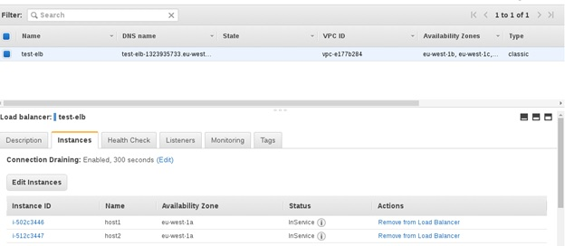](images/rancher_blog_nginx-instances.jpg)
To test the ELB, use the DNS name for the classic ELB:
[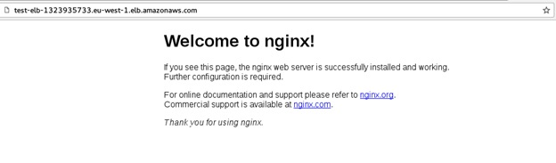](images/rancher_blog_nginx-ELB.jpg)
