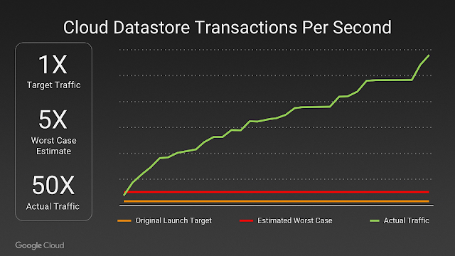

Take a deep dive into Best Practices in Kubernetes NetworkingFrom overlay networking and SSL to ingress controllers and network security policies, we've seen many users get hung up on Kubernetes networking challenges. In this video recording, we dive into Kubernetes networking, and discuss best practices for a wide variety of deployment options.[Watch the video](https://rancher.com/events/2018/kubernetes-networking-masterclass-june-online-meetup/)

Sometimes I feel that those of us with a bend toward distributed systems engineering like pain. Building distributed systems is hard. Every organization regardless of industry, is not only looking to solve their business problems, but to do so at potentially massive scale. On top of the challenges that come with scale, they are also concerned with creating new features and avoiding regression. And even if they achieve all of those objectives with excellence, there’s still concerns about information security, regulatory compliance, and building value into all the investment of the business.

If that picture sounds like your team and your system is now in production – congratulations! You’ve survived round 1.

Regardless of your best attempts to build a great system, sometimes life happens. There’s lots of examples of this. A great product, or viral adoption, may bring unprecidented success, and bring with it an end to how you thought your system may handle scale.

#### Pokémon GO Cloud Datastore Transactions Per Second Expected vs. Actual

Source: [Bringing Pokémon GO to life on Google Cloud](https://cloudplatform.googleblog.com/2016/09/bringing-Pokemon-GO-to-life-on-Google-Cloud.html), pulled 30 May 2018

You know this may happen, and you should be prepared. That’s what this series of posts is about. Over the course of this series we’re going to cover things you should be tracking, why you should track it, and possible mitigations to handle possible root causes.

We’ll walk through each metric, methods for tracking it and things you can do about it. We’ll be using different tools for gathering and analyzing this data. We won’t be diving into too many details, but we’ll have links so you can learn more. Without further ado, let’s get started.

## Metrics are for Monitoring, and More

These posts are focused upon monitoring and running Kubernetes clusters. Logs are great, but at scale they are more useful for post-mortem analysis than alerting operators that there’s a growing problem. Metrics Server allows for the monitoring of container CPU and memory usage as well as on the nodes they’re running.

This allows operators to set and monitor KPIs (Key Performance Indicators). These operator-defined levels give operations teams a way to determine when an application or node is unhealthy. This gives them all the data they need to see problems as they manifest.

In addition, Metrics Server allows Kubernetes to enable [Horizontal Pod Autoscaling](https://kubernetes.io/docs/tasks/run-application/horizontal-pod-autoscale/). This capability allows Kubernetes autoscaling to scale pod instance count for a number of API objects based upon metrics reported by the Kubernetes Metrics API, reported by Metrics Server.

If you’re just getting underway with Kubernetes, read the [Introduction to Kubernetes Monitoring](https://rancher.com/blog/2018/2018-10-18-monitoring-kubernetes/), which will help you get the most out of the rest of this article.

## Setting up Metrics Server in Rancher-Managed Kubernetes Clusters

[Metrics Server](https://github.com/kubernetes-incubator/metrics-server) became the standard for pulling container metrics starting with Kubernetes 1.8 by plugging into the [Kubernetes Monitoring Architecture](https://github.com/kubernetes/community/blob/master/contributors/design-proposals/instrumentation/monitoring_architecture.md). Prior to this standardization, the default was [Heapster](https://github.com/kubernetes/heapster), which has been deprecated in favor of Metrics Server.

Today, under normal circumstances, Metrics Server won’t run on a Kubernetes Cluster provisioned by Rancher 2.0.2. This will be fixed in a later version of Rancher 2.0. Check our Github repo for the [latest version of Rancher](https://github.com/rancher/rancher/releases).

In order to make this work, you’ll have to modify the cluster definition via the Rancher Server API. Doing so will allow the Rancher Server to modify the Kubelet and KubeAPI arguments to include the flags required for Metrics Server to function properly.

Instructions for doing this on a Rancher Provisioned cluster, as well as instructions for modifying other [hyperkube](https://github.com/kubernetes/kubernetes/tree/master/cluster/images/hyperkube)-based clusters is availabe on github [here](https://github.com/JasonvanBrackel/metrics-server-on-rancher-2.0.2).

Take a deep dive into Best Practices in Kubernetes NetworkingFrom overlay networking and SSL to ingress controllers and network security policies, we've seen many users get hung up on Kubernetes networking challenges. In this video recording, we dive into Kubernetes networking, and discuss best practices for a wide variety of deployment options.[Watch the video](https://rancher.com/events/2018/kubernetes-networking-masterclass-june-online-meetup/)
