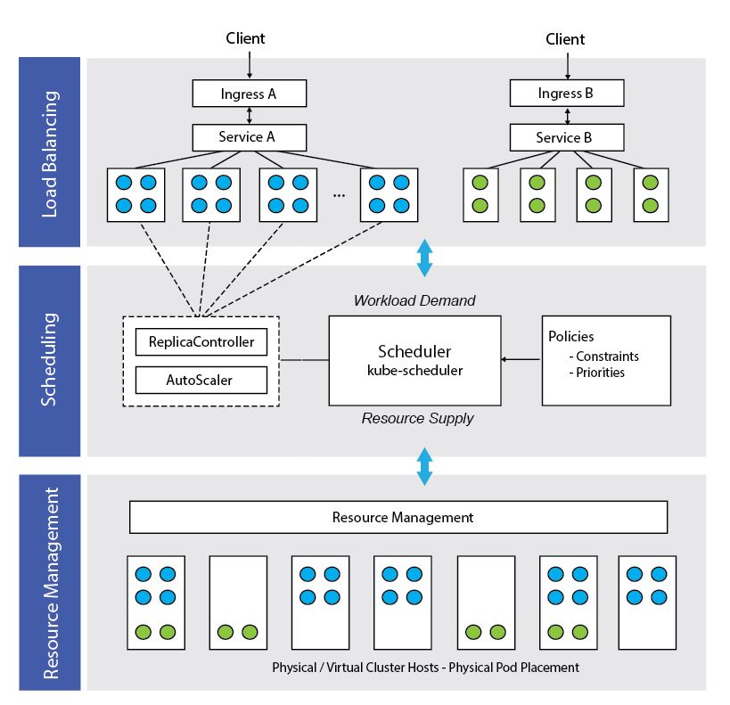

In Kubernetes, we often hear terms like **resource management**,
**scheduling** and **load balancing**. While Kubernetes offers many
capabilities, understanding these concepts is key to appreciating how
workloads are placed, managed and made resilient. In this short
article, I provide an overview of each facility, explain how they are
implemented in Kubernetes, and how they interact with one another to
provide efficient management of containerized \*workloads. \*If you’re
new to Kubernetes and seeking to learn the space, please consider
reading our [case for Kubernetes
article](https://rancher.com/the-case-for-kubernetes/).

## Resource Management

*Resource management* is all about the efficient allocation of
infrastructure resources. In Kubernetes, resources are things that can
be requested by, allocated to, or consumed by a container or pod.
Having a common resource management model is essential, since many
components in Kubernetes need to be resource aware including the
scheduler, load balancers, worker-pool managers and even applications
themselves. If resources are underutilized, this translates into waste
and cost-inefficiency. If resources are over-subscribed, the result can
be application failures, downtime, or missed SLAs. Resources are
expressed in units that depend on the type of resource being
described—as examples, the number of bytes of memory or the number of
milli-cpus of compute capacity. Kubernetes provides a clear
specification for defining resources and their various properties. While
cpu and memory are the main resource types used today, the resource
model is extensible, allowing for a variety of system and user-defined
resource types. Additional types include things like
*network-bandwidth*, *network-iops* and *storage-space*. Resource
specifications have different meanings in different contexts. The three
main ways we specify resources in Kubernetes are described below:

- A **ResourceRequest** refers to a combined set of resources being
  requested for a container or Pod. For example, a Pod might request
  1.5 cpus and 600MB of memory for each pod instance. A
  ResourceRequest can be thought of as describing the application
  services’ “demand” for resources.
- A **ResourceLimit** refers to an upper boundary on combined
  resources that a container or pod can consume. For example, if a
  pod uses more than 2.5 cpus or 1.2GB of memory at run-time, we might
  consider it to have gone “rogue” owing to a memory leak or some
  other issue. In this case, the Scheduler might consider the pod a
  candidate for eviction to prevent it from interfering with other
  cluster tenants.
- A **ResourceCapacity** specification describes the amount of
  resource available on a cluster node. For example, a physical
  cluster host might have 48 cores and 64GB or RAM. Clusters can be
  comprised of nodes with different resource capacities. The capacity
  specification can be thought of a describing the resource “supply”.

## Scheduling

In Kubernetes, *scheduling* is the process by which pods (the basic
entity managed by the scheduler) are matched to available resources.
The scheduler considers resource requirements, resource availability and
a variety of other user-provided constraints and policy directives such
as quality-of-service, affinity/anti-affinity requirements, data
locality and so on. In essence, the scheduler’s role is to match
resource “supply” to workload “demand” as illustrated below:

Some scheduling constraints (referred to as
*FitPredicates*)
are mandatory. For example, if a pod requires a cluster node with four
cpu cores and 2GB of memory, the pod will remain in a pending state
until a cluster host satisfying this requirement is found. In other
cases, there may be multiple hosts that meet a mandatory criterion. In
this case,
*PriorityFunctions*
are considered that reflect scheduling preferences. Basically the
scheduler takes the list of hosts that meet the mandatory FitPredicates,
scores each host based on the results of user-configurable priority
functions, and finds an optimal placement solution where the maximum
number of scheduling priorities are satisfied. In Kubernetes, workloads
can be comprised of a variable number of pods, each with specific
resource requirements. Also, workloads and clusters are dynamic and
with scaling and auto-scaling capabilities, the number of pods can
change with time requiring the scheduler to constantly re-evaluate
placement decisions. Also, with Kubernetes features like cron jobs, the
scheduler needs to consider not just present supply, demand and cluster
state, but reserved capacity for future workloads as well. A useful
metaphor for understanding the scheduling challenge is a game of Tetris.
The goal is to pack all the pieces as tightly as possible (using
resources efficiently). Rather than the game pieces (pods) being two
dimensional however, they are multi-dimensional (requiring specific
memory, cpu, label selectors etc..). Failing to fit a game piece is
analogous to an application that can’t run. As if things aren’t hard
enough already, instead of the gameboard being static, it is changing
with time as hosts go in and out of service and services scale up and
down. Such is the challenge of scheduling in Kubernetes.

## Load Balancing

Finally, *load balancing* involves spreading application load uniformly
across a variable number of cluster nodes such that resources are used
efficiently. Application services need to be scalable and remain
accessible even individual nodes are down or components fail. While
load balancing is a different challenge than scheduling, the two
concepts are related. Kubernetes relies on the concept of pods to
realize horizontal scaling. As a reminder, pods are collections of
containers related to an application function that run on the same
host. To scale, multiple pods sharing a common label will run across
multiple cluster hosts. Replication controllers are responsible for
ensuring that a target number of pods for an application are running,
and will create or destroy pods as needed to meet this target. Each pod
will have its own virtual IP address on the cluster that can change with
time, so this is where services come in. A service in Kubernetes
abstracts a set of pods, providing a single network endpoint. Because
the service IP address (like the pods) has an IP that is only routable
within the cluster, services are often coupled with an ingress resource
providing a means to proxy an external IP address and port to the
service endpoint. This makes the application available to the outside
world. While there are multiple ways to achieve load balancing in
Kubernetes (including using load balancers provided by cloud providers)
the scenario described above involving an ingress and service is common.

## Wrapping up

What does all this have to do with scheduling? As outlined above, with
pod autoscaling, Kubernetes can scale the number of pods managed by a
replication controller dynamically based on observed cpu utilization.
The controller periodically queries the resource metrics API to obtain
utilization for each pod, compares this to a target cpu utilization
specified when the autoscaler is created, and, based on the result,
instructs the replication controller to adjust the target number of pod
replicas. The result of this is an elegant interplay between load
balancing and scheduling. As external clients create load, accessing
an application service through an ingress, the cpu utilized by pods will
increase or fall. Beyond certain thresholds, the autoscaler will
interact with the replication controller and scheduler to adjust the
number of pods based on load. The revised number of pods and their
locations will be available to the service, so the fact the number of
pods may have changed is transparent to the ingress and external
clients. This delicate ballet, balancing resource requirements with
application demand involves constant negotiation between autoscalers,
replication controllers and the Kubernetes scheduler factoring resource
demand, supply, constraints and priorities. All this takes place behind
the scenes without client applications being aware. The ability to
perform these operations efficiently, transparently and reliably such
that applications just run are the reasons that Kubernetes is a popular
orchestration solution for containerized workloads. To learn more about
Kubernetes, and how it is implemented on Rancher, download the eBook
[Deploying and Scaling Kubernetes with
Rancher](https://info.rancher.com/deploying-scaling-kubernetes-ebook).
Want to learn more about Kubernetes? Check our the new [Rancher
Kubernetes Education](https://info.rancher.com/kubernetes-training)!
