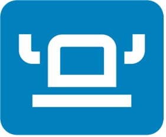

Containers and Kubernetes have changed the way we operate applications. This has been a boon for Site Reliability Engineers (SREs) and DevOps professionals who handle infrastructure management. Yet, it has come at a cost to many who develop and operate applications. Their experience has become more complicated and cumbersome.

If we look at our cloud or cluster computing platforms as a stack, Kubernetes and many supporting tools have focused on low-level concerns. This is great because these projects provide a foundation and API to projects higher in the stack. To illustrate this, the Kubernetes resource API is sometimes compared to an assembly language. It’s long and descriptive, enabling many cases to be covered. Other tools can build on this API with a simpler experience the same way higher-level programming languages do.

New open source projects are being developed that build on the lower-level cloud native projects to simplify the process. In this post, you’ll learn about three such projects: Rancher Desktop, Epinio and Kubewarden.

## Rancher Desktop

Application developers and operators do a lot of their work right on their desktops. This means they need to run Kubernetes locally and would prefer it be the same version that’s running in their production environments. Many of these people would like something as easy as running a desktop application and selecting the version of Kubernetes they need.

[Rancher Desktop](https://rancherdesktop.io/) is a desktop application that provides Kubernetes on your local computer. It also leverages [KIM](https://github.com/rancher/kim) to build, push, and pull container images.

The Rancher Desktop open source project aims to make working with Kubernetes and container images easy for most developers. It’s built using a variety of CNCF projects, including K3s, Helm and containerd.

You can get started with Rancher Desktop by [downloading the latest release](https://github.com/rancher-sandbox/rd/releases).

## Epinio

When developers need to take the time to learn and work with Kubernetes, it takes away from their time working on their applications. Many developers want an easy button so they can just run their code. We sometimes refer to this as Heroku in a box. The need for a simplified app developer experience that works well with Kubernetes has led numerous organizations to build their own platforms.

[Epinio](https://epinio.io/) is a platform for app developers that works well with Kubernetes. A Kubernetes-native platform as a service (PaaS),

it’s for those who want a system that plays well with native Kubernetes and is light enough to use on their desktops. Epinio aims to make it easy for every organization to have a platform to satisfy developers.

We designed Epinio with Kubernetes operators and app developers in mind. This is different from many other platforms that treat Kubernetes as an afterthought, or they try to pigeonhole developers into an operator’s workflow.

The [quick start guide](https://github.com/epinio/epinio#quick-start) provides simple steps you can use to try out Epinio.

## Kubewarden

Often developers need to write and enforce policies in a Kubernetes cluster. Yet, they also want to codify policies in their (or their organization’s) programming language of choice. With their language of choice, developers can leverage their existing expertise and toolchain to write policies with confidence.

[Kubewarden](https://www.kubewarden.io/) leverages Web Assembly (WASM) to make this possible. Developers can write policies in a growing variety of languages, compiled to WASM, and run them in a cluster. WASM is often known for bringing languages to web applications. A growing number of projects are leveraging WASM to enable programming language variety.

Installing Kubewarden is as easy as installing a Helm chart. You can learn about installing Kubewarden and trying it out in the [quick start guide](https://docs.kubewarden.io/quick-start.html).

# Conclusion

In this post, I’ve introduced three open source projects aimed at making life with Kubernetes easier for application developers and operators. You can use these projects together. For example, you can run Epinio in Rancher Desktop to simplify local application development. You can then run Epinio in another environment and push the application there when it’s ready.

As more projects for application developers build on top of existing Kubernetes and cloud native technology, we will see the overall experience continue to improve.
