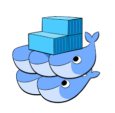

## Docker containers make app development easier. But deploying them in production can be hard.

Software developers are typically focused on a single application,

application stack or workload that they need to run on a specific

infrastructure. In production, however, a diverse set of applications

run on a variety of technology (e.g. Java, LAMP, etc.), which need to be

deployed on heterogeneous infrastructure running on-premises, in the

cloud or both. This gives rise to several challenges with running

containerized applications in production:

1. Controlling the complexity of extremely dense, fast changing

   environments
2. Taking maximum advantage of a highly volatile technology ecosystem
3. Ensuring developers have the freedom to innovate
4. Deploying containers across disparate, distributed infrastructure
5. Enforcing organizational policy and controls

#### Controlling the complexity of extremely dense, fast changing environments

According to the June 2016 Cloud Foundry “Hope Versus Reality:

Containers in 2016” report, 45 percent of survey respondents said their

biggest deployment worry is that Docker is too complex to integrate into

their environments. A big reason for this is

the density and volatility of containerized environments. Because

operating systems and kernels do not need to be loaded for

each container, containerized environments enable better workload

density within a given amount of infrastructure than more traditional

virtualized environments. As a result, the total volume of components

that need to be created, monitored and destroyed across the production

environment is exponentially larger, significantly increasing the

complexity of managing container-based environments. Not only are there

more things to be managed, but they are also changing faster than ever

before. A Datadog survey shows that, while traditional and cloud-based

VMs have an average lifespan of almost 15 days, Docker containers have

an average lifespan of 2.5 days. The result

is an order-of-magnitude increase in the number of things that need to

be individually managed and monitored. The complexity of these dense,

fast-changing environments is further compounded by the complexity of

the architecture. Containers are typically deployed over highly

distributed environments; on a single cluster or on a multi-cluster

environment. The makeup of these clusters is highly disparate and they

may be located on-premises, in the cloud or some combination of the two.

Organizations therefore need an easier approach to orchestrate containers and manage the

underlying infrastructure services for multi-container, multi-host

applications. This is particularly important for applications with a

microservices architecture, such as a web application that consists of a

container cluster running web servers to host multiple instances of the

frontend (for failover and load balancing), as well as multiple backend

services each running in separate containers.

#### Taking advantage of a highly volatile technology ecosystem

The Docker ecosystem is very volatile and complex. Over the past few

years a flurry of third-party tools and services have emerged to help

developers deploy, configure and manage their containerized workflows as

they move from development to production. Because they are based on

open source technologies, the rate at which these tools and services

change and the volume of new documentation makes it very challenging to

put together a stable technology stack to run containers in production.

It also makes it hard for companies to build and maintain the

engineering skills needed to take advantage of the rich ecosystem.

According to RightScale’s fifth annual State of the Cloud Survey, for

companies who are not currently using containers, lack of experience was

by far the top challenge (39 percent) for container

adoption.

#### Ensuring developers have the freedom to innovate

In simplifying container management, it’s important not to lose the

flexibility developers require to innovate. They need to be able to

pick and choose the tools and frameworks they want to use when they need

them. RedMonk refers to this as the “era of permissionless

development”. When asked to solve a problem,

most developers no longer ask what tools they can use, they look for the

best tool for the job. They also prefer to use the most recent releases,

which isn’t necessarily the most stable version, so they can quickly

take advantage of any new capabilities. However, they are also

increasingly being required to take responsibility for ensuring that any

application logic they create runs in production and quickly fixing it

if it does not. This means that they also need to be able to roll back a

deployment if they run into issues. Developers require the freedom of

root access and they want to be able to install any open source software

they like. This is why they typically avoid traditional platform as a

service (PaaS) solutions. PaaS abstracts away containers, so developers

can focus on coding instead of managing containers. However, they are

also proprietary and are not as versatile as a home-grown open source

stacks. They constrain the developers’ ability to innovate by locking

them into one vendor or infrastructure provider.

#### Deploying containers across disparate, distributed infrastructure

One of the primary benefits of containers is that they are portable—an

application and all its dependencies can be bundled into a single

container, which is independent from the host version of Linux kernel,

platform distribution or deployment model. This container can be

transferred to another host running Docker and executed without

compatibility issues. Infrastructure services vary dramatically between

clouds and data centers, however, making real application portability

almost impossible without architecting around those differences in the

application. Using containers to make applications portable across

diverse infrastructure therefore requires more than just a standardized

unit for shipping code. It requires infrastructure services, which

include:

1. Hosts (CPU, memory, storage and network connectivity) running Docker

   containers, including virtual machines or physical machines running

   on-premises as well as on the cloud
2. A network that enables containers on different hosts to communicate

   with each other using either coordinated port mappings or software

   defined networking
3. Load balancers to expose services to the Internet
4. DNS, which is commonly used to implement service discovery
5. Integrated health checks ensure only healthy containers are used to

   serve requests
6. A way to perform actions triggered by certain events, such as

   restarting new containers after a host fails, ensuring a fixed

   number of healthy containers are available or ensuring new hosts and

   containers are created in response to increased load
7. A way to scale services by creating new containers from existing

   containers
8. Storage snapshot and backup for backing up a stateful container for

   disaster recovery purposes

Kubernetes infrastructure provides, nowadays all the above services leveraging developer experience allowing them to focus on the development part

#### Enforcing organization policy and controls

There are security and compliance concerns related to deploying

containers that must be addressed for larger enterprises to use them in

production, particularly those in regulated industries such as finance

and healthcare. Companies such as Docker have continued to push for

fixes and create new software and integration across the toolchain to

cope with that problem. However, there is still a lack of parity between

application container security and what enterprises are used to with

virtual machines. This includes enforcing organizational policy and

ensuring secure access to the containers and cluster administration,

including managing certificates for transport layer security (TLS).

Users and groups need to be able to share or deny access to resources

and environments (e.g. development or production) via role-based access

control (RBAC). User authentication requires integration with Active

Directory, LDAP and/or GitHub.

## SUSE Rancher container management platform can help

Containers make software development easier, enabling you to write code

faster and run it better. However, running containers in production can

be hard. There are a wide variety of technologies to integrate and

manage, and new tools are emerging every day.

SUSE Rancher makes it easy for you to manage

all aspects of running containers. You no longer need to develop the

technical skills required to integrate a complex set of open source

technologies.

SUSE Rancher includes everything you need to make

containers work in production on any infrastructure. A portable layer of

infrastructure services is easily configured and integrated. An easy to

use user interface enables you to take advantage of a rich set

orchestration features and then deploy your containers with a single

click. The robust application catalog makes it simple to package

configuration files as templates and share them across your

organization. With millions downloads and enterprise-class

support, SUSE Rancher has quickly become the open source platform of choice

for running containers in production.

#### It’s easy to get started with Rancher.

Just follow these steps:

1. [Download](http://github.com/rancher/) - SUSE Rancher is deployed as a

   set of container images, easy to deploy on your cluster or even your laptop.
2. [Get started](https://www.suse.com/products/suse-rancher/get-started/) - Deploying SUSE Rancher takes less than 5 minutes if you follow the steps in

   the quick start guide.
3. [Use the docs](https://docs.ranchermanager.rancher.io/v2.7) - SUSE Rancher is incredibly easy

   to use. However, there’s a wealth of information in the technical

   documents in case you need it.
4. [Take advantage of our awesome community of users](https://forums.rancher.com) - The forums are the best place to

   hear about the latest product releases as well as interact with your

   peers and Rancher engineers.

Resources:

##### [[1]](#_ftnref1) <https://www.cloudfoundry.org/hope-versus-reality-containers-in-2016/>

##### [[2]](#_ftnref2) <https://www.datadoghq.com/docker-adoption/>

##### [[3]](#_ftnref5) <http://redmonk.com/fryan/2016/02/16/docker-containers-and-the-cio/>
