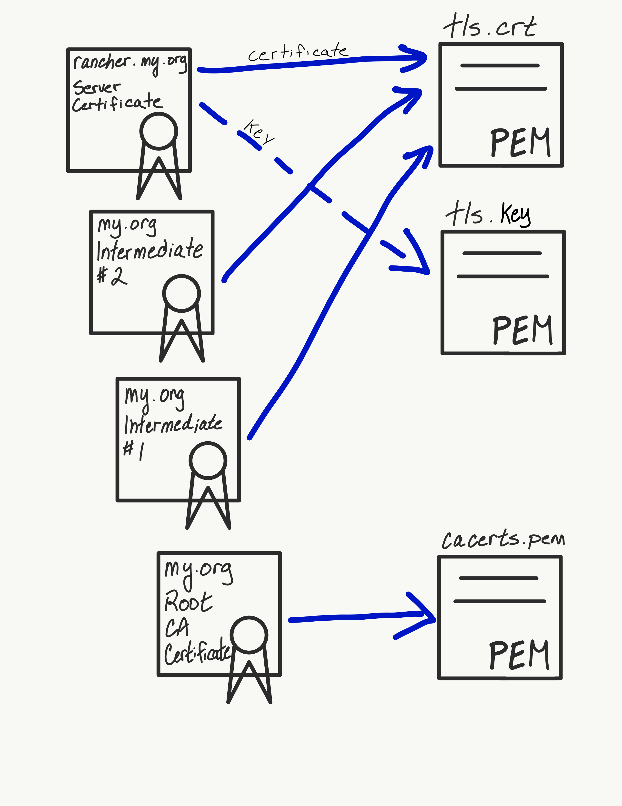

## Introduction

In this blog series, we’ll explore a few ways that Rancher uses of TLS certificates. TLS, or Transport Layer Security, is a cryptographic protocol used to secure network communication. It is the successor to the now-deprecated Secure Sockets Layer, or SSL.

You can expect to walk away with an understanding of how TLS integrates into various Rancher components, and how you can prepare your environment to properly leverage TLS in Rancher.

## Background

In the [first article in this series](/blog/transport-layer-security-termination-in-rancher-2-x-part-one/), we explored the ways that Rancher uses TLS certificates. Recall that Rancher uses certificates in many locations. Two of these are of particular interest to users: UI security and agent<->API communication security. We also looked at one method of Rancher installation: using self-signed certificates.

In this article, we’ll explore two more Rancher installation methods and how they leverage TLS certificates:

- Let’s Encrypt (LE)
- Bring-your-own certificates

## Using Let’s Encrypt

From Wikipedia:

Let’s Encrypt is a non-profit certificate authority run by Internet Security Research Group that provides X.509 certificates for Transport Layer Security encryption at no charge.

(read more at [Let’s Encrypt](https://https://letsencrypt.org/))

So, in other words, free TLS certificates! Not only are the certificates free, but one of the most publicly trusted Certificate Authorities signs them. So, you get automatic trust in most browsers and operating systems.

### Single Node Installation

The Rancher server includes, by way of Golang’s [autocert](https://godoc.org/golang.org/x/crypto/acme/autocert) library, a way to automatically provision a Let’s Encrypt certificate. This library provides automatic handling of ACME-based certificate authorities, of which Let’s Encrypt is one.

Before you enable this functionality, you need to do a few things:

1. Set up a DNS name that points to the IP address of the node where your Rancher container is running.
2. Expose TCP port 80 of this host to the Internet. Let’s Encrypt ACME requests can come from any location on the Internet, so you won’t be able to limit this via firewall rules easily.
3. Start the `rancher` container with the following argument:

   `--acme-domain <YOUR.DNS.NAME>`

Meeting these prerequisites and starting Rancher with that argument (among other arguments you may need) instructs Rancher to request a certificate from Let’s Encrypt for `<YOUR.DNS.NAME>`. Barring any complications, your Rancher server should receive a certificate from LE within a few minutes.

### Kubernetes Installation

In an HA installation scenario, `cert-manager` manages the Let’s Encrypt certificate request lifecycle instead of Rancher server itself. Follow the instructions here to install `cert-manager` into the Kubernetes cluster you have prepared.

Once you’ve have installed `cert-manager`, the next step is to install `rancher`. There are three arguments required (in addition to any other arguments you need) to enable Let’s Encrypt for Rancher:

1. `--set hostname=<YOUR.DNS.NAME>`
   Once you set the hostname, it is used *for the lifetime of the Rancher install*. Be sure you set this correctly.
2. `--set ingress.tls.source=letsEncrypt`
   This instructs the ingress controller (the mechanism by which HTTPS traffic reaches Rancher in the Kubernetes cluster) to secure HTTP traffic using a Let’s Encrypt certificate.
3. `--set letsEncrypt.email=<YOUR@EMAIL.COM>`
   This email address is associated with the request for a Let’s Encrypt certificate.

In addition to these options, you need to make sure that HTTP traffic can reach your Rancher cluster from the Internet on tcp/80. Let’s Encrypt ACME requests can come from any location on the Internet, so you won’t be able to limit this via firewall rules easily.

## Bring-your-own certificates

This option for TLS termination allows you to bring your own certificates, whether they were signed by a public CA (such as Digicert) or a private CA that you or your organization have set up.

This option is often a good choice for organizations whose security teams require the use of a certificate signed by the org’s private CA. That CA certificate might be deployed on corporate workstations, so you get the benefits of browser and operating system trust while retaining total control of the certificate chain.

This option is also a solid choice if you have a certificate that has been signed by a public CA.

### Docker Installation

If you decide to do BYO certificates with single node installation, you need to ensure that the certificate (including any intermediates) and private key are present on the host machine where the Rancher container will run.

Note: If you’re using a certificate signed by a private CA, you need the certificate of the root CA. Rancher requires this certificate to generate `CATTLE_CA_CHECKSUM`, as described in the [first article in this blog series](/blog/transport-layer-security-termination-in-rancher-2-x-part-one/).

When the Rancher container starts, it looks inside the container at `/etc/rancher/ssl` for the TLS files. To place those files in the correct location (and with the correct names), you must use the following `docker` bind mount arguments. Please note that ALL files must be PEM encoded.

1. `-v /<CERT_DIRECTORY>/<FULL_CHAIN.pem>:/etc/rancher/ssl/cert.pem`
   This is the bind mount for your server certificate, including any intermediate certs. In order, the file must contain your server certificate, followed by any intermediate(s). Replace `/<CERT_DIRECTORY>/<FULL_CHAIN.pem>` with the path on your host system where this file is located.
2. `-v /<CERT_DIRECTORY>/<PRIVATE_KEY.pem>:/etc/rancher/ssl/key.pem`
   This is the bind mount for the private key that corresponds with your server certificate. Replace `/<CERT_DIRECTORY>/<PRIVATE_KEY.pem>` with the path on your host system where this file is located.
3. If you’re using a server certificate signed by a private CA, you must supply a copy of the root CA certificate for Rancher. To do so, pass the argument `-v /<CERT_DIRECTORY>/<CA_CERTS.pem>:/etc/rancher/ssl/cacerts.pem.` Replace `/<CERT_DIRECTORY>/<CA_CERTS.pem>` with the path on your host system where this file is located. This file must contain only the root CA certificate and no others.
4. If you’re using a server certificate that has been signed by a public CA, you must pass the argument `--no-cacerts`. This prevents Rancher from generating its own CA certificate, which could cause issues.

Note how these files have a specific path (`/etc/rancher/ssl/`) and specific file names (`cert.pem`, `key.pem` and `cacerts.pem`). Do not alter these paths and file names. Rancher looks specifically for the existence of these files when attempting to secure traffic using these certificates.

### HA Installation

When you install Rancher in an HA scenario, TLS termination is delegated to the cluster’s ingress controller. During installation, an  resource is created in the underlying Kubernetes cluster. This Ingress resource configures the controller to respond to queries on the hostname you specify for the Rancher server. Additionally, this `Ingress` resource specifies the TLS certificate to use.

You must pass the following arguments to the `helm` command when installing the Rancher chart:

1. `--set ingress.tls.source=secret`
   This tells Rancher to create an Ingress resource that uses a TLS certificate of a predefined name (`cattle-system/tls-rancher-ingress`) to secure HTTP traffic.
2. `--set privateCA=true`.
   This tells Rancher to look for a CA certificate of a predefined name (`cattle-system/tls-ca`). You may want to include this argument *even if you are not using a private CA*. Occasionally, the CA certificate store of node operating systems may not contain the public CA used to sign your cert. If that occurs, the Rancher agents won’t trust the certificate presented by Rancher, and you may have issues.

Once you’ve completed Rancher installation, you need to place the certificates into the Rancher Kubernetes cluster.

First, place the Rancher server certificate (that is, the certificate issued for `<your.rancher.com>`) and any intermediate(s) into a file called `tls.crt`. Those certificates should begin with the server cert, followed by any intermediate(s) in their issuance order. Place the Rancher server certificate *key* into a file called `tls.key`. \*These files **must** be called `tls.crt` and `tls.key` as Rancher is looking for specific file names in the secret.\*

Once you have created these files, issue the following command to place them into the Kubernetes cluster:

```
kubectl -n cattle-system create secret tls tls-rancher-ingress 
    --cert=tls.crt 
    --key=tls.key
```

Next, place the CA certificate into a file called `cacerts.pem`. This should be *only* the root CA of your TLS chain. That is, no intermediate(s) should be in this file – they will be in `tls.crt` as discussed above. Then, issue the following command to place this into the Kubernetes cluster:

```
kubectl -n cattle-system create secret generic tls-ca 
    --from-file=cacerts.pem
```

Once you’ve uploaded these files, Rancher is secured using these TLS certificates, and the provided CA certificate are used for agent connection verification.

Here is a simple diagram showing where various certificates should be placed:



## Next Post

In Part Three in this series, we’ll examine the final TLS termination type: external termination.

## More Resources

Check out our other [security related guides](https://rancher.com/tags/security), including Kubernetes Master Classes and Online Meetups.
