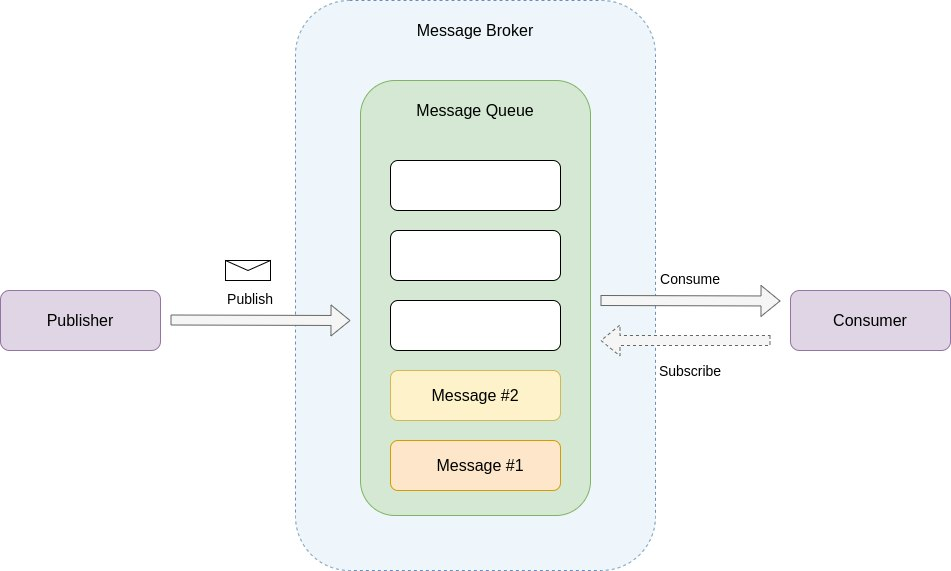
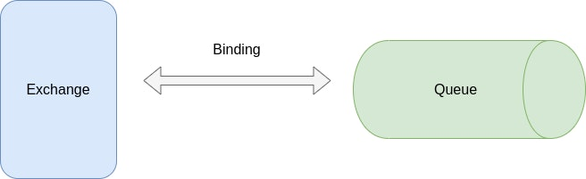
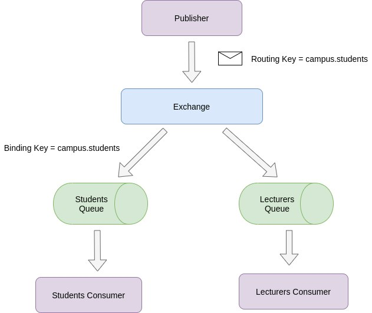
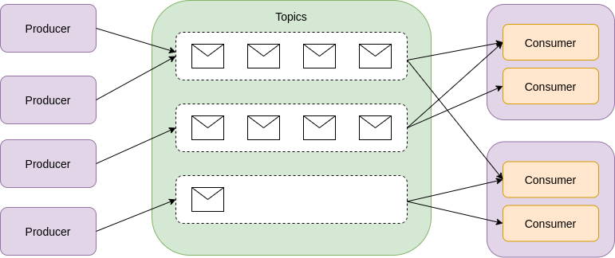
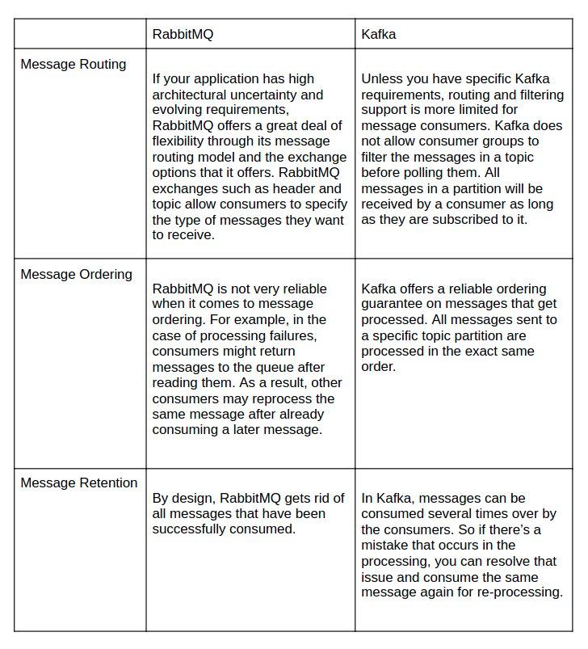

Over the past few years, tightly coupled applications have become less and less viable due to the increasing complexity and demands of modern software. Monolithic architectures will continue to have their place, but modular software components’ flexibility has given rise to distributed systems. These types of systems, however, present communication challenges between their respective services. As a result, the use of messaging-oriented middleware is now a go-to solution. These messaging systems provide many advantages for teams that want to maintain a decoupled and more flexible model for the producers and consumers of information in their application architecture.

In this article, I will cover RabbitMQ, one of the top message brokers used for application communication in distributed software systems. I will begin with a general overview of message brokers and queues before elaborating on RabbitMQ and it's Advanced Queueing Message Protocol (AMQP) based messaging model. Last, I will compare RabbitMQ with its main competitor, Kafka.

## **Message Brokers**

Message brokers take care of the connections between applications that need to communicate. A bidirectional connection is created between each application system and the message broker based on requirements. Then messages are transported via this connection. But, these brokers act as a hub to route messages to their appropriate destinations for asynchronous communication. To reliably store and deliver these messages, brokers rely on components known as queues. Queues are covered in more detail in the next section. Message brokers can be viewed as queue managers in that they handle the interactions between message queues and provide data routing, persistence and message translation among other functionalities.

## **Message Queues**

Message queuing facilitates effective communication between applications by buffering messages between sender and receiver while the destination application is busy or disconnected. The message broker hosts queues.  A producer or publisher generates the messages and pushes them into a message queue in a process called enqueuing. Pushed messages will stay in this queue until a consumer connects and fetches the message. When an application consumes a message, it is known as dequeuing. The producer and consumer applications carry out both the enqueuing and dequeuing processes. Because of the independent nature of the producer and consumer, there is an option to hold a message in a message queue, where it waits for a consumer to fetch it.

Message queueing encompasses the entirety of this flow from the message being pushed and getting consumed. In synchronous processing-based connections, message-sending applications require a response before proceeding with other tasks, i.e. the function call to send a message “blocks” the process. Furthermore, applications on the receiving end are susceptible to being bogged down by an influx of messages. If the application consumers run into a problem and the process dies, messages (with potentially sensitive information) can get lost. On the other hand, queues form part of a more resilient messaging system, whereby the messaging platform returns the message to the queue where it is made available for other consumers. This provides better fault tolerance against processing errors. Also, message queues allow for independent scaling of producers and consumers.

Messages that get added to queues don't prevent publisher applications from carrying out further tasks. Similarly, the recipient service can consume from the queue whenever it's ready. It can then proceed to process the message and immediately consume the next one.



## **What is RabbitMQ?**

RabbitMQ is a lightweight yet powerful message broker introduced in 2007. Since then, it has grown in popularity and mainstream usage, being adopted by large corporations such as NASA, Google and Reddit, to name a few. This shouldn't come as a surprise when you consider its many benefits. These include its lightweight nature, platform and vendor neutrality, client libraries for most modern programming languages, extensibility through third-party plugins, minimal changes to its APIs and wide support from both the core team and the developer community.

When you pop the hood to see what’s underneath, RabbitMQ uses AMQP as its core protocol, but it also supports STOMP, MQTT and HTTP through plugins. Here’s a quick glossary:

- [STOMP](https://stomp.github.io/) — a simple text-based messaging protocol
- [MQTT](http://www.steves-internet-guide.com/mqtt/) — a binary protocol known for its lightweight messaging
- [HTTP](https://developer.mozilla.org/en-US/docs/Web/HTTP) — this is not a messaging protocol, but management plugins in RabbitMQ use HTTP to send and receive messages

## **AMQP Model in RabbitMQ**

As mentioned in the previous section, RabbitMQ implements the AMQP message model, specifically Version 0-9-1. AMQP is a protocol primarily used for message-oriented middleware. Some of its impressive features include flexible message routing, configurable message durability, and secure messaging, to name a few. It mandates the behavior of publishers and consumers for seamless transportation of messages between different applications.

There are three entities required to route messages in the AMQP architecture successfully:

- Exchanges — this is where producers/publishers push their message to
- Bindings — route messages from the exchange to a particular queue
- Queues — where consumers receive messages from



With this AMQP message model, the service that produces the messages doesn't publish directly to a queue. Instead, messages are published in an exchange, like the Post Office. It receives all the messages and distributes them according to how they're addressed. This type of pattern is significant because it consists of a broadcast type of message distribution, in which there is a one-to-many relationship between the message publisher and the consumers. The messages that are published to exchange are distributed to all the consumer applications subscribed to it.

An exchange can connect to many queues, which connect to the consuming services through bindings. The binding key references these bindings and registers the queue in the exchange. Consumer applications subscribe to the queues. When publishing a message, a publisher passes along attributes used by RabbitMQ and the consumer applications. The use of exchanges provides a flexible message-routing model.

Bindings are created based on application requirements. For example, if you wanted to route all messages with the routing key 'campus.students' to a queue named Students, the appropriate Binding should be made to bind the Students queue with the 'campus.students' routing key. A routing key is like an address that an exchange uses to decide where to route the message. The message goes to the queue whose binding key exactly matches the message’s routing key. In this case, that would be 'campus.students'. This particular scenario demonstrates what is known as a direct exchange. The various exchange types are covered later in this section.



What happens when a message fails to deliver to a consumer? This can occur due to a network or application failure. If either of these failures occurs, the system could potentially lose the message forever. To address this issue, AMQP has a delivery acknowledgment mechanism: a message is not completely removed from a queue unless the consumer acknowledges it. In the case of a negative acknowledgment, the message is either re-sent to the consumer or dropped, depending on the publisher’s configuration settings.

RabbitMQ offers great flexibility with how the messages move through the system. The flexibility is mostly due to the different types of exchanges that are available, as follows:

**Default Exchange (or Nameless Exchange)**

This exchange is unique to RabbitMQ and is not part of the AMQP message model. In this type of exchange, the routing key is tied to the name of the queue. The message is routed through the queue whose name matches the message’s routing key. This is equivalent to a brokerless model, where producers publish to queues directly.

**Fanout Exchange**

In this exchange, the publisher duplicates the message and sends it to every known queue. This is essentially a message broadcasting model.

**Direct Exchange**

In the direct exchange, the publisher produces the message, and the message gets a routing key. The routing key is compared to the binding key on queues. When it finds the exact match, then the message moves through the system accordingly.

**Topic Exchange**

In a topic exchange, a partial match between the routing key and the binding key routes a message to the relevant queue.

**Header Exchange**

The routing key is irrelevant in this exchange. Instead, the message moves through the system according to the Header. An example where this is helpful is when you use the message broker as an API gateway and you have different API servers for data submission (HTTP PUT or POST) and retrieval (HTTP GET).

## **RabbitMQ in Action (Programming Example)**

Time to get your hands a little bit dirty. I’m going to demonstrate a basic implementation of pub/sub pattern using a fanout exchange in RabbitMQ. I’ll be using JavaScript as my programming language of choice. The two main prerequisites are to have RabbitMQ and Node.js installed on your local machine.

### **Project Setup**

To initialize a new Node.js project, run the following command and complete the appropriate steps as you’re promoted.

```
npm init
```

The only dependency for this application is the amqp client. To install it, run the following command.

```
npm install amqplib
```

The only thing left to do is create two files, one for the producer and one for the consumer. You can do this manually or use the terminal with the command below.

```
touch index.js consumer.js
```

The names of these files don’t really matter as long as their respective purposes can be identified by how you save them.

### **Create The Consumer**

First, the amqp client library is required at the top of the consumer file (consumer.js). This will be repeated in the producer (index.js) file.

```
const amqp = require('amqplib/callback_api');
```

Next, connect to the local RabbitMQ server and create a channel.

```
amqp.connect('amqp://localhost', function(error0, connection) {
  if (error0) {
    throw error0;
  }
  connection.createChannel(function(error1, channel) {});
});
```

In this case, the consumer will listen to receive all messages. Create a variable for the name of the exchange and define the fanout exchange as follows:

```
const exchange = 'logs';
channel.assertExchange(exchange, 'fanout', {
  durable: false,
});
```

Creating a queue with a specific name won't be required. You can rely on the server to choose a queue name. When the consumer is disconnected, the queue will be deleted automatically. Declaring a queue without a name will create an ephemeral one.

```
channel.assertQueue('', {
  exclusive: true
});
```

Inside the assertQueue function, a callback will need to be created to establish a relationship between the exchange and the queue, which is what is referred to as a binding.

```
channel.bindQueue(q.queue, exchange, '');
```

With messages being pushed asynchronously, I'll add a callback that will be executed when the messages are pushed to the consumer by RabbitMQ.

```
channel.consume(
          q.queue,
          function (msg) {
            if (msg.content) {
              console.log(' [x] %s', msg.content.toString());
            }
          },
          {
            noAck: true,
          }
);
```

Once completed, the consumer will look like the code block detailed below.

```
const amqp = require('amqplib/callback_api');
amqp.connect('amqp://localhost', function (error0, connection) {
  if (error0) {
    throw error0;
  }
  connection.createChannel(function (error1, channel) {
    if (error1) {
      throw error1;
    }
    const exchange = 'logs';
    channel.assertExchange(exchange, 'fanout', {
      durable: false,
    });

   channel.assertQueue(
      '',
      {
        exclusive: true,
      },
      function (error2, q) {
        if (error2) {
          throw error2;
        }
        console.log(' [*] Waiting for messages in %s.', q.queue);
        channel.bindQueue(q.queue, exchange, '');
        
        channel.consume(
          q.queue,
          function (msg) {
            if (msg.content) {
              console.log(' [x] %s', msg.content.toString());
            }
          },
          {
            noAck: true,
          }
        );
      }
    );
  });
});
```

### **Create The Publisher**

Just like we did with the consumer, we start by importing the relevant library, connecting to RabbitMQ and opening a connection and a channel. This file's main difference will be publishing messages to the 'logs' exchange. As highlighted earlier in the article, a routing key is not required for fanout exchanges, so there is no need to supply one here.

```
connection.createChannel(function (error1, channel) {
    if (error1) {
      throw error1;
    }
    const exchange = 'logs';
    const msg = 'Message';
    channel.assertExchange(exchange, 'fanout', {
      durable: false,
    });
    channel.publish(exchange, '', Buffer.from(msg));
    console.log(' [x] Sent %s', msg);
  });
```

The last step is to close the connection and exit the application process.

```
setTimeout(function () {
    connection.close();
    process.exit(0);
  }, 500);
```

The final content for the publisher reflects the code block below.

```
const amqp = require('amqplib/callback_api');
amqp.connect('amqp://localhost', function (error0, connection) {
  if (error0) {
    throw error0;
  }
  connection.createChannel(function (error1, channel) {
    if (error1) {
      throw error1;
    }
    const exchange = 'logs';
    const msg = 'Message';
channel.assertExchange(exchange, 'fanout', {
      durable: false,
    });
    channel.publish(exchange, '', Buffer.from(msg));
    console.log(' [x] Sent %s', msg);
  });
  setTimeout(function () {
    connection.close();
    process.exit(0);
  }, 500);
});
```

### **Test The Application**

Finally, we come to the step of testing the application. Start the consumer with the following command to print any incoming messages to a log file.

```
node consumer.js > logs_from_rabbitmq.log
```

You can then proceed to start the publisher by running either *npm start* or *node index.js*. This will trigger the sending of the message.

The source code for this example is also available in a public repo found [here](https://github.com/LukeMwila/rabbitmq-fan-exchange-example).

## **Comparing RabbitMQ & Kafka Messaging**

The question of whether to use RabbitMQ or Kafka is a common one when looking for a solution in the messaging space. The two, however, are not exactly alike. They have underlying differences as platforms, so the choice of picking one over the other depends on architectural requirements. I'll elaborate on some of their differences and explore a few categories that can help work through the decision-making process.

First and foremost, both RabbitMQ and Kafka are “publish/subscribe” messaging systems. As detailed above, RabbitMQ is a message broker that implements the "pub/sub" model using message exchanges. Kafka is often referred to as a distributed streaming platform. It has a partitioned transaction log, a simplified abstraction for a redundant data storage and queues system that Kafka uses under the hood to realize better resilience and scaling properties. Kafka stores collections of records in groups or categories referred to as topics inside this transaction log, which are somewhat analogous to queues in RabbitMQ. It maintains a partitioned log of messages for every topic. As these messages arrive, they are appended to the different partitions using a round-robin partitioner to distribute the messages across the partitions. Producers in Kafka send messages to a specific topic, and one or more consumer groups can consume these messages from the topic and others.



The table below compares RabbitMQ and Kafka in a few categories that pertain to messaging.



As scenarios and requirements differ from project to project, so will the comparison categories that get used. If need be, additional things such as scaling, message timing, fault handling, and consumer complexity, to name a few, can be further explored. Irrespective of this, determining a winner is comparable to playing a Tetris game: the right tile match will depend on your particular application needs.
