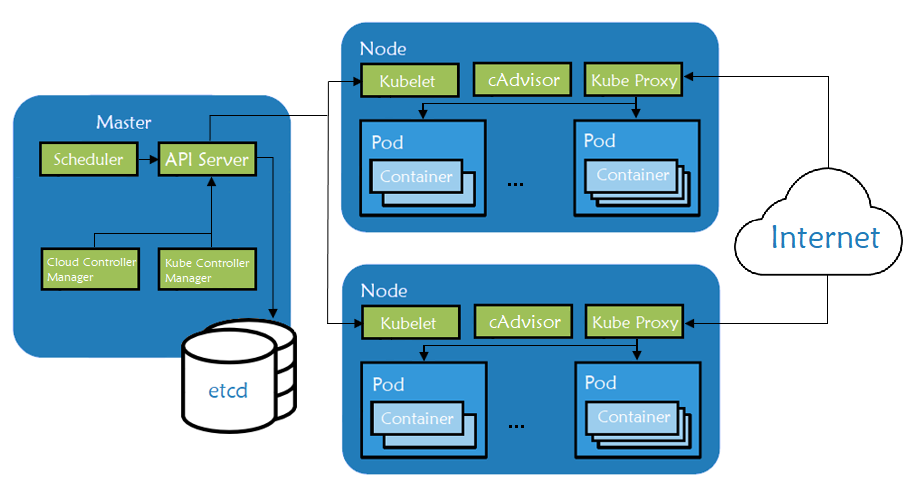
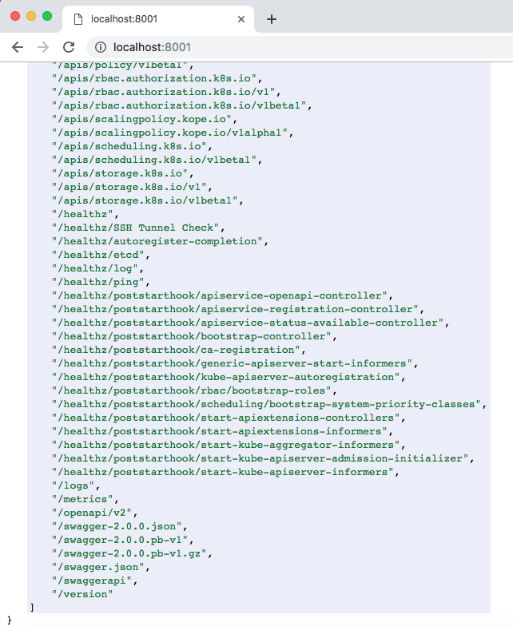
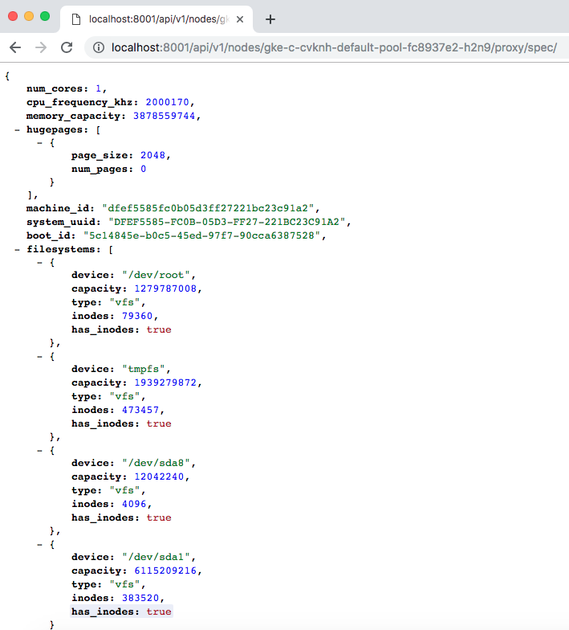
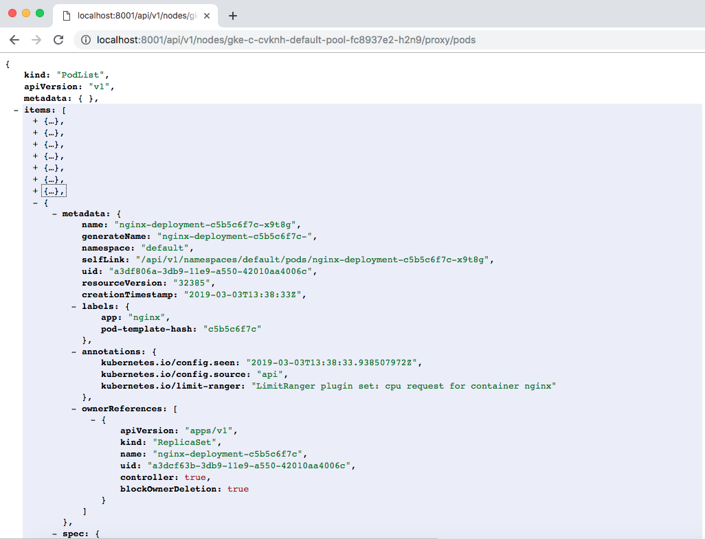
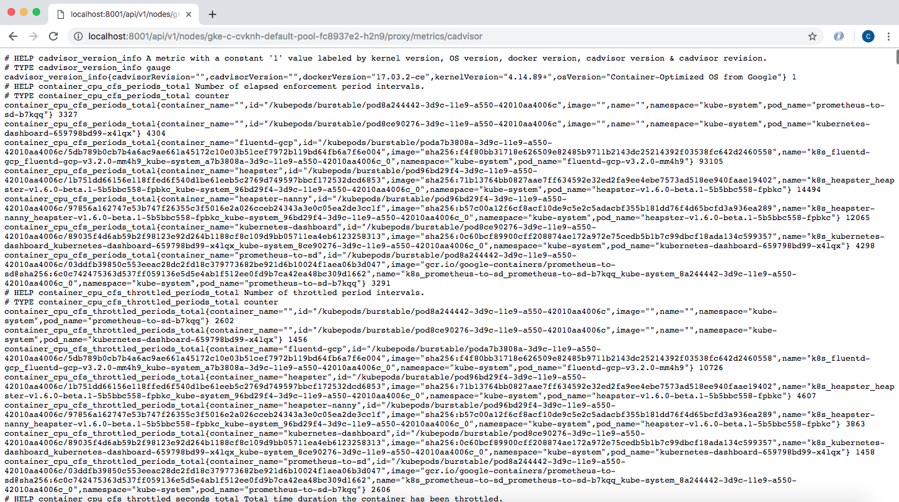

## Introduction

With over 48,000 stars on GitHub, more than 75,000 commits, and with major contributors like Google and Red Hat, Kubernetes has rapidly taken over the container ecosystem to become the true leader of container orchestration platforms. Kubernetes offers great features like rolling and rollback of deployments, container health checks, automatic container recovery, container auto-scaling based on metrics, service load balancing, service discovery (great for microservice architectures), and more. In this article, we will speak about some basic Kubernetes concepts and its master node architecture, concentrating on the node components.

## Understanding Kubernetes and Its Abstractions

Kubernetes is an open-source orchestration engine for automating deployments, scaling, managing, and providing the infrastructure to host containerized applications. At the infrastructure level, a Kubernetes cluster is comprised of a set of physical or virtual machines, each acting in a specific role.

The **master** machines act as the brain of all operations and are charged with orchestrating containers that run on all of the **node** machines. Each node is equipped with a container runtime. The node receives instruction from the master and then takes actions to either create pods, delete them, or adjust networking rules.



#### Fig. 1: Kubernetes node components architecture

- [Master components](https://kubernetes.io/docs/concepts/overview/components/#master-components) are responsible for managing the Kubernetes cluster. They manage the life cycle of pods, the base unit of a deployment within a Kubernetes cluster. Master servers run the following components:

  - `kube-apiserver` - the main component, exposing APIs for the other master components.
  - `etcd` - distributed key/value store which Kubernetes uses for persistent storage of all cluster information.
  - `kube-scheduler` - uses information in the pod spec to decide on which node to run a pod.
  - `kube-controller-manager` - responsible for node management (detecting if a node fails), pod replication, and endpoint creation.
  - `cloud-controller-manager` - daemon acting like an abstraction layer between the APIs and the different cloud providers’ tools (storage volumes, load balancers etc.)
- [Node components](https://kubernetes.io/docs/concepts/architecture/nodes/#what-is-a-node) are worker machines in Kubernetes and are managed by the Master. A node may be a virtual machine (VM) or physical machine, and Kubernetes runs equally well on both types of systems. Each node contains the necessary components to run pods:

  - [`kubelet`](https://kubernetes.io/docs/reference/command-line-tools-reference/kubelet/) - watches the API server for pods on that node and makes sure they are running
  - [`cAdvisor`](https://github.com/google/cadvisor) - collects metrics about pods running on that particular node
  - [`kube-proxy`](https://kubernetes.io/docs/reference/command-line-tools-reference/kube-proxy/) - watches the API server for pods/services changes in order to maintain the network up to date
  - container runtime - responsible for managing container images and running containers on that node

## Kubernetes Node Components in Detail

To summarize, the node runs the two most important components, the `kubelet` and the `kube-proxy`, as well as a container engine in charge of running the containerized applications.

### kubelet

The `kubelet` agent handles all communication between the master and the node on which it is running. It receives commands from the master in the form of a **manifest** which defines the workload and the operating parameters. It interfaces with the container runtime that is responsible for creating, starting, and monitoring pods.

The `kubelet` also periodically executes any configured liveness probes and readiness checks. It constantly monitors the state of the pods and, in the event of a problem, launches a new instance instead. The `kubelet` also has an internal HTTP server exposing a read-only view at port 10255. There’s a health check endpoint at `/healthz` and also a few additional status endpoints. For example, we can get a list of running pods at `/pods`. We can also get specs of the machine the `kubelet` is running on at `/spec`.

### kube-proxy

The `kube-proxy` component runs on each node and proxies UDP, TCP, and SCTP packets (it doesn’t understand HTTP). It maintains the network rules on the host and handles transmission of packets between pods, the host, and the outside world. It acts like a network proxy and load balancer for pods running on the node by implementing east/west load-balancing using NAT in `iptables`.

The `kube-proxy` process stands in between the network Kubernetes is attached to and the pods that are running on that particular node. It is essentially the core networking component of Kubernetes and is responsible for ensuring that communication is maintained efficiently across all elements of the cluster. When a user creates a Kubernetes service object, the `kube-proxy` instance is responsible to translate that object into meaningful rules in the local `iptables` rule set on the worker node. `iptables` is used to translate the virtual IP assigned to the service object to all of the pod IPs mapped by the service.

### Container Runtime

The container runtime is responsible for pulling the images from public or private registries and running containers based on those images. The most popular engine is [Docker](https://www.docker.com), although Kubernetes supports container runtimes from [rkt](https://coreos.com/rkt/), [runc](https://github.com/opencontainers/runc) and [others](https://github.com/opencontainers/runtime-spec). As previously mentioned, `kubelet` interacts directly with container runtime to start, stop, or delete containers.

### cAdvisor

`cAdvisor` is an open-source agent that monitors resource usage and analyzes the performance of containers. Originally created by Google, cAdvisor is now integrated with `kubelet`.

The `cAdvisor` instance on each node collects, aggregates, processes, and exports metrics such as CPU, memory, file, and network usage for all running containers. All data is sent to the scheduler to ensure that it knows about the performance and resource usage inside of the node. This information is used to perform various orchestration tasks like scheduling, horizontal pod scaling, and managing container resource limits.

## Observing Node Component Endpoints

Next, we will be installing a Kubernetes cluster (with the help of Rancher) so we can explore few of the APIs exposed by the node components. To perform this demo, we will need the following:
- a Google Cloud Platform account, the free tier provided is more than enough (any other cloud should work the same)
- a host where Rancher will be running (can be a personal PC/Mac or a VM in a public cloud)
- on same host [Google Cloud SDK](https://cloud.google.com/sdk/install) should be installed along [kubectl](https://kubernetes.io/docs/tasks/tools/install-kubectl/). Make sure that `gcloud` has access to your Google Cloud account by authenticating with your credentials (`gcloud init` and `gcloud auth login`).
- Kubernetes cluster running on Google Kubernetes Engine (running EKS or AKS should be the same)

### Starting a Rancher Instance

To begin, start a Rancher instance. There is a very intuitive [getting started guide for Rancher](https://rancher.com/quick-start/) that you can follow for this purpose.

### Using Rancher to deploy a GKE cluster

Use Rancher to set up and configure your Kubernetes cluster, follow the how-to [guide](https://rancher.com/docs/rancher/v2.x/en/cluster-provisioning/hosted-kubernetes-clusters/gke/).

As soon as cluster is deployed, we can make a quick Nginx deployment to use for testing:

```
cat nginx_deployment.yaml
```

```
---
 apiVersion: extensions/v1beta1
 kind: Deployment
 metadata:
   name: nginx-deployment
 spec:
   replicas: 3
   template:
     metadata:
       labels:
         app: nginx
     spec:
       containers:
         - name: nginx
           image: nginx
           ports:
             - containerPort: 80
```

```
kubectl apply -f nginx_deployment.yaml
```

```
deployment.extensions "nginx-deployment" created
```

In order to interact with Kubernetes API, we need to start a proxy server on your local machine:

```
kubectl proxy &
```

```
[1] 3349
$ Starting to serve on 127.0.0.1:8001
```

Let’s check the progress to see it is running and listening to the default port:

```
netstat -anp | grep 8001 | grep LISTEN
```

```
tcp        0      0 127.0.0.1:8001          0.0.0.0:*               LISTEN      3349/kubectl
```

Now, in your browser, check the various endpoints that `kubelet` exposes:



#### Fig. 2: kubelet API endpoints

Next, display the list of your cluster’s available nodes:

```
kubectl get nodes
```

```
NAME                                     STATUS   ROLES    AGE     VERSION
gke-c-cvknh-default-pool-fc8937e2-h2n9   Ready    <none>   3h13m   v1.12.5-gke.5
gke-c-cvknh-default-pool-fc8937e2-hnfl   Ready    <none>   3h13m   v1.12.5-gke.5
gke-c-cvknh-default-pool-fc8937e2-r4z1   Ready    <none>   3h13m   v1.12.5-gke.5
```

We can check the `spec` for any of the listed nodes using the API. In this example, we created a 3 node cluster, using the `n1-standard-1` machine type (1 vCPU, 3.75GB RAM, root size disk of 10GB). We can confirm these specs by accessing the dedicated endpoint:

```
curl http://localhost:8001/api/v1/nodes/gke-c-cvknh-default-pool-fc8937e2-h2n9/proxy/spec/
curl http://localhost:8001/api/v1/nodes/gke-c-cvknh-default-pool-fc8937e2-hnfl/proxy/spec/
curl http://localhost:8001/api/v1/nodes/gke-c-cvknh-default-pool-fc8937e2-r4z1/proxy/spec/
```



#### Fig. 3: Kubernetes node spec listing

Using same `kubelet` API with a different endpoint, we can check the Nginx pods we created to see what nodes they are running on.

First, list the running pods:

```
kubectl get pods
```

```
NAME                               READY     STATUS    RESTARTS   AGE
nginx-deployment-c5b5c6f7c-d429q   1/1       Running   0          1m
nginx-deployment-c5b5c6f7c-w7qtc   1/1       Running   0          1m
nginx-deployment-c5b5c6f7c-x9t8g   1/1       Running   0          1m
```

Now, we can `curl` the `/proxy/pods` endpoint for each node to see the list of pods its running:

```
curl http://localhost:8001/api/v1/nodes/gke-c-cvknh-default-pool-fc8937e2-h2n9/proxy/pods
curl http://localhost:8001/api/v1/nodes/gke-c-cvknh-default-pool-fc8937e2-hnfl/proxy/pods
curl http://localhost:8001/api/v1/nodes/gke-c-cvknh-default-pool-fc8937e2-r4z1/proxy/pods
```



#### Fig. 4: Kubernetes node's list of pods

We can also check the cAdvisor endpoint, which outputs lots of data in Prometheus format. By default, this is available at the `/metrics` HTTP endpoint:

```
curl http://localhost:8001/api/v1/nodes/gke-c-cvknh-default-pool-fc8937e2-h2n9/proxy/metrics/cadvisor
```



#### Fig. 5: Kubernetes /metrics endpoint

The same cAdvisor or pod information can also be obtained by SSHing into the node and making direct calls to the `kubelet` port:

```
gcloud compute ssh admin@gke-c-cvknh-default-pool-fc8937e2-h2n9 --zone europe-west4-c
admin@gke-c-cvknh-default-pool-fc8937e2-h2n9 ~ $ curl localhost:10255/metrics/cadvisor
admin@gke-c-cvknh-default-pool-fc8937e2-h2n9 ~ $ curl localhost:10255/pods
```

### Cleanup

To clean up the resources we used in this article, let’s delete the Kubernetes cluster from Rancher UI (simply select the cluster and hit the `Delete` button). This will remove all the nodes our cluster was using, along with the associated IP addresses. If you used a VM in a public cloud to run Rancher, you will need to take care of that too. Find out your instance name, then delete it:

```
$ gcloud compute --project=<<YOUR_PROJECT_ID>> instances list
$ gcloud compute --project=<<YOUR_PROJECT_ID>> instances delete <<INSTANCE_NAME>>
```

## Conclusions

In this article, we’ve discussed the key components of Kubernetes node machines. Afterwards, we deployed a Kubernetes cluster using Rancher and made a small deployment to help us play with the `kubelet` API. To learn more about Kubernetes and its architecture, a great starting point is the official [documentation](https://kubernetes.io/docs/concepts/overview/components/).

## Next up: Online Training in Kubernetes and Rancher

Join an intro to Kubernetes and Rancher online training. In these free weekly training sessions, you’ll learn about the fundamental components of Kubernetes and how to install and manage Kubernetes workloads with Rancher. [Join the free training.](https://rancher.com/training)
