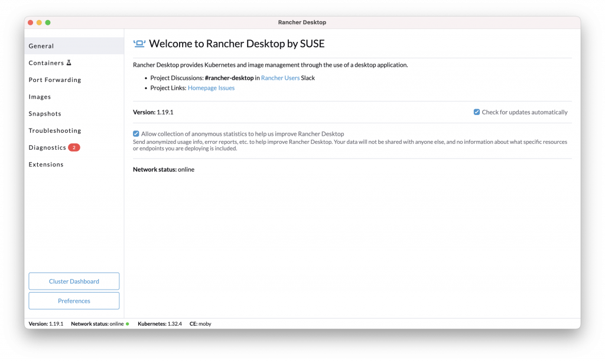
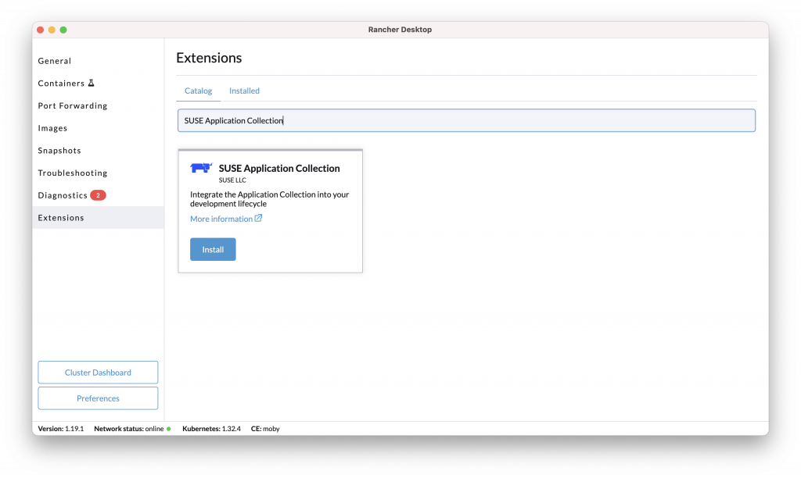
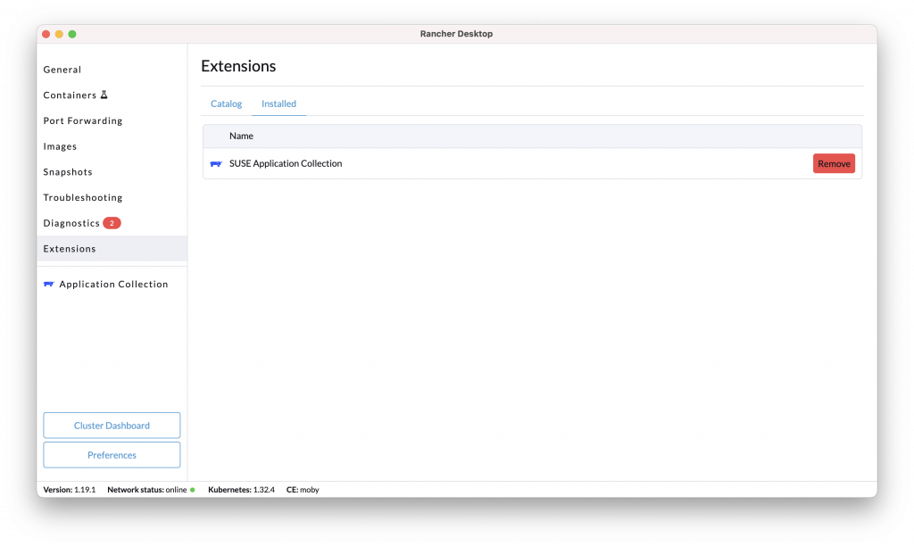
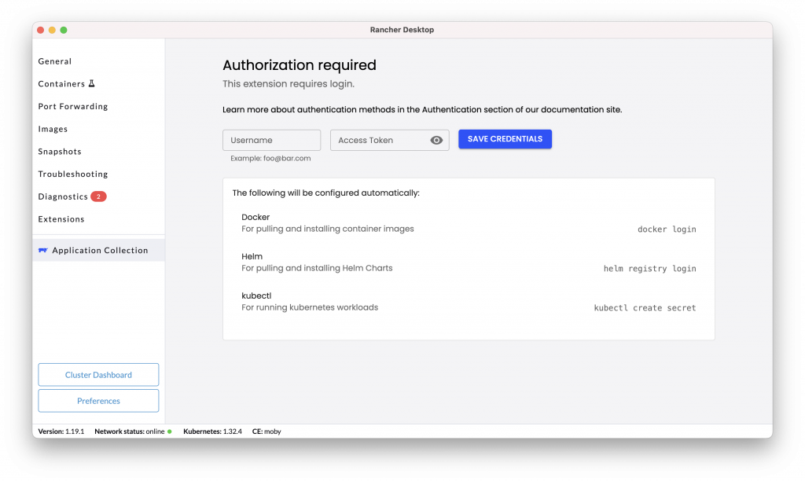
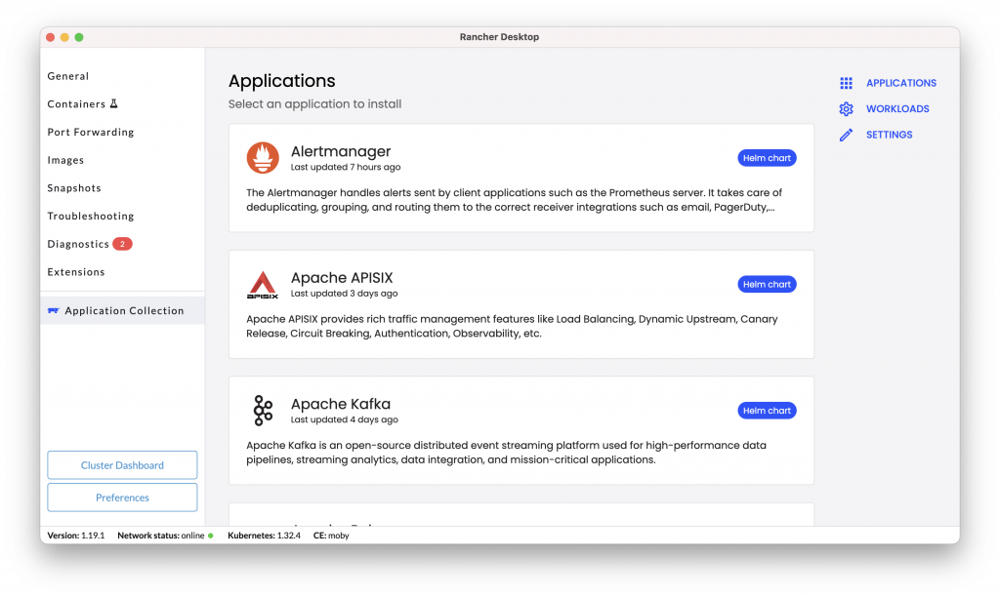
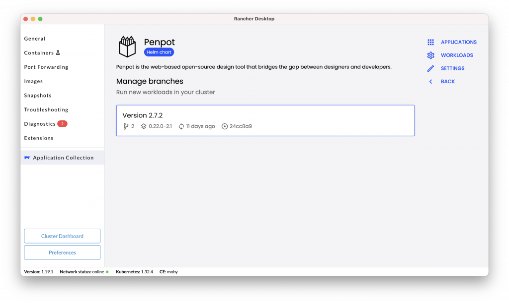
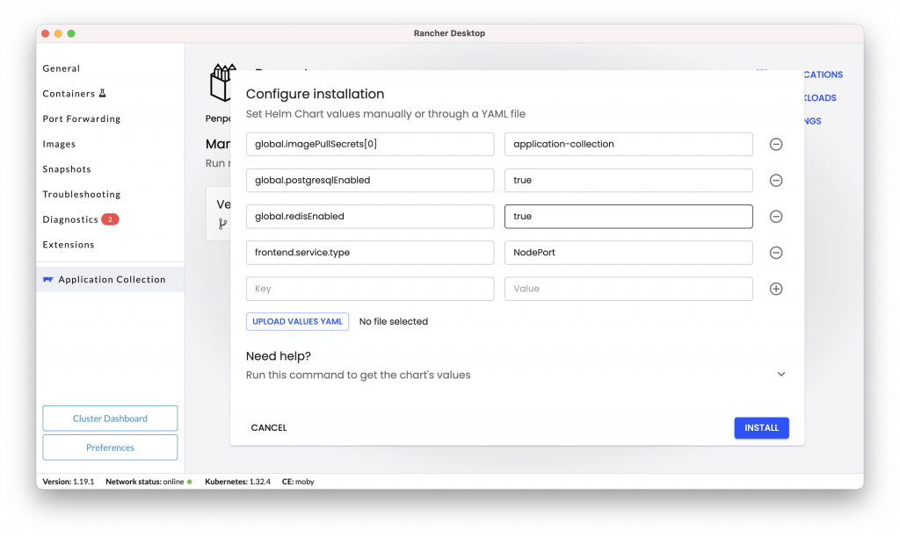
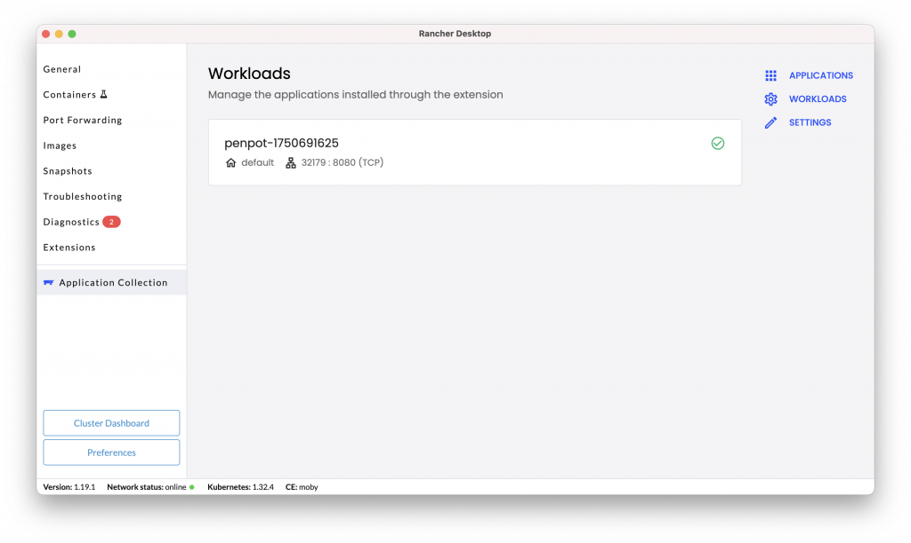
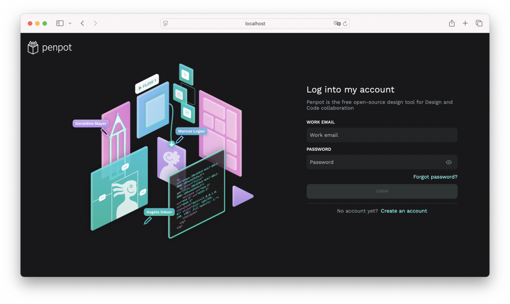

Same as in the community, Enterprise developers need tools that are both powerful and flexible. They need to innovate quickly, iterate efficiently‌ and deploy with confidence. This is where the synergy between Rancher Desktop and SUSE Application Collection truly shines, offering a comprehensive environment for modern enterprise developers.

## SUSE Application Collection: Enterprise-Grade Open Source for Developers

The SUSE Application Collection is a curated set of enterprise-grade open source applications. When combined with Rancher Desktop, it provides developers with a robust and secure foundation for building and deploying critical applications. Here's how it elevates the developer experience:

- **Curated Open Source:** SUSE provides curated and tested versions of popular open source software, ensuring stability and long-term maintainability.
- **Security and Compliance:** Benefit from SUSE's commitment to security, with regular updates and patches for all included applications, helping enterprises meet their compliance requirements.
- **Full Transparency:** Applications within the collection can be reviewed thanks to a list of all the packages installed with their exact version and license used (SBOMs), a provenance attestation (SLSA level 3) and a list of vulnerabilities (CVEs).
- **Developer Tooling:** The collection includes essential developer tools and frameworks, streamlining the development workflow from coding to deployment.
- **Enterprise Support:** Backed by SUSE's world-class support, developers and operations teams have access to expert assistance, minimizing downtime and accelerating problem resolution.

SUSE Application Collection reduces operational risks, improves security posture‌ and a faster path to production for business-critical applications. It offers the confidence of enterprise-grade solutions built on open source, ensuring that development efforts are secure, scalable‌ and supported.

## Rancher Desktop: Your Local Kubernetes and Container Development Hub

Rancher Desktop is an open source application that provides a local Kubernetes and container management environment on your workstation. It's designed to simplify the development process, allowing developers to easily create, test‌ and run containerized applications locally. Here’s why it’s a game-changer:

- **Simplified Kubernetes:** No more complex setups. Rancher Desktop makes it incredibly easy to spin up a local Kubernetes cluster, complete with popular tools like kubectl and helm.
- **Container Runtime Flexibility:** It supports both containerD and Moby (Docker Engine open source), giving developers the freedom to choose their preferred container runtime.
- **Resource Management:** Developers can assign CPU and memory resources to their local cluster. This helps the cluster run better without impacting the host machine.
- **Multi-OS:** Rancher Desktop is available for the most popular operating systems: Linux, macOS and Windows.
- **Aligned with Production:** Test changes quickly in a local environment that mirrors production, reducing feedback loops and accelerating development cycles.

Rancher Desktop empowers development teams to be more agile and independent. It makes it easier to use shared development environments, saves money on cloud-based dev clusters‌ and speeds up the time it takes to release new features and applications.

## Step-by-Step Integration with Images

This section will provide a detailed, step-by-step guide on how to integrate and leverage SUSE Application Collection with Rancher Desktop. We will walk through the installation, configuration‌ and initial usage, showcasing the benefits of this powerful combination.

### Prerequisites

- Rancher Desktop installed
  - Docs: <https://docs.rancherdesktop.io>
- SUSE Application Collection account
  - Site: <https://apps.rancher.com>
- [Optional] SUSE Application Collection service account
  - Docs: <https://docs.apps.rancher.io/get-started/authentication/#create-a-service-account>

### Add the SUSE Application Collection Extension

- Launch Rancher Desktop

*Rancher Desktop welcome screen*

- Click on Extensions
- Search for SUSE Application Collection

*Searching SUSE Application Collection extension*

- Click Install

*SUSE Application Collection extension installed*

### Authenticate

Before deploying the first application, you’ll need to authenticate:

- Click on Application Collection in the left menu

*SUSE Application Collection authentication*

- Enter the Username and Access Token, and press Save Credentials

*SUSE Application Collection listing*

### Deploy an Application

Once the authentication is complete, you can now deploy your first application:

- Click on the application you want to install (i.e. [Penpot](https://penpot.app/))

*SUSE Application Collection Penpot details*

- Click the install button under Actions column
- Review the Helm chart options and values and click Install

*SUSE Application Collection Penpot install details*

- Once installed, check the port used for the NodePort

*SUSE Application Collection Penpot nodeport*

### Access the Application

- Rancher Desktop forwards the Kubernetes ports to the host by default. The application can then be reached using “localhost” as if it was hosted in the host.
- In this example, to access the application, open a web browser and set the URL to [http://localhost:[port](about:blank) listed in the Workloads] (i.e. http://localhost:32179)

*Penpot welcome page*

## Next Steps

With ‌Enterprise Developers working with trusted applications, the overall company's Secure Supply Chain is enforced. This allows ‌strong compliance from the start of the application lifecycle.

If you want to learn more about Rancher Desktop, visit our [documentation site](https://docs.rancherdesktop.io/).

And don’t hesitate to visit our partners at [Penpot.app](https://penpot.app/) to learn how their web-based open source design tool bridges the gap between designers and developers.

For more information and to explore how SUSE Application Collection can benefit your organization, please visit:

- [**SUSE Application Collection**](https://apps.rancher.com)
- [**SUSE Rancher Prime**](https://www.suse.com/products/rancher)

You can also reach out to our sales team or an SUSE partner to discuss your specific needs and receive a personalized demonstration. Unlock the full potential of your enterprise development with the trusted power of SUSE.

Finally, the SUSE Application Collection extension is an [open source project](https://github.com/rancherlabs/application-collection-extension), so don't hesitate to share your feedback.
