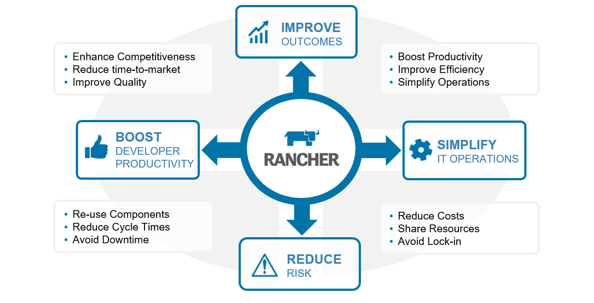

### **Why Smart Container Management is Key**

For anyone working in IT, the excitement around containers has been hard

to miss. According to RightScale, enterprise deployments of Docker over

doubled in 2016 with 29% of organizations using the software versus just

14% in 2015 [[1]](#_ftn1). Even more impressive, fully 67%

of organizations surveyed are either using Docker or plan to adopt it.

While many of these efforts are early stage, separate research shows

that over two thirds of organizations who try Docker report that it

meets or exceeds expectations [[2]](#_ftn2), and the

average Docker deployment quintuples in size in just nine months.

Clearly, Docker is here to stay. While exciting, containers are hardly

new. They’ve existed in various forms for years. Some examples include

BSD jails, Solaris Zones, and more modern incarnations like Linux

Containers (LXC). What makes Docker (based on LXC) interesting is that

it provides the tooling necessary for users to easily package

applications along with their dependencies in a format readily portable

between environments. In other words, Docker has made containers

practical and easy to use.

## Re-thinking Application Architectures

It’s not a coincidence that Docker exploded in popularity just as

application architectures were themselves changing. Driven by the

global internet, cloud, and the explosion of mobile apps, application

services are increasingly designed for internet scale. Cloud-native

applications are comprised of multiple connected components that are

resilient, horizontally scalable, and wired together via secured virtual

networks. As these distributed, modular architectures have become the

norm, Docker has emerged as a preferred way to package and deploy

application components. As Docker has matured, the emphasis has shifted

from the management of the containers themselves to the orchestration

and management of complete, ready-to-run application services. For

developers and QA teams, the potential for productivity gains are

enormous. By being able to spin up fully-assembled dev, test and QA

environments, and rapidly promote applications to production, major

sources of errors, downtime and risk can be avoided. DevOps teams

become more productive, and organizations can get to market faster with

higher quality software. With opportunities to reduce cost and improve

productivity, Docker is no longer interesting just to technologists -

it’s caught the attention of the board room as well.

## New Opportunities and Challenges for the Enterprise

Done right, deploying a containerized application environment can bring

many benefits:

- Improved developer and QA productivity
- Reduced time-to-market
- Enhanced competitiveness
- Simplified IT operations
- Improved application reliability
- Reduced infrastructure costs

While Docker provides real opportunities for enterprise deployments, the

devil is in the details. Docker is complex, comprised of a whole

ecosystem of rapidly evolving open-source projects. The core Docker

projects are not sufficient for most deployments, and organizations

implementing Docker from open-source wrestle with a variety of

challenges including management of virtual private networks, managing

databases and object stores, securing applications and registries, and

making the environment easy enough to use that it is accessible to

non-specialists. They also are challenged by skills shortages and

finding people knowledgeable about various aspects of Docker

administration.  A business guide to effective

container app management -

Compounding these challenges, orchestration technologies essential to

realizing the value of Docker are also evolving quickly. There are

multiple competing solutions, including Kubernetes, Docker Swarm and

Mesos. The same is true with private cloud management frameworks.

Because Docker environments tend to grow rapidly once deployed,

organizations are concerned about making a misstep, and finding

themselves locked into a particular technology. In the age of rapid

development and prototyping, what is a sandbox one day may be in

production the next. It is important that the platform used for

evaluation and prototyping has the capacity to scale into production.

Organizations need to retain flexibility to deploy on bare-metal, public

or private clouds, and use their choice of orchestration solutions and

value-added components. For many, the challenge is not whether to deploy

Docker, but how do so cost-effectively, quickly and in a way that

minimizes business and operational risk so the potential of the

technology can be fully realized.

### Reaping the Rewards with Rancher

In a sense, the Rancher® container management platform is to Docker what

Docker is to containers: just as Docker makes it easy to package,

deploy and manage containers, Rancher software does the same for the

entire application environment and Docker ecosystem. Rancher software

simplifies the management of Docker environments helping organizations

get to value faster, reduce risk, and avoid proprietary lock-in.

Written with a

technology and business audience in mind, in a recently published

whitepaper, *Unlocking the Value of Docker in the Enterprise*,

Rancher Labs explores the challenges of container management and

discusses and quantifies some of the specific areas that Rancher

software can provide value to the business. To learn more about Rancher,

and understand why it has become the choice of leading organizations

deploying Docker, download the whitepaper and

learn what Rancher can do for your business.

[[1]](#_ftnref1)

<http://assets.rightscale.com/uploads/pdfs/rightscale-2016-state-of-the-cloud-report-devops-trends.pdf>

[[2]](#_ftnref2)

<https://www.twistlock.com/2016/09/23/state-containers-industry-reports-shed-insight/>
