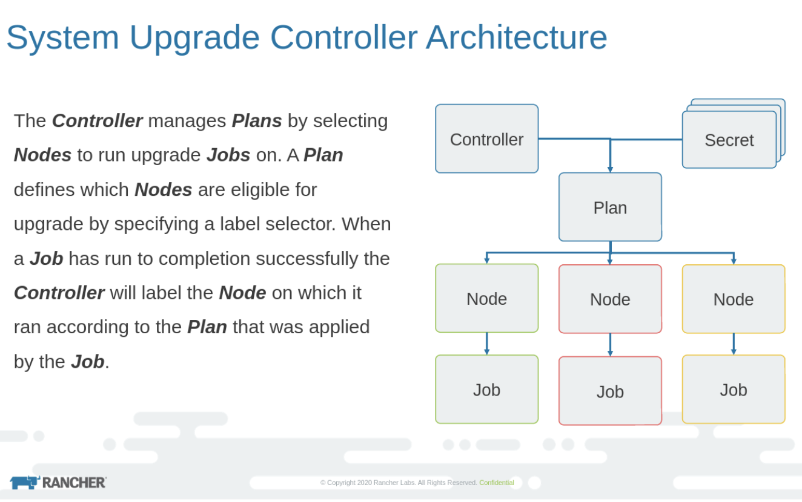

The certified Kubernetes distribution built for IoT & Edge computing[Download K3S](https://k3s.io/)

Kubernetes upgrades are always a tough undertaking when your clusters are running smoothly. Upgrades are necessary as every three months, Kubernetes releases a new version. If you do not upgrade your Kubernetes clusters, within a year, you can fall far behind. Rancher has always focused on solving problems, and they are at it again with a new open source project called **System Upgrade Controller.** In this tutorial, we will see how to upgrade a K3s Kubernetes cluster using System Upgrade Controller.

System Upgrade Controller introduces a new Kubernetes custom resource definition (CRD) called **Plan**. Now Plan is the major component that handles the upgrade process. Here is the architecture diagram, taken from the git repo.



As you can see in the image, Plan is a Kubernetes object in the yaml where the nodes to be updated are defined using the label selector. Let’s say there is a node with label upgrade: true. Now when plan runs, only the nodes with label true will be updated. The controller decides on which node the upgrade jobs have to run and takes care of updating the labels after the job’s successful completion.

## Automate K3s Upgrades with System Upgrade Controller

There are two major requirements for upgrading your K3s Kubernetes cluster:

- CRD install
- Creating the Plan

First, let’s check the current version of K3s cluster running.

For quick installation, run the below commands:

```
#For master install:
curl -sfL https://get.k3s.io | INSTALL_K3S_VERSION=v1.18.9+k3s1 sh

#For joining nodes:
K3S_TOKEN is created at /var/lib/rancher/k3s/server/node-token on the server.
For adding nodes, K3S_URL and K3S_TOKEN needs to be passed:

curl -sfL https://get.k3s.io | INSTALL_K3S_VERSION=v1.18.9+k3s1 K3S_URL=https://myserver:6443 K3S_TOKEN=XXX sh -

KUBECONFIG file is create at /etc/rancher/k3s/k3s.yaml location
```

```
kubectl get nodes
NAME   STATUS   ROLES    AGE     VERSION
k3s1   Ready    master   2m31s   v1.18.9+k3s1
k3s3   Ready    <none>   28s     v1.18.9+k3s1
k3s2   Ready    <none>   40s     v1.18.9+k3s1
```

Now let’s deploy the CRD:

```
apiVersion: v1
kind: Namespace
metadata:
  name: system-upgrade
---
apiVersion: v1
kind: ServiceAccount
metadata:
  name: system-upgrade
  namespace: system-upgrade
---
apiVersion: rbac.authorization.k8s.io/v1
kind: ClusterRoleBinding
metadata:
  name:  system-upgrade
roleRef:
  apiGroup: rbac.authorization.k8s.io
  kind: ClusterRole
  name: cluster-admin
subjects:
- kind: ServiceAccount
  name: system-upgrade
  namespace: system-upgrade
---
apiVersion: v1
kind: ConfigMap
metadata:
  name: default-controller-env
  namespace: system-upgrade
data:
  SYSTEM_UPGRADE_CONTROLLER_DEBUG: "false"
  SYSTEM_UPGRADE_CONTROLLER_THREADS: "2"
  SYSTEM_UPGRADE_JOB_ACTIVE_DEADLINE_SECONDS: "900"
  SYSTEM_UPGRADE_JOB_BACKOFF_LIMIT: "99"
  SYSTEM_UPGRADE_JOB_IMAGE_PULL_POLICY: "Always"
  SYSTEM_UPGRADE_JOB_KUBECTL_IMAGE: "rancher/kubectl:v1.18.3"
  SYSTEM_UPGRADE_JOB_PRIVILEGED: "true"
  SYSTEM_UPGRADE_JOB_TTL_SECONDS_AFTER_FINISH: "900"
  SYSTEM_UPGRADE_PLAN_POLLING_INTERVAL: "15m"
---
apiVersion: apps/v1
kind: Deployment
metadata:
  name: system-upgrade-controller
  namespace: system-upgrade
spec:
  selector:
    matchLabels:
      upgrade.cattle.io/controller: system-upgrade-controller
  template:
    metadata:
      labels:
        upgrade.cattle.io/controller: system-upgrade-controller # necessary to avoid drain
    spec:
      affinity:
        nodeAffinity:
          requiredDuringSchedulingIgnoredDuringExecution:
            nodeSelectorTerms:
              - matchExpressions:
                  - {key: "node-role.kubernetes.io/master", operator: In, values: ["true"]}
      serviceAccountName: system-upgrade
      tolerations:
        - key: "CriticalAddonsOnly"
          operator: "Exists"
        - key: "node-role.kubernetes.io/master"
          operator: "Exists"
          effect: "NoSchedule"
      containers:
        - name: system-upgrade-controller
          image: rancher/system-upgrade-controller:v0.5.0
          imagePullPolicy: IfNotPresent
          envFrom:
            - configMapRef:
                name: default-controller-env
          env:
            - name: SYSTEM_UPGRADE_CONTROLLER_NAME
              valueFrom:
                fieldRef:
                  fieldPath: metadata.labels['upgrade.cattle.io/controller']
            - name: SYSTEM_UPGRADE_CONTROLLER_NAMESPACE
              valueFrom:
                fieldRef:
                  fieldPath: metadata.namespace
          volumeMounts:
            - name: etc-ssl
              mountPath: /etc/ssl
            - name: tmp
              mountPath: /tmp
      volumes:
        - name: etc-ssl
          hostPath:
            path: /etc/ssl
            type: Directory
        - name: tmp
          emptyDir: {}
```

Breaking down the above yaml, it will create the following components:

- system-upgrade namespace
- system-upgrade service account
- system-upgrade ClusterRoleBinding
- A config map to set the environment variables in the container
- Lastly, the actual deployment

Now let’s deploy the yaml:

```
#Get the Lateest release tag
curl -s "https://api.github.com/repos/rancher/system-upgrade-controller/releases/latest" | awk -F '"' '/tag_name/{print $4}'
v0.6.2

# Apply the controller manifest
kubectl apply -f https://raw.githubusercontent.com/rancher/system-upgrade-controller/v0.6.2/manifests/system-upgrade-controller.yaml

namespace/system-upgrade created
serviceaccount/system-upgrade created
clusterrolebinding.rbac.authorization.k8s.io/system-upgrade created
configmap/default-controller-env created
deployment.apps/system-upgrade-controller created

# Verify everything is running
kubectl get all -n system-upgrade

NAME                                             READY   STATUS    RESTARTS   AGE

pod/system-upgrade-controller-7fff98589f-blcxs   1/1     Running   0          5m26s
NAME                                        READY   UP-TO-DATE   AVAILABLE   AGE
deployment.apps/system-upgrade-controller   1/1     1            1           5m28s
NAME                                                   DESIRED   CURRENT   READY   AGE
replicaset.apps/system-upgrade-controller-7fff98589f   1         1         1       5m28s
```

## Making a K3s Upgrade Plan

Now it’s time to make an upgrade Plan. We will use the sample Plan mentioned in the examples folder of the Git repo and modify it to use the latest k3s version.

```
---
apiVersion: upgrade.cattle.io/v1
kind: Plan
metadata:
  name: k3s-server
  namespace: system-upgrade
  labels:
    k3s-upgrade: server
spec:
  concurrency: 1
  version: v1.19.4+k3s1
  nodeSelector:
    matchExpressions:
      - {key: k3s-upgrade, operator: Exists}
      - {key: k3s-upgrade, operator: NotIn, values: ["disabled", "false"]}
      - {key: k3s.io/hostname, operator: Exists}
      - {key: k3os.io/mode, operator: DoesNotExist}
      - {key: node-role.kubernetes.io/master, operator: In, values: ["true"]}
  serviceAccountName: system-upgrade
  cordon: true
#  drain:
#    force: true
  upgrade:
    image: rancher/k3s-upgrade
---
apiVersion: upgrade.cattle.io/v1
kind: Plan
metadata:
  name: k3s-agent
  namespace: system-upgrade
  labels:
    k3s-upgrade: agent
spec:
  concurrency: 2 # in general, this should be the number of workers - 1
  version: v1.19.4+k3s1
  nodeSelector:
    matchExpressions:
      - {key: k3s-upgrade, operator: Exists}
      - {key: k3s-upgrade, operator: NotIn, values: ["disabled", "false"]}
      - {key: k3s.io/hostname, operator: Exists}
      - {key: k3os.io/mode, operator: DoesNotExist}
      - {key: node-role.kubernetes.io/master, operator: NotIn, values: ["true"]}
  serviceAccountName: system-upgrade
  prepare:
    # Since v0.5.0-m1 SUC will use the resolved version of the plan for the tag on the prepare container.
    # image: rancher/k3s-upgrade:v1.17.4-k3s1
    image: rancher/k3s-upgrade
    args: ["prepare", "k3s-server"]
  drain:
    force: true
    skipWaitForDeleteTimeout: 60 # set this to prevent upgrades from hanging on small clusters since k8s v1.18
  upgrade:
    image: rancher/k3s-upgrade
```

Breaking down the above yaml, it will create:

- A plan where it matches the expressions to understand what needs to be upgraded. So in the above example, we have two plans: `k3s-server` and `k3s-agent`. The nodes with node-role.kubernetes.io/master true and k3s-upgrade will be taken up by the server Plan. Those with false and k3s-upgrade will be taken by the client plan. So the labels have to be set properly. Let’s apply the Plan.

```
#Set the Node Labels

kubectl label node k3s1 node-role.kubernetes.io/master=true
kubectl label node k3s1 k3s2 k3s3 k3s-upgrade=true

# Apply the plan manifest you created above
#kubectl apply -f https://raw.githubusercontent.com/rancher/system-upgrade-controller/master/examples/k3s-upgrade.yaml
kubectl apply -f k3s-upgrade.yaml
plan.upgrade.cattle.io/k3s-server created
plan.upgrade.cattle.io/k3s-agent created

# We see that the jobs have started
kubectl get jobs -n system-upgrade
NAME                                                              COMPLETIONS   DURATION   AGE
apply-k3s-server-on-k3s1-with-e50d232791db24fa7ce5039d6f9-5f7ae   0/1           4s         4s
apply-k3s-agent-on-k3s2-with-e50d232791db24fa7ce5039d6f9c-630d9   0/1           4s         4s
apply-k3s-agent-on-k3s3-with-e50d232791db24fa7ce5039d6f9c-b87d5   0/1           3s         3s

# Upgrade in-progress, completed on the `node-role.kubernetes.io/master=true` node
kubectl get nodes
NAME   STATUS                     ROLES                AGE   VERSION
k3s1   Ready                      master               69m   v1.19.4+k3s1
k3s2   Ready,SchedulingDisabled   <none>               67m   v1.18.9+k3s1
k3s3   Ready,SchedulingDisabled   <none>               67m   v1.18.9+k3s1

# In a few minutes all nodes get upgraded to latest version as per the plan
kubectl get nodes
NNAME   STATUS   ROLES                AGE   VERSION
k3s3   Ready    <none>               69m   v1.19.4+k3s1
k3s1   Ready    master               71m   v1.19.4+k3s1
k3s2   Ready    <none>               69m   v1.19.4+k3s1
```

That’s it. Our K3s Kubernetes upgrade is finished – easily and smoothly. The project can update the underlying operating system and reboot the nodes, which is amazing.

To learn more, watch this video to see it in action:

The certified Kubernetes distribution built for IoT & Edge computing[Download K3S](https://k3s.io/)
