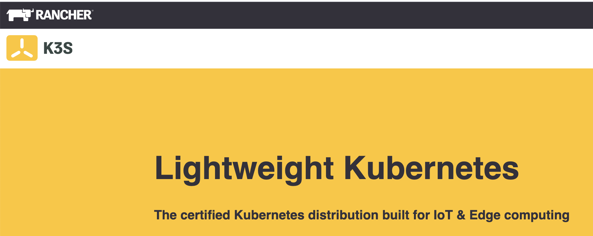
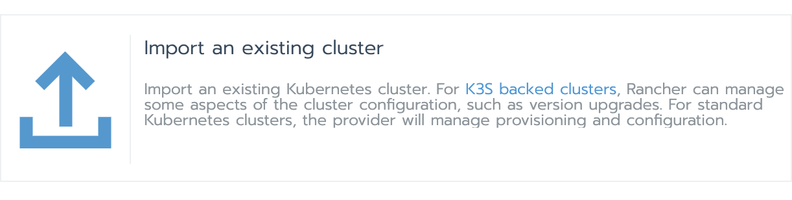
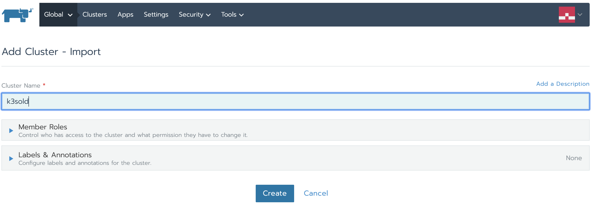
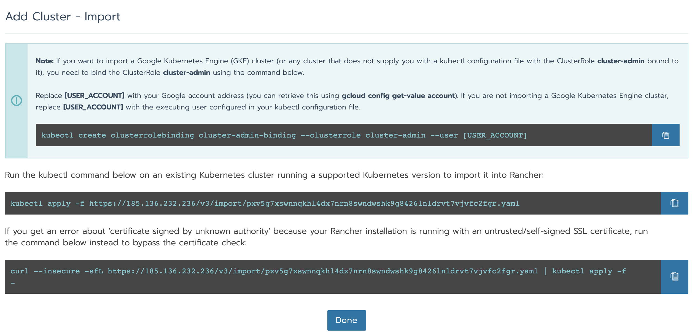
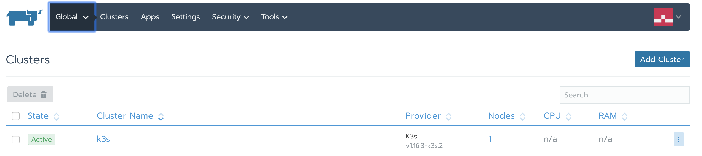
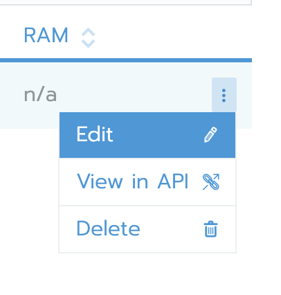
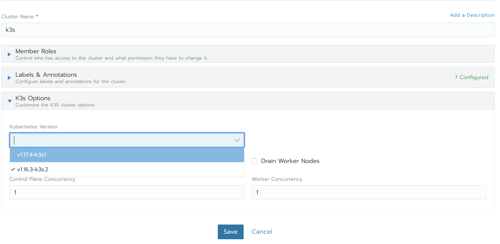
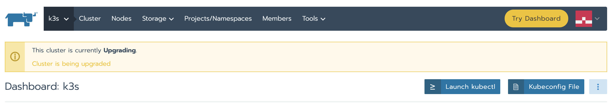
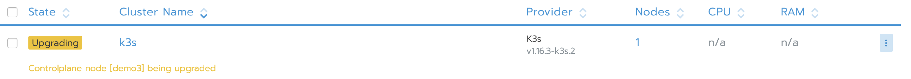
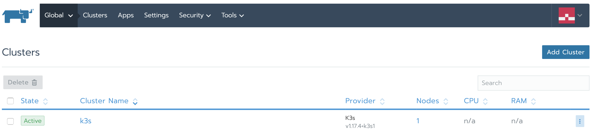

The certified Kubernetes distribution built for IoT & Edge computing[Download K3S](https://k3s.io/)

In Rancher 2.4, the latest release of Rancher Labs’ open source Kubernetes management platform, you can now manage K3s cluster upgrades from the Rancher UI.

K3s is a lightweight Kubernetes distribution from Rancher that you can use to set up your development Kubernetes environment within minutes. It is great for production use cases and is built primarily for IOT and Edge devices.



In Rancher 2.4, you can import K3s clusters and can manage the upgrades for it via Rancher itself. In this tutorial, we’ll see how to perform a live upgrade on a running K3s cluster.

**Step1**: **K3s Cluster Creation**
Before doing the upgrade, we will spin up a K3s cluster on a plain CentOS VM (this can be in any cloud).

Log in to the VM and run following command:

```
**[root@demo3 ~]# curl -sfL [https://get.k3s.io](https://get.k3s.io) | INSTALL_K3S_VERSION="v1.0.1" sh -s -**

[INFO]  Using v1.0.1 as release
[INFO]  Downloading hash [https://github.com/rancher/k3s/releases/download/v1.0.1/sha256sum-amd64.txt](https://github.com/rancher/k3s/releases/download/v1.0.1/sha256sum-amd64.txt)
[INFO]  Downloading binary [https://github.com/rancher/k3s/releases/download/v1.0.1/k3s](https://github.com/rancher/k3s/releases/download/v1.0.1/k3s)
[INFO]  Verifying binary download
[INFO]  Installing k3s to /usr/local/bin/k3s
[INFO]  Creating /usr/local/bin/kubectl symlink to k3s
[INFO]  Creating /usr/local/bin/crictl symlink to k3s
[INFO]  Creating /usr/local/bin/ctr symlink to k3s
[INFO]  Creating killall script /usr/local/bin/k3s-killall.sh
[INFO]  Creating uninstall script /usr/local/bin/k3s-uninstall.sh
[INFO]  env: Creating environment file /etc/systemd/system/k3s.service.env
[INFO]  systemd: Creating service file /etc/systemd/system/k3s.service
[INFO]  systemd: Enabling k3s unit
Created symlink from /etc/systemd/system/multi-user.target.wants/k3s.service to /etc/systemd/system/k3s.service.
[INFO]  systemd: Starting k3sAbove will install k3s version

**[root@demo3 ~]# kubectl get  nodes**

NAME    STATUS   ROLES    AGE     VERSION
demo3   Ready    master   5m55s   **v1.16.3-k3s.2**
```

You can see that we’ve installed Kubernetes version **v1.16.3** on the VM.

**Step2** : **Install Rancher**
In order to perform the upgrade from the Rancher UI, it  has to be installed via the following command:

```
**[root@demo3 ~]# sudo docker run -d --restart=unless-stopped -p 80:80 -p 443:443 rancher/rancher
**Unable to find image 'rancher/rancher:latest' locally
Trying to pull repository docker.io/rancher/rancher ...
latest: Pulling from docker.io/rancher/rancher
5bed26d33875: Pull complete
f11b29a9c730: Pull complete
930bda195c84: Pull complete
78bf9a5ad49e: Pull complete
fdb587a45dfe: Pull complete
0c3f7647a659: Pull complete
02c5407ca821: Pull complete
ebc009758b56: Pull complete
57a6e40f0f6e: Pull complete
30a88d01aca6: Pull complete
76505b705d6f: Pull complete
e585ea16af8d: Pull complete
6b069694034e: Pull complete
8c5d309f94d1: Pull complete
8ec56f5fa6c2: Pull complete
75872eb736b7: Pull complete
e774fd043162: Pull complete
c76d81e7a658: Pull complete
49bf6b83af1c: Pull complete
Digest: sha256:248ddca1169e8a4e06babd50e8105cbba0a326f86ec4de3e38d61e8909ffdb4e
Status: Downloaded newer image for docker.io/rancher/rancher:latest
ef7f9a0d5bca831af19900a6ceafd30daca51e4f951295762cf7516e48d3d742
```

**Step3: Import the Cluster in Rancher**

Open the Rancher UI and import the K3s cluster by clicking below:




Copy the last command and run on the VM where K3s is installed.

```
**[root@demo3 ~]# curl --insecure -sfL [https://185.136.232.236/v3/import/pxv5g7xswnnqkhl4dx7nrn8swndwshk9g8426lnldrvt7vjvfc2fgr.yaml](https://185.136.232.236/v3/import/pxv5g7xswnnqkhl4dx7nrn8swndwshk9g8426lnldrvt7vjvfc2fgr.yaml) | kubectl apply -f -**
clusterrole.rbac.authorization.k8s.io/proxy-clusterrole-kubeapiserver created
clusterrolebinding.rbac.authorization.k8s.io/proxy-role-binding-kubernetes-master created
namespace/cattle-system created
serviceaccount/cattle created
clusterrolebinding.rbac.authorization.k8s.io/cattle-admin-binding created
secret/cattle-credentials-d6e5b6d created
clusterrole.rbac.authorization.k8s.io/cattle-admin created
deployment.apps/cattle-cluster-agent created
daemonset.apps/cattle-node-agent created
```


**Step 4:** **Perform the Upgrade**

Click on the `three dots` and select `Edit option`. Choose the latest Kubernetes version and click save.



As soon as you click save, you will see the status of the cluster change from `Active` to `Upgrading`.



After some time, that status will again change back to `Active` and you will see the version of K3s cluster upgraded to the latest one.


With just a few clicks, we’ve upgraded the K3s imported cluster to v1.17.4 directly from the Rancher UI.

## Conclusion

Rancher Labs built K3s to be lightweight and easy to use. With support in Rancher 2.4, it is easier to upgrade the cluster as well. When you import the K3s cluster via the Rancher UI, Rancher automatically detects and enables the upgrade cluster option with the list of versions available. With this feature, you can upgrade any K3s cluster, whether it is self managed or a cloud-managed K3s cluster.

The certified Kubernetes distribution built for IoT & Edge computing[Download K3S](https://k3s.io/)
