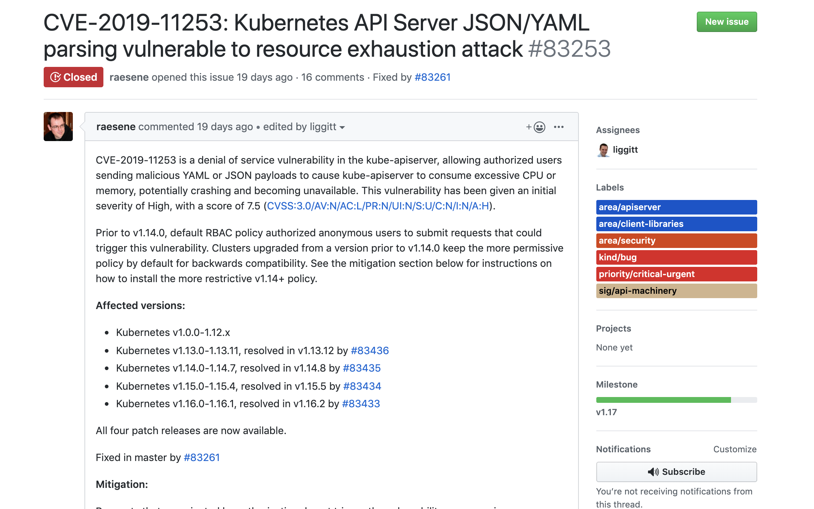

Prior to version 2.3, new versions of Kubernetes came out with point releases of Rancher and required an upgrade to Rancher before they were made available for use. Rancher 2.3 changes that pattern and now makes it possible to update the metadata store for available Kubernetes versions, disconnecting the Rancher server upgrade process from the Kubernetes cluster upgrade process.

## Kubernetes Symantic Versioning

The [Kubernetes document on release versioning](https://github.com/kubernetes/community/blob/master/contributors/design-proposals/release/versioning.md)
covers this in detail, but each Kubernetes version is of the X.Y.Z format, where:

- X = major version
- Y = minor version
- Z = patch version

The Kubernetes community releases minor versions (1.14 -> 1.15)
roughly every three months, and these releases include many desired features
and improvements. Despite being labeled as “minor releases,” they are by no means minor!

Patch versions (1.15.1 -> 1.15.2) are more frequent, and they’re
crucial because they include critical security and bug fixes applied to the latest minor version. They address:

- security vulnerabilities
- fixes to problems affecting a large number of users problems with no workaround
- blockers for customers and products based on Kubernetes

The Kubernetes community expects clusters to be “reasonably” up-to-date in production and “approximately” running the latest patch version. They support three minor releases at a time. All of this means that if you have a Kubernetes version a few patch versions behind the latest version, and you’re wondering “when is the right time to upgrade my cluster?” the answer is probably sooner than later to keep your cluster secure and robust. If you are a few minor versions behind, the answer is probably that you should update now before the upgrade path becomes more challenging.

Rancher is committed to making this process easy and manageable through one-click upgrades. New Rancher releases always ship with the latest Kubernetes patch versions. Critical security fixes are backported to the released versions, so they’re available as soon as Rancher is upgraded.

## Decoupling Kubernetes Versions from Rancher Releases

Prior to 2.3, upgrading Rancher-launched clusters to the latest version of Kubernetes required two steps:

1. Upgrade the Rancher server
2. Upgrade the Kubernetes version on downstream clusters

Rancher 2.3 now makes it possible for you to upgrade Kubernetes clusters to the latest version without having to upgrade Rancher too. It does this by decoupling Kubernetes metadata from Rancher.

Rancher-deployed clusters run Rancher Kubernets Engine (RKE), which is Rancher’s open-source Kubernetes distribution that runs anywhere that you can run Docker. Before Rancher 2.3, the information required for launching different Kubernetes versions was stored in multiple locations. The data was close to where it was used in the codebase, and therefore updating any one value required a new Rancher release. There was no single location where the system could access the values that needed to be passed to a cluster. Rancher 2.3 refactored the entire approach to meet the following requirements:

- Continuous delivery of Kubernetes metadata to compatible Rancher servers
- Clear mapping of all metadata components to a Kubernetes version
- Everything easily accessible from the Rancher API
- Availability and support path for airgap setups
- Easy configuration to enable or disable the upgrade process or set values used in the upgrade

{{ note }}
The Kubernetes API can change between minor versions, so upgrading minor versions might not always be available. For example, if there are breaking API changes in v1.15 and the highest available version in your Rancher server is v1.14, you’d need to upgrade Rancher to add support for v1.15.
{{ /note }}

## Rancher Metadata

Rancher syncs and downloads metadata periodically. The information isn’t available in the UI, but users can always view it in the API.

| Type | Usage | API Path |
| --- | --- | --- |
| System Images | System images used to deploy Kubernetes through RKE | `/v3/rkek8ssystemimages` |
| Service Options | Default options passed to Kubernetes componenents like `kube-api`, `scheduler`, `kubelet`, `kube-proxy`, and `kube-controller-manager` | `/v3/rkek8sserviceoptions` |
| Add-on Templates | YAML definitions used to deploy add-on components like Canal, Calico, Flannel, Weave, Kube-DNS, Core-DNS, metrics-server, and nginx-ingress. | `/v3/rkeaddons` |

The RKE metadata configuration controls how often Rancher syncs metadata and from where it downloads data. It’s available under Settings in the UI or via the API at `/v3/settings/rke-metadata-config`. It contains the following options:

| Setting Name | Usage |
| --- | --- |
| `refresh_interval_minutes` | The amount of time that Rancher waits before syncing the metadata. To disable the periodic refresh, set this value to `0`. |
| `url` | The HTTP path from which Rancher fetches data. |
| `branch` | The Git branch name if the URL points to a Git repository. |

We also provide an option to manually refresh, which is available under **Tools > Drivers > Refresh Kubernetes Metadata** in the top-right corner. For airgap setups, there’s an option to configure the URL to mirror to the default Rancher metadata repository. You can also download a file containing the required system images by clicking the Rancher version at bottom left corner of the Rancher UI.

Here’s how it works:

Rancher v2.3.0 comes with following Kubernetes versions.

Kubernetes releases 1.15.5 with a critical CVE fix, and our current
version 1.15.4 is affected by the vulnerability.

The Rancher QA team tests out the new version and makes it available. Users
only need to refresh metadata by selecting **Tools > Drivers > Refresh Kubernetes Metadata**

The latest Kubernetes versions (1.14.8, 1.15.5 and 1.16.2) for the
same Rancher version (v2.3.0) are now available!

This change in the workflow makes it possible for you to keep your clusters up to date on your schedule, independent of when Rancher releases new versions of the Rancher server.

Rancher strives to make every aspect of Kubernetes this easy, and we’ll continue adding more features and enhancements. We’d love your feedback! Please share your thoughts with us on [Slack](https://slack.rancher.io/), [Twitter](https://twitter.com/Rancher_Labs), or directly via our [contact form](https://rancher.com/contact/).
