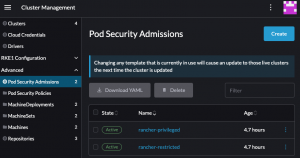
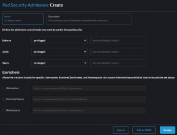
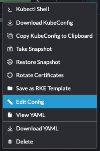
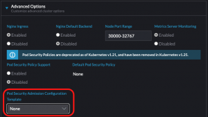
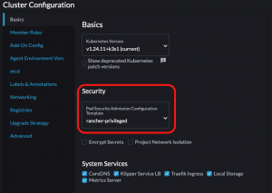

## Introduction

The PodSecurityPolicy API, initially deprecated in Kubernetes v1.21, was [entirely removed](https://kubernetes.io/blog/2022/08/04/upcoming-changes-in-kubernetes-1-25/#podsecuritypolicy-removal) in Kubernetes v1.25. Because the API was removed, you cannot create, edit or query PodSecurityPolicy resources in a Kubernetes v1.25 cluster. Also, because its admission controller was removed, your clusters can no longer enforce any PodSecurityPolicy rules that were created in Kubernetes v1.24 and prior. Therefore, you must either migrate your workload security to the new Pod Security Admission controller, a supplemental policy engine or a combination of both. 
This article discusses how to prepare your Rancher downstream clusters to Kubernetes v1.25, including how to use Rancher-specific mechanisms to apply a Pod Security Admission configuration and how to remove PodSecurityPolicies from Rancher-maintained workloads you have installed in your downstream clusters. It is structured as a semi-tutorial. Run these steps in a non-production environment to get acquainted with the process, and then determine what your production environment requires. 

## Requirements

Before you upgrade your clusters to Kubernetes v1.25, make sure that: 
-You are running Rancher v2.7.2 or higher. 
-Your downstream clusters are running Kubernetes v1.24. 
-You have gone over the steps outlined in the [Migrating from PodSecurityPolicies to the Built-In Pod Security Admission Controller](https://kubernetes.io/docs/tasks/configure-pod-container/migrate-from-psp/) Kubernetes documentation to map your PodSecurityPolicies into a Pod Security Admission configuration or into Pod Security Standards labels. 
-You have evaluated whether Pod Security Admission is suitable for your needs. At the end of this article, there are some linked resources on supplemental policy engines you may wish to add to your cluster if Pod Security Admission is not enough for your use case. 

 

### Configuring the Pod Security Admission controller

The first step is to configure the new Pod Security Admission controller. In Kubernetes v1.24, this admission controller is already enabled by default in the kube-apiserver. There are a few ways this admission controller can be configured. One of the options is to deploy a cluster-wide AdmissionConfiguration via kube-apiserver command-line arguments. As of version 2.7.2, Rancher provides two out-of-the-box AdmissionConfigurations you can use, or you can also create your own Pod Security Admission Configuration via the Rancher user interface. These features will be covered in greater detail below. 
 

### Review the Pod Security Admission Configuration presets

To check out the Pod Security Admission Configuration presets shipped with Rancher, navigate to **Cluster Management** → **Advanced** → **Pod Security Admissions** while logged in to Rancher as an administrator. You will see two available presets: **rancher-privileged** and **rancher-restricted**. The **rancher-restricted** sets the enforce, warn, and audit values to **restricted** and includes some namespace exemptions to allow Rancher to work properly in your cluster without further intervention. The **rancher-privileged** preset is equivalent to the [sample AdmissionConfiguration available in Kubernetes documentation](https://kubernetes.io/docs/tasks/configure-pod-container/enforce-standards-admission-controller/#configure-the-admission-controller) and does not provide any specific security assurances. You can read more about Pod Security Admission and Pod Security Standards on the [Rancher Docs.](https://ranchermanager.docs.rancher.com/how-to-guides/new-user-guides/authentication-permissions-and-global-configuration/pod-security-standards) 
 

#### (Optional) Create a custom Pod Security Admission configuration

You can also create your own Pod Security Admission configuration. To do so, navigate to **Cluster Management** → **Advanced** → **Pod Security Admissions**, and click **Create**: 
 

Choose a name for your new Pod Security Admission Configuration and the rules you would like to apply for enforcing, auditing and warning. You can also specify if any exemptions apply to your use case. After filling out the form, make sure to click **Create**. 

 

### Configuring your cluster to use a Pod Security Admission Configuration

You can leverage the Rancher user interface to apply a cluster-wide Pod Security Admission Configuration. In your **Cluster Management** tab in Rancher Manager, select the hamburger menu for the cluster you would like to configure, then select the **Edit Config** option:
 
Follow the cluster-specific steps to enable it: 

- **RKE**: Navigate to **Advanced Options**, then select your preferred option in the **Pod Security Admission Configuration Template** field.
   
- **RKE2** or **K3S**: Navigate to the **Cluster Configuration** panel. In the **Basics** pane, under the **Security** section, select your preferred option in the **Pod Security Admission Configuration Template** field.
   

After finishing your configuration, make sure to save and test it. 
 

### Configuring individual namespaces manually

For configuring namespaces individually with the Pod Security Standards labels, follow the [Kubernetes documentation](https://kubernetes.io/docs/concepts/security/pod-security-admission/#pod-security-levels) on the topic. Note that when a Pod Security Admission Configuration is combined with Pod Security Standards labels, any Pod Security Standards labels applied to resources marked as exempt in the Pod Security Admission Configuration will be ignored by the admission controller. 
 

### Removing PodSecurityPolicies

This section assumes you have already mapped your PodSecurityPolicies into a Pod Security Admission Configuration and Pod Security Standards namespace labels and that your cluster conforms to the **requirements**. If you have not done so already, go over the [Kubernetes documentation on migrating from PodSecurityPolicies to the built-in PodSecurity Admission Controller](https://kubernetes.io/docs/tasks/configure-pod-container/migrate-from-psp/). 
You should not remove PodSecurityPolicies manually. Deleting PodSecurityPolicies that were added by a Helm chart via kubectl delete will not remove their references from the Helm release and can lead to situations where a Helm chart cannot be upgraded or even removed. To learn more about how to prevent this situation, continue reading this section. 

Upgrade your Apps & Marketplace charts to remove PodSecurityPolicies 

Rancher-maintained workloads that previously installed PodSecurityPolicies have a new version with the format v102.x.y that allows you to remove those resources. Notable changes include: 
-The creation of a new PodSecurityPolicy switch: global.cattle.psp.enabled. The previous PodSecurityPolicy switches have been superseded by this new one. 
-The addition of a cluster capability verification for PodSecurityPolicies before a chart installation. If you try to install these new charts into your Kubernetes v1.25 cluster with the PodSecurityPolicy switch turned on, you will see an error message asking you to disable PodSecurityPolicies before proceeding. 
For a smooth upgrade to Kubernetes v1.25, you must remove PodSecurityPolicy resources that were deployed with Helm. To do so, upgrade each of your charts’ installations to the newest version v102.0.0, making sure to set the PodSecurityPolicy switch global.cattle.psp.enabled value to false. 
 

### Verify all workloads in the cluster have been migrated to Pod Security Admission

Verify that other workloads you have in your cluster have also been migrated from PodSecurityPolicies to Pod Security Admission and Standards. You can check which PodSecurityPolicies still exist in your cluster by running kubectl get podsecuritypolicies. Note that the presence of a PodSecurityPolicy resource in a cluster does not mean that there are workloads using it. 
To check which PodSecurityPolicies are still in use, you can run the command below. Be aware that this strategy may miss workloads that are not currently running, such as CronJobs, workloads that are currently scaled to zero or other workloads that have not rolled out:  

```
kubectl get pods --all-namespaces \      --output jsonpath="{.items[*].metadata.annotations.kubernetes\.io\/psp}" \    | tr " " "\n" | sort -u   
```

To learn more about this strategy for checking for PodSecurityPolicies in use, see section [3.a. Identify an appropriate Pod Security level](https://kubernetes.io/docs/tasks/configure-pod-container/migrate-from-psp/#identify-appropriate-level) of the PodSecurityPolicy migration documentation for Kubernetes. 
 

### Upgrade your cluster to Kubernetes v1.25

After the previous steps are complete and there are no leftover PodSecurityPolicies in your cluster, it is time to upgrade your cluster to Kubernetes v1.25. For your downstream clusters, you can do so via the user interface. 
To upgrade your clusters, navigate to **Cluster Management**. In the **Clusters** page, click the hamburger menu for the cluster you wish to upgrade to Kubernetes v1.25, then select the **Edit Config** option. Change the Kubernetes version according to your cluster type: 
**-RKE**: navigate to **Cluster Options** à **Kubernetes options**. In the **Kubernetes Version** field, select the v1.25 patch you would like to upgrade to. 
**-RKE2** or **K3S**: navigate to the **Cluster Configuration** panel and select the **Basics** pane. Under the **Basics** section, find the **Kubernetes Version** field. Select the v1.25 patch you would like to upgrade to. 
Save the selected configuration. You will see the status for your cluster transition from **Active** to **Upgrading**. The upgrade may take some time and will be reflected in the **Cluster Management** list view once it is completed, as your cluster status will be once again **Active**. 
 

### My use case requires fine-grained policies

Because Pod Security Admission and Pod Security Standards are not as granular as PodSecurityPolicies and do not provide mutating features to ensure pods comply with the rules, you may wish to complement the functionality by having a separate admission controller installed in your cluster. On the Kubernetes landscape, there are admission controllers that offer mutating admissions and more granular validation functionalities, such as Kubewarden, Kyverno, Neuvector and OPA Gatekeeper, to cite some names. You can find links to documentation on these supplemental policy engines at the end of this article. 
 

### Troubleshooting

I forgot to check my workloads for lingering PodSecurityPolicies 

After the upgrade to Kubernetes v1.25, if you forgot to check for lingering PodSecurityPolicies (or other APIs that were discontinued), you may notice that some Helm releases cannot be upgraded or uninstalled. If this happens, you can use the helm-mapkubeapis plugin to restore your release to a working state. This plugin reads Helm release data and replaces superseded APIs with their new versions or removes resources that refer to APIs that were completely removed from Kubernetes. 
Note that Helm plugins are installed locally in the machine where the commands are run. Therefore, please make sure to run the installation steps in the same machine where you intend to run the cleanup steps. 

#### *Install helm-mapkubeapis*

1. In your terminal of choice, make sure that Helm is installed by running helm version. You should see an output similar to the following:

```
version.BuildInfo{Version:"v3.10.2", GitCommit:"50f003e5ee8704ec937a756c646870227d7c8b58", GitTreeState:"clean", GoVersion:"go1.18.8"}  
```

1. Install the helm-mapkubeapis plugin:
   `helm plugin install` `https://github.com/helm/helm-mapkubeapis`
   Output should be similar to:
   `Downloading and installing helm-mapkubeapis v0.4.1` …
   `https://github.com/helm/helm-mapkubeapis/releases/download/v0.4.1/helm-mapkubeapis_0.4.1_darwin_amd64.tar.gz`
   `Installed plugin: mapkubeapis`

1. Check that the plugin was installed correctly:

   ```
   helm mapkubeapis --help
   ```

   Output should be similar to:

   ```
   Map release deprecated or removed Kubernetes APIs in-place

   Usage:

       mapkubeapis [flags] RELEASE

      

   Flags:

       --dry-run               simulate a command

       -h, --help              help for mapkubeapis

       --kube-context string   name of the kubeconfig context to use

       --kubeconfig string     path to the kubeconfig file

       --mapfile string        path to the API mapping file

       --namespace string      namespace scope of the release
   ```

Make sure that the installed version of helm-mapkubeapis is v0.4.1 or later, as earlier versions do not support the removal of resources. 

#### *Clean up releases with lingering PodSecurityPolicies*

1. Open your terminal of choice and make sure the target cluster is accessible by running kubectl cluster-info.

1. List all the releases installed in your cluster by running

   ```
   helm list --all-namespaces 
   ```

1. Perform a dry run for each one of the releases you wish to clean up with helm mapkubeapis `--dry-run <release-name> --namespace <namespace-name>` The output will inform you what resources will be replaced or removed.

1. After reviewing the changes, perform a full run with

   ```
   helm mapkubeapis <release-name> --namespace <namespace-name>. 
   ```

#### *Upgrade your workloads to a Kubernetes v1.25-supported version*

After cleaning up any broken releases, you will need to upgrade your workloads to a version that is supported in Kubernetes v1.25. This is a necessary step that should not be skipped, as cleaned-up releases are not guaranteed to work or have the security required in Kubernetes v1.25. 
For Rancher-maintained workloads, follow the steps outlined in the **Removing PodSecurityPolicies** section of this article. For other workloads, refer to the vendor documentation. 
 

## Next steps

-Learn more about the [Pod Security Admission controller](https://kubernetes.io/docs/concepts/security/pod-security-admission/) and [Pod Security Standards](https://kubernetes.io/docs/concepts/security/pod-security-standards/). 
-Learn more about supplemental policy engines: [Kubewarden](https://docs.kubewarden.io/), [Kyverno](https://kyverno.io/docs/), [NeuVector](https://open-docs.neuvector.com/), and [OPA Gatekeeper](https://open-policy-agent.github.io/gatekeeper/website/docs/). 
-Check out [how to migrate your PodSecurityPolicies to Kubewarden policies](https://docs.kubewarden.io/tasksDir/psp-migration). 
-Learn more about [how to use helm-mapkubeapis](https://ranchermanager.docs.rancher.com/how-to-guides/new-user-guides/authentication-permissions-and-global-configuration/pod-security-standards#cleaning-up-releases-after-a-kubernetes-v125-upgrade).
