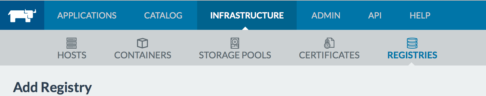

A Detailed Overview of Rancher's ArchitectureThis newly-updated, in-depth guidebook provides a detailed overview of the features and functionality of the new Rancher: an open-source enterprise Kubernetes platform.[Get the eBook](https://more.suse.com/fy21-global-web-landing-page-rancher2-technical-architecture)


In an earlier [article](https://rancher.com/comparing-four-hosted-docker-registries/), we looked at four hosted Docker repositories: DockerHub, Quay.io,
Artifactory and Google Container Registry. Since that article was
published, Amazon has released their hosted container registry
service. Many Docker and Rancher users host their infrastructure on
Amazon Web Services (AWS). So, we wanted to provide an overview of
setting up and using Amazon’s container registry service and compare it
with other tools we looked at earlier.

### Registry Setup

**1. Install AWS CLI**: To setup an Amazon Container Registry (ACR),
first make sure you have a new version of the [AWS
CLI](http://docs.aws.amazon.com/cli/latest/userguide/installing.html)
installed and configured. This article was tested using
\*version 1.10.1. \* You can verify your installed version by running:

```
aws --version
aws-cli/1.10.1 Python/2.7.10 Darwin/15.3.0 botocore/1.3.23
```

**2. Create a Repository**: The next step is to create a
repository. This can be done using the command below where project-name
and repository name can be selected as needed. Please take note of the
project and repository name as you will need this in later steps.

```
aws ecr create-repository --repository-name project-name/repository-name
```

**3.** **Login to the AWS Registry**: Once you have created a registry,
you need to log your docker client into the AWS Registry service using
the following command. Note, if you are running infrastructure in a
region other than us-east-1, you will need to either configure your AWS
client or override the default region using the --region switch.

```
$(aws ecr get-login)
WARNING: login credentials saved in /Users/XXXXXXXXX/.docker/config.json
Login Succeeded
```

\*\*4. Create a Policy Document: \*\* The registry service allows very fine
grained permissions management which ties into Amazon’s
[IAM](https://aws.amazon.com/documentation/iam/) service. To setup
permissions, copy the following text into a file called
*repository-policy.json*. In the file, replace 000000000000 with your
AWS Account id. If you don’t know your Account ID browse to [AWS
Support](https://console.aws.amazon.com/support/home) and the ID will be
in the top right corner. In the example file, we are giving permissions
to one specific IAM user and one specific role. You can add as many
roles and users to the list as your need. If you would like to give all
users in the AWS account permissions, then you may use *“Principal” :
”\*“,* instead of the array below. Secondly, the list of permissions
in the *Action* section below contain all possible permissions. You may
specify a subset of permissions if you would like to create a more
constrained access profile. Lastly, we are creating a policy with a
single statement block. You may create multiple statement blocks to give
different levels of permissions to different users.

```
{
    "Version": "2008-10-17",
    "Statement": [{
        "Sid": "PolicyStatement",
        "Effect": "Allow",
        "Principal": {
            "AWS": [
                "arn:aws:iam::000000000000:role/SOME-ROLE",
                "arn:aws:iam::000000000000:user/SOME-USER"
            ]
        },
        "Action": [
            "ecr:GetDownloadUrlForLayer",
            "ecr:BatchGetImage",
            "ecr:BatchCheckLayerAvailability",
            "ecr:PutImage",
            "ecr:InitiateLayerUpload",
            "ecr:UploadLayerPart",
            "ecr:CompleteLayerUpload",
            "ecr:DescribeRepositories",
            "ecr:GetRepositoryPolicy",
            "ecr:ListImages",
            "ecr:DeleteRepository",
            "ecr:BatchDeleteImage",
            "ecr:SetRepositoryPolicy",
            "ecr:DeleteRepositoryPolicy"
        ]
    }]
}
```

**5.** **Apply Policy:** To apply the policy you created, use the
command specified below. You are not setup and can push and pull
containers from the AWS Container registry.

```
aws ecr set-repository-policy                      
    --repository-name project-name/repository-name 
    --policy-text "$(cat repository-policy.json)"
```

### Using the AWS Registry Service

To start using the service, you follow the same steps as any other
private docker registry i.e. re-tag your container and push to the
repository. For example, in the snippet below we are building a
container called *container-tag,* re-tagging with the Amazon Registry
Service URL and our repository name from earlier and then pushing to the
Amazon Registry Service. Note in the commands below, you must once again
replace 000000000000 with your AWS Account ID.

```
docker build -t container-tag .
docker tag -f container-tag 
    000000000000.dkr.ecr.us-east-1.amazonaws.com/project-name/repository-name:version
docker push 000000000000.dkr.ecr.us-east-1.amazonaws.com/project-name/repository-name:version
```

When you would like to pull this container onto another host you must
run $(aws ecr get-login) and then use docker pull with the AWS Registry
Service URL.

```
$(aws ecr get-login)
docker pull 000000000000.dkr.ecr.us-east-1.amazonaws.com/project-name/repository-name:version
```

### Using the AWS Registry Service with Rancher

### [](images/rancher_blog_Screen-Shot-2016-03-18-at-9.42.52-PM.png)

If you would like to use the ECR with Rancher browse to *Infrastructure
> Registries* and select \*Add Registry \*and select *Custom* as the
registry type. In the resulting form your will be asked to enter the
Address, Email, Username and Password. The address corresponds to your
Amazon Account ID and region e.g.
(000000000000.dkr.ecr.us-east-1.amazonaws.com). The email field will
always be set to *none* and the username will be set to *AWS*. The
password can be retrieved using the *aws ecr get-login* command and
looking for the -p parameter in the output. You can use the following
command to get the password string. Now you can use the fully qualified
name of the image (e.g.
*000000000000.dkr.ecr.us-east-1.amazonaws.com/project-name/repository-name:version*)
in Rancher to pull images from ECR.

```
aws ecr get-login | cut -d ' ' -f 6
```

Note that because access to ECR is controlled with AWS IAM. An IAM user
must request a temporary credential to the registry using the AWS API.
This temporary credential is then valid for 12 hours. To do this you can
use the image
[objectpartners/rancher-ecr-credentials](https://hub.docker.com/r/objectpartners/rancher-ecr-credentials/)to
refresh the credentials periodically. The docker-compose.yaml file to
setup the credentials service is shown below.

```
ECRCredentials:
  environment:
    AWS_REGION: us-east-1
    AWS_ACCESS_KEY_ID: XXXXXXXXXXXXXXXXXXXX
    AWS_SECRET_ACCESS_KEY: XXXXXXXXXXXXXXXXXXXXXXXXXXXXXXXXXXXXXXXX
  labels:
    io.rancher.container.pull_image: always
    io.rancher.container.create_agent: 'true'
    io.rancher.container.agent.role: environment
  tty: true
  image: objectpartners/rancher-ecr-credentials
  stdin_open: true
```

### Evaluation

When we compared the four hosted registry services earlier, we use four
dimensions to evaluate their performance: Workflow,
Authentication/Authorization, Availability/Performance and Pricing. We
will use the same to evaluate Amazon Container Registry.

In terms of workflow, the registry offer basic features and does not
integrate any automated builds or detailed metrics for repository usage.
This does mean that you will need to setup and manage continuous
integration. This can be an issue if you were looking to offload this
task. However, you probably already run CI tools such as Jenkins or
Bamboo for continuous integration of your code. It should be trivial to
integrate the registry service with your CI tool. Furthermore, fully
scripted command-line access to create and manage repositories is a
powerful feature.

Amazon offers very detailed and comprehensive support for authentication
and authorization through their IAM service. If you are not already
versed in IAM usage, then setting up fine grained policies and roles can
be daunting. However, this is a hurdle you have to get over once. If you
are running infrastructure in AWS, being well versed in IAMs usage is a
pretty much a prerequisite.

The Container registry service uses Amazon s3 which promises 4 nines of
up-time and 11 nines for data durability. This is well within reasonable
limits for most commercial applications. As for cost, you pay the
standard AWS rates for storage and network transfer. This is ten cents
per gigabyte per month for storage and nine cents per gigabyte for
egress traffic from Amazon’s network. Transfers to in-region Amazon
infrastructure is free. This means for most use-cases, the cost of the
service will be negligible compared to other infrastructure costs.

If you’re interested in learning more about Docker, Rancher, Kubernetes
or anything else, join us for our monthly online meetups, where we talk
about the latest on using containers to deploy applications.

A Detailed Overview of Rancher's ArchitectureThis newly-updated, in-depth guidebook provides a detailed overview of the features and functionality of the new Rancher: an open-source enterprise Kubernetes platform.[Get the eBook](https://more.suse.com/fy21-global-web-landing-page-rancher2-technical-architecture)
