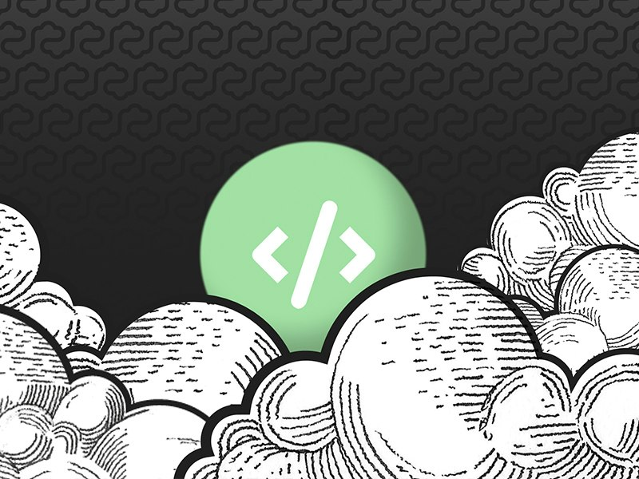
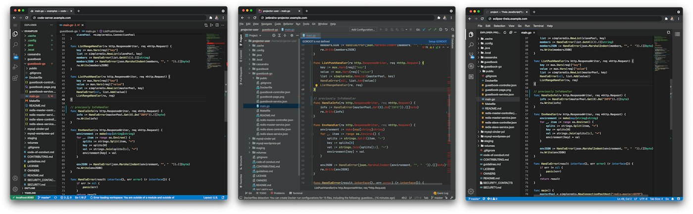
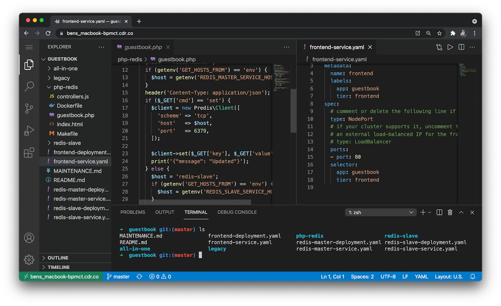

Deploying changes rapidly is an important part of developing cloud native applications. Because of this, many teams strive to build development environments that have close parity with their production environments to simplify and speed up testing. Whether it is a remote staging server or a local cluster, developers are looking for better development workflows.

Disclaimer: I work at Coder, a cloud development platform and maintainers of code-server (cloud IDE).

[](https://media1-production-mightynetworks.imgix.net/asset/24831156/cloud_ide_new.jpg?ixlib=rails-4.2.0&fm=jpg&q=75&auto=format)

## What Constitutes a Cloud IDE?

Cloud-based IDEs offer one pathway for improvement. When most people think of cloud IDEs, they envision an editor only accessible from the web browser. While this is often the case, running a local IDE that supports a remote target is possible. Both variations will be referred to as “cloud IDEs” in this post.

[VS Code Remote](https://code.visualstudio.com/docs/remote/remote-overview) is a great way to develop and debug on remote environments, either on your local machine (such as a k3d cluster) or an environment in the cloud.

Also, many modern web IDEs are open source, fast, and provide a familiar development experience:

[](https://media1-production-mightynetworks.imgix.net/asset/24830660/IDE_Comparison.png?ixlib=rails-4.2.0&fm=jpg&q=75&auto=format)

- [code-server](https://github.com/cdr/code-server): VS Code in the web browser
- [JetBrains Projector](https://jetbrains.github.io/projector-client/mkdocs/latest/): JetBrains IDEs in the web browser
- [Eclipse Theia](https://theia-ide.org/): Extensible IDE, similar to VS Code, runs popular extensions

Cloud IDEs offer interesting workflows to developers by bringing the development tools, source code, and IDE to the cloud. Developers using cloud IDEs do not have to configure their local machine, install dependencies or clone source code. Cloud IDEs can also be much closer to production environments, such as a remote Kubernetes cluster, thereby reducing latency when accessing other cloud-based resources, such as databases. [Read more about the advantages of using a cloud IDE.](https://coder.com/blog/what-is-a-cloud-ide)

## Development Platforms

It’s common to see cloud IDEs paired with remote development platforms, such as [Coder](https://coder.com/docs), [GitPod](https://www.gitpod.io/docs), or [RedHat CodeReady Workspaces](https://developers.redhat.com/products/codeready-workspaces/overview). These let teams provision workspaces on demand and configure workspaces on a team or admin level.

This makes it possible, for example, to avoid version mismatches by orchestrating version bumps of the developers’ environments, such as a new version of Python, or to roll out a new dev tool to multiple users simultaneously.

Many of these platforms, including ours at [Coder](https://coder.com/docs), take an editor-neutral approach in order to support the popular cloud IDEs that work best for organizations.

## Try a Cloud IDE: code-server

[](https://media1-production-mightynetworks.imgix.net/asset/24742603/1622839343244.png?ixlib=rails-4.2.0&fm=jpg&q=75&auto=format)

Because code-server is built for the web, it's a popular choice for developing from an iPad or Chromebook. It's also used for secure remote development, so developers don't need to use a remote desktop or a VPN to access and test their code.

code-server has packages on many operating systems, as well as a Docker image and a helm chart so that it can be deployed into your cloud for a remote dev environment.

To get started, follow the [install guides](https://github.com/cdr/code-server/blob/main/docs/install.md) to install on your local machine or a remote server. Once installed, you can use the --link flag to tunnel code-server without setting up networking or authentication:

```
$ code-server --link

Proxying code-server, you can access your IDE at
https://bens_macbook-bpmct.cdr.co
```

## Now, Create a Cloud Development Environment

If you want to develop on any device, like an iPad, “code-server --link” on your main desktop or VM will do the trick!

To source-controlled workspaces and roll-out changes, deploying [a custom code-server container](https://github.com/cdr/deploy-code-server/tree/main/deploy-container) with your development tools (kubectl, helm, Python, pip, etc.) is a great way to go! Development platforms like [Coder](https://coder.com/docs) can help distribute these environments across your teams.
