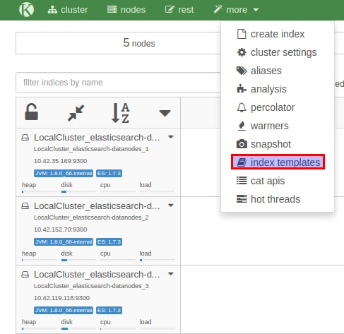
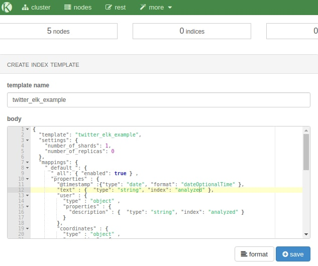
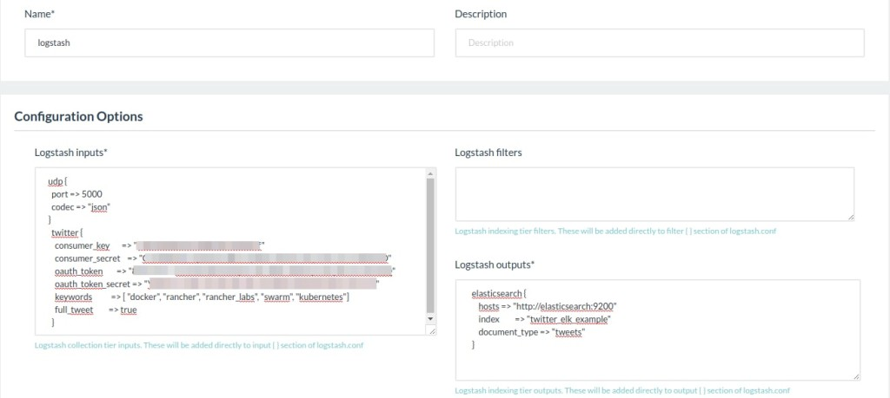
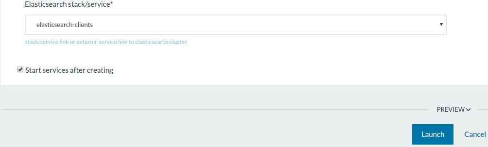
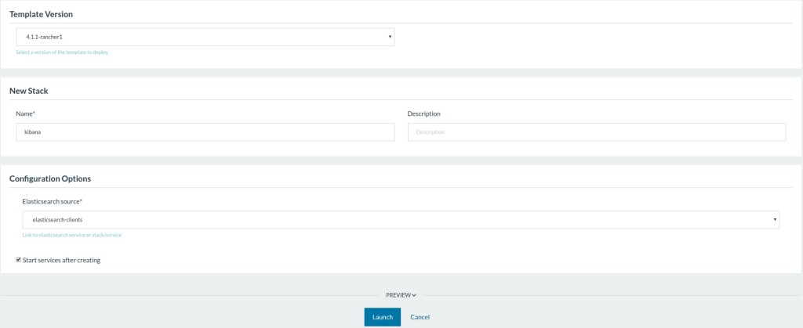
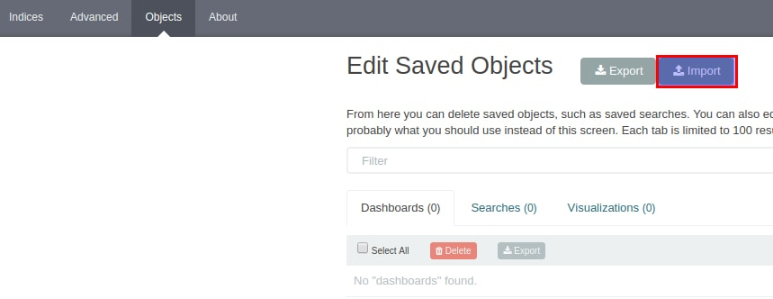
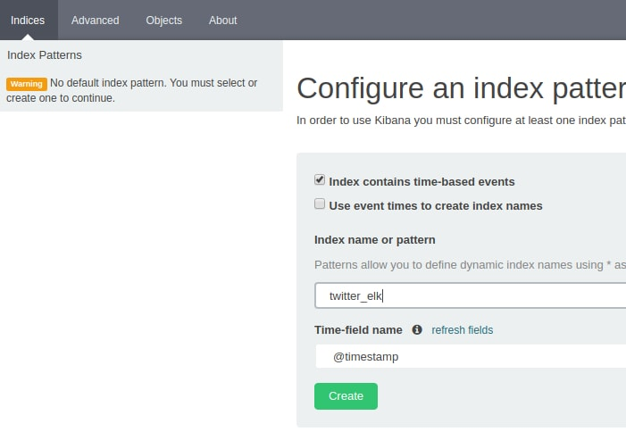
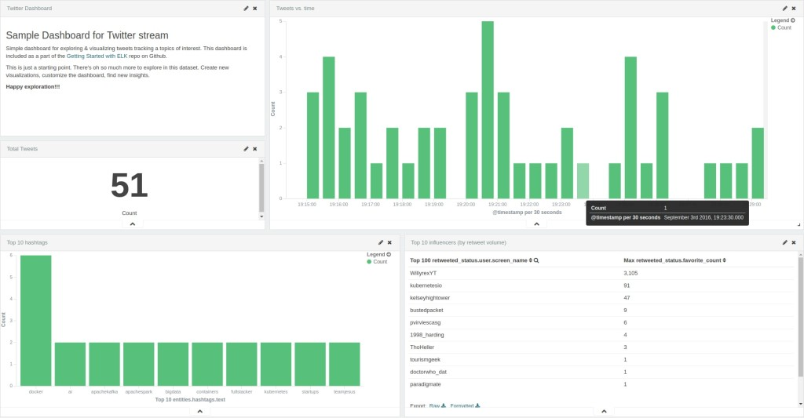

In the previous part of this series, we have seen how to [deploy an
Elasticsearch Cluster using Rancher
Catalog](https://rancher.com/deploying-an-elasticsearch-cluster-using-rancher-catalog/).
Now it’s time to make good use of this catalog, right?

### **Introduction**

As a reminder, Elasticsearch is the cornerstone of the ELK platform (ELK
stands for Elasticsearch/Logstash/Kibana). In this article, we’ll
deploy the stack using Rancher Catalog, and use it to track tags and
brands on Twitter. Tracking hashtags on Twitter can be very useful for
measuring the impact of a Twitter-based marketing campaign. You can pull
information like the number of times your announcement has been
retweeted, or how many new followers your marketing campaign has brought
in.

### **Installing the ELK Stack**

**Elasticsearch** Following the previous article, you should know have a
fully working Elasticsearch Cluster. So now for our example, we just
have to tweak its configuration a bit, by creating an index template
using JSON configuration.

- grab the JSON template
  [here](https://github.com/elastic/examples/blob/master/Common%20Data%20Formats/twitter/twitter_template.json),
  on Github
- open your browser at http://[your rancher host where kopf is
  deployed]
- in kopf, click : ‘[more]’ and
  them ‘[index templates]’

[](images/rancher_blog_Image_1.jpg)
Now we’ll give a name to our index template, and push its
configuration.

- use twitter\_elk\_example as a template name
- paste the content of the JSON file you’ve previously downloaded
- click ‘[save]’

[](images/rancher_blog_Image_2.jpg)
That’s it for our Elasticsearch Cluster. Now let’s move on to...
**Logstash** Logstash allows you to process and transport these data
right into your Elasticsearch cluster with a little bit of magic. Lots
of data sources are natively supported (Twitter APIs, collectd, Apache
logs, etc). While processing your data, Logstash can help you
extract/format the right portion of your data. In doing so, you won’t
push unnecessary or (even worse) wrong data, which would makes your
Kibana dashboard irrelevant ! Before we start , we need to create
[Twitter Application Keys](https://apps.twitter.com) We’ll need
specifically:

- Consumer Key
- Consumer Secret
- Access Token
- Access Token Secret

**Note:** make sure your Rancher hosts have their clocks synced, or
you’ll won’t be able to use Twitter credentials correctly

Now go to the catalog page and select Logstash (latest version will do
well). In the input field, you should add the following (replace the CAP
text with your own twitter APIs authentication keys):

```
twitter {
 consumer_key => "INSERT YOUR CONSUMER KEY"
 consumer_secret => "INSERT YOUR CONSUMER SECRET"
 oauth_token => "INSERT YOUR ACCESS TOKEN"
 oauth_token_secret => "INSERT YOUR ACCESS TOKEN SECRET"
 keywords => [ "docker", "rancher_labs", "rancher", "kubernetes" ]
 full_tweet => true
 }
```

**Note**: in the keywords array, don’t use @ or #, or else Logstash
will fail with an incorrect error: unauthorized message.

In the output field, you should then add:

```
output {
 elasticsearch {
 host => "elasticsearch:9200"
 protocol => "http"
 cluster_name => "NAME OF YOUR ELASTICSEARCH CLUSTER"
 index => "twitter_elk_example"
 document_type => "tweets"
 }
```

[](https://cdn.rancher.com/wp-content/uploads/2016/09/13090557/Image_3.jpg)
Finally, select : elasticsearch-clients as the Elasticsearch
stack/service That’s it! Click on :
[‘launch’]
[](images/rancher_blog_Image_4.jpg)
Rancher will do the magic and deploy Logstash, fully configured. If
everything went well, within a few minutes you should see data being
added to your Elasticsearch index. You can c[heck at http://[your
ElasticSearch host]/#kopt]
[](https://cdn.rancher.com/wp-content/uploads/2016/09/13090604/Image_5.jpg)
**Kibana** Kibana allows you to create a powerful dashboard using data
stored in your Elasticsearch cluster. To deploy Kibana, you need to do
just two things: select the correct version in Rancher Catalog (4.1.X),
and connect it to the elasticsearch-clients container:
[](https://cdn.rancher.com/wp-content/uploads/2016/09/13090609/Image_6.jpg)
That’s it! Kibana is ready to use, we’ll see configurations right
afterwards. Now, the entire ELK stack is freshly deployed. While
Elasticsearch and Logstash are already configured, we’ll need to take
care of Kibana. In our case, we just need to import a JSON dashboard
right into Kibana.

- grab the JSON file
- go to Settings --> Object, then click
  ‘I[mport]‘, and select the
  file previously downloaded. You should see something close to this:

[](images/rancher_blog_Image_7.jpg)
All that’s left is to create the appropriate index settings in Kibana.
Go to Indices , then click
‘[New]‘. You should be see the
index created and @timestamp selected, as well.
[](images/rancher_blog_Image_8.jpg)
Here we are! You now have a Kibana dashboard that helps you monitor
hashtags and brands on Twitter. You can load the imported dashboard
clicking on its name here:
[](https://cdn.rancher.com/wp-content/uploads/2016/09/13090539/Image_9.jpg)
After a few minutes, let’s check the dashboard again. You should then
having something like this:
[](https://cdn.rancher.com/wp-content/uploads/2016/09/13090542/Image_10.jpg)
Thanks for reading this tutorial on deploying a containerized ELK stack
with Rancher! Please reach out to us on Github or on Twitter - we’d
love to hear more about how you’re using Rancher in your organization.
*[](https://cdn.rancher.com/wp-content/uploads/2016/06/08180221/rachid-photo.png)Rachid
is a former virtualization consultant and Instructor. After a successful
experience building and training the ops team of the French registry
AFNIC, he is now the CIO of a worldwide recognized CRM and ecommerce
agency.*
