Join the Master Class: Using Hybrid and Multi-Cloud Service Mesh Based Applications for Highly Distributed Environment Deployments[Join the Master Class on Jan. 12](https://info.rancher.com/kubernetes-master-class-jan12-2020-kong)

Service Mesh is an emerging architecture pattern gaining traction today. Along with Kubernetes, Service Mesh can form a powerful platform which addresses the technical requirements that arise in a highly distributed environment typically found on a microservices cluster and/or service infrastructure. A Service Mesh is a dedicated infrastructure layer for facilitating service-to-service communications between microservices.

Service Mesh addresses the communication requirements typical in a microservices-based application, including encrypted tunnels, health checks, circuit breakers, load balancing and traffic permission. Leaving the microservices to address these requirements leads to an expensive and time consuming development process.

In this blog, we’ll provide an overview of the most common microservice communication requirements that the Service Mesh architecture pattern solves.

## Microservices Dynamics and Intrinsic Challenges

The problem begins when you realize that microservices implement a considerable amount of code not related to the business logic they were originally assigned. Additionally, it’s possible you have multiple microservices implementing similar capabilities in a non-standardized process. In other words, the microservices development team should focus on business logic and leave the low-level communication capabilities to a specific layer.

Moving forward with our scenario, consider the intrinsic dynamics of microservices. In given time, you may (or most likely will) have multiple instances of a microservice due to several reasons, including:

- Throughput: depending on the incoming requests, you might have a higher or lower number of instances of a microservice
- Canary release
- Blue/green deployment
- A/B testing

In short, the microservice-to-microservice communication has specific requirements and issues to solve. The illustration below shows this scenario:

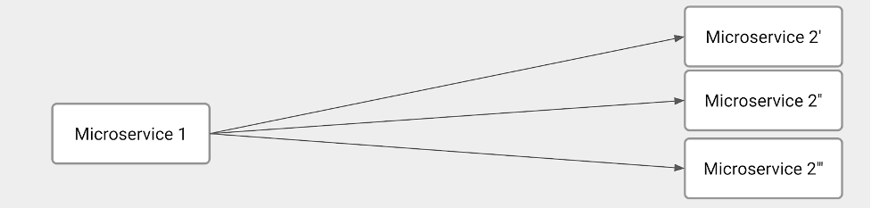

The illustration depicts several technical challenges. Clearly, one of the main responsibilities of Microservice 1 is to balance the load among all Microservice 2 instances. As such, Microservice 1 has to figure out how many Microservice 2 instances we have at the request moment. In other words, Microservice 1 must implement service discovery and load balancing.

On the other hand, Microservice 2 has to implement some service registration capabilities to tell Microservice 1 when a brand-new instance is available.

In order to have a fully dynamic environment, these other capabilities should be part of the microservices development:

- Traffic control: a natural evolution of load balancing. We want to specify the number of requests that should go to each of the Microservice 2 instances.
- Encrypted communication between the Microservices 1 and 2.
- Circuit breakers and health checks to address and overcome networking problems.

In conclusion, the main problem is that the development team is spending significant resources writing complex code not directly related to business logic expected to be delivered by the microservices.

## Potential Solutions

How about externalizing all the non-functional and operational capabilities in an external and standardized component that all microservices can call? For example, the diagram below compiles all capabilities that should not be part of a given microservice. So, after identifying all capabilities, we need to decide where to implement them.

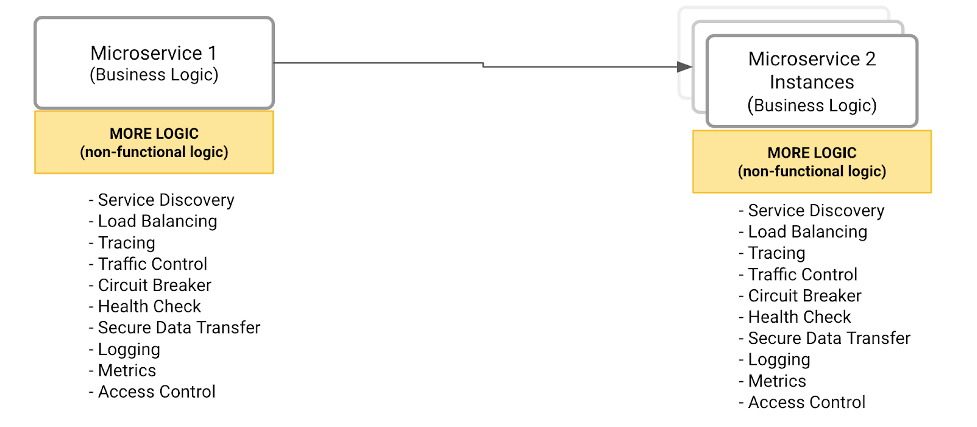

### Solution #1 - Encapsulating all capabilities in a library

The developers would be responsible for calling functions provided by the library to address the microservice communication requirements.

There are a few drawbacks to this solution:

- It’s a tightly coupled solution, meaning that the microservices are highly dependent on the library.
- It’s not an easy model to distribute or upgrade new versions of the library.
- It doesn’t fit the microservice polyglot principle with different programming languages being applied on different contexts

### Solution #2 - Transparent Proxy

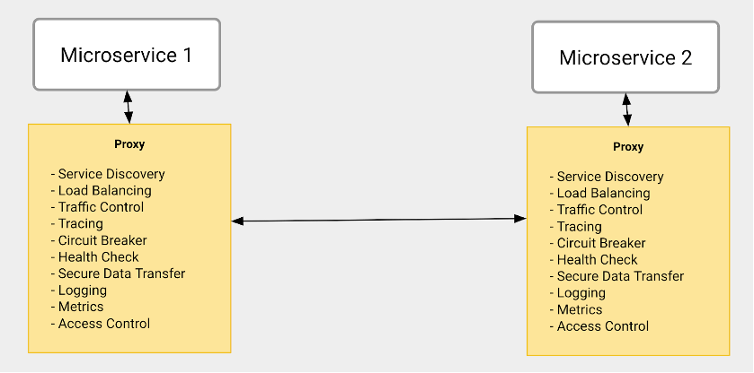

This solution implements the same collection of capabilities. However, with a very different approach: each microservice has a specific component, playing a proxy role, taking care of its incoming and outcoming traffic. The proxy solves the library drawbacks we described before as follows:

- The proxy is transparent, meaning the microservice is not aware it is running nearby and implementing all needed capabilities to communicate with other microservices.
- Since it’s a transparent proxy, the developer doesn’t need to change the code to refer to the proxy. Therefore, upgrading the proxy would be a low-impact process from a microservice development perspective.
- The proxy can be developed using different technologies and programming languages used by microservice.

**The Service Mesh Architectural Pattern**

While a transparent proxy approach brings several benefits to the microservice development team and the microservice communication requirements, there are still some missing parts:

- The proxy is just enforcing policies to implement the communication requirements like load balancing, canary, etc.
- What is responsible for defining such policies and publishing them across all running proxies?

The solution architecture needs another component. Such components would be used by admins for policy definition and it will be responsible for broadcasting the policies to the proxies.

The following diagram shows the final architecture which is the service mesh pattern:

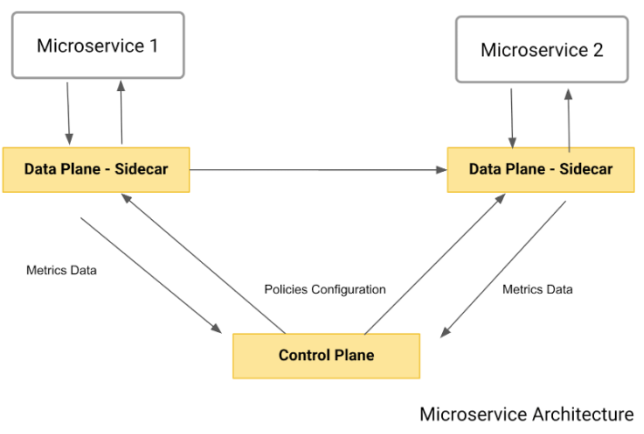

As you can see, the pattern comprehends the two main components we’ve described:

- The data plane: also known as sidecar, it plays the transparent proxy role. Again, each microservice will have its own data plane intercepting all incoming and outgoing traffic and applying the policies previously described.
- The control plane: used by the admin to define policies and publish them to the data plane.

Some important things to note:

- It’s “push-based” architecture. The data plane doesn’t do “callouts” to get the policies: that would be a big network consuming architecture.
- The data plane usually reports usage metrics to the control plane or a specific infrastructure.

## Get Hands-On with Rancher, Kong and Kong Mesh

Kong provides an enterprise-class and comprehensive service connectivity platform that includes an API gateway, a Kubernetes ingress controller and a Service Mesh implementation. The platform allows customers to deploy on multiple environments such as on premises, hybrid, multi-­­­­­­region and multi-cloud.

Let’s implement a Service Mesh with a canary release running on a cloud-agnostic Kubernetes cluster, which could include a Google Kubernetes Engine (GKE) cluster or any other Kubernetes distribution. The Service Mesh will be implemented by Kong Mesh (and protected by [Kong for Kubernetes](https://github.com/Kong/kubernetes-ingress-controller) as the Kubernetes ingress controller. Generically speaking, the ingress controller is responsible for defining entry points to your Kubernetes cluster, exposing the microservices deployed inside of it and applying consumption policies to it.

First of all, make sure you have [Rancher](https://rancher.com/docs/rancher/v2.x/en/installation/) installed, as well as a Kubernetes cluster running and managed by Rancher. After logging into Rancher, choose the Kubernetes cluster we’re going to work on – in our case “kong-rancher”. Click the **Cluster Explorer** link. You will be redirected to a page like this:

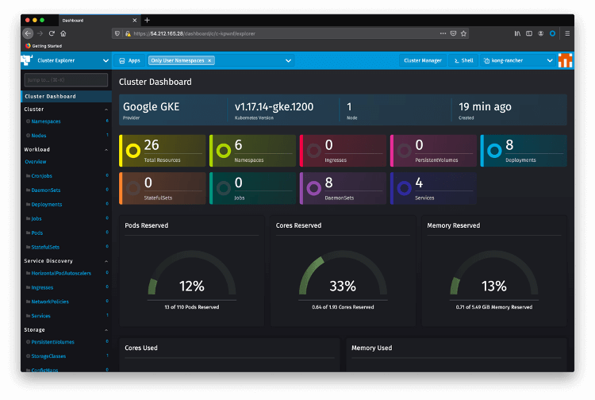

Now, let’s start with the Service Mesh:

1. Kong Mesh Helm Chart

   Go back to Rancher Cluster Manager home page and choose your cluster again. To add a new catalog, pass your mouse over the “Tools” menu option and click on **Catalogs**. Click the **Add Catalog** button and include [Kong Mesh’s Helm v3 charts](https://kong.github.io/kong-mesh-charts) .

   Choose **global** as the scope and **Helm v3** as the Helm version.

   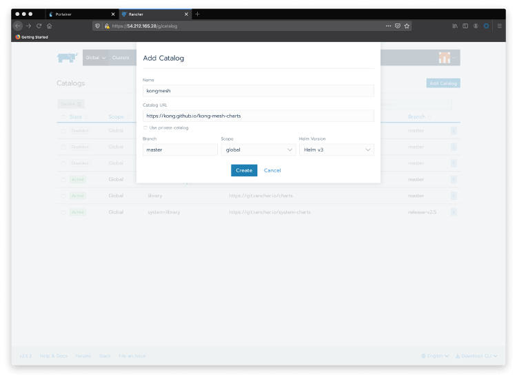

   Now click on **Apps** and **Launch** to see Kong Mesh available in the Catalog. Notice that Kong, as a Rancher partner, provides Kong for Kubernetes Helm Charts, by default:

   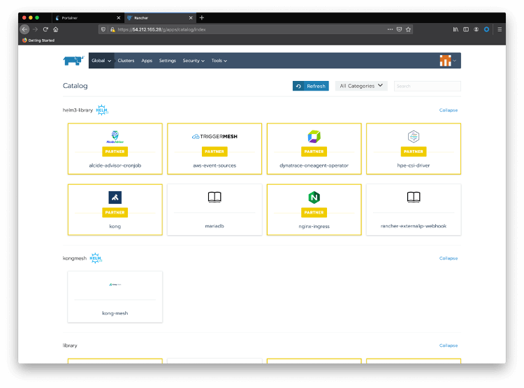
2. Install Kong Mesh

   Click on the top menu option **Namespaces** and create a “kong-mesh-system” namespace.

   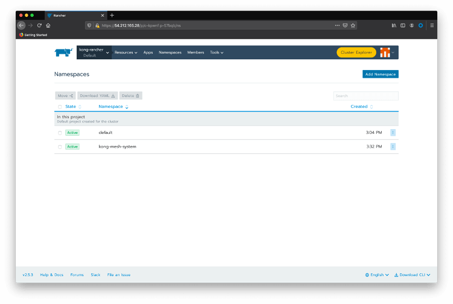

   Pass your mouse over the **kong-rancher** top menu option and click on **kong-rancher active cluster**.

   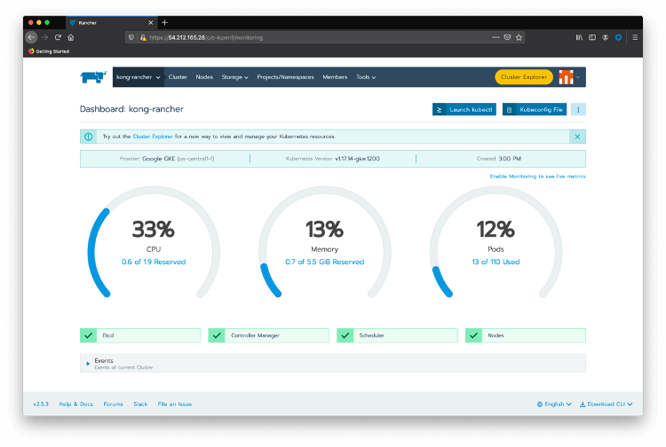

   Click on **Launch kubectl**

   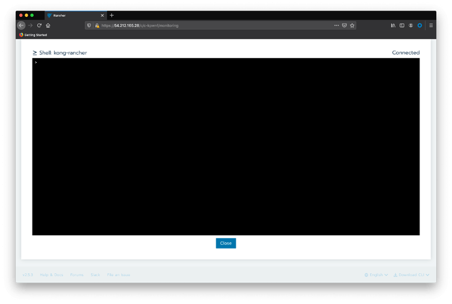

   Create a file named “license.json” for the Kong Mesh license you received from Kong. The license follows the format:

   {“license”:{“version”:1,“signature”:“6a7c81af4b0a42b380be25c2816a2bb1d761c0f906ae884f93eeca1fd16c8b5107cb6997c958f45d247078ca50a25399a5f87d546e59ea3be28284c3075a9769”,“payload”:{“customer”:“Kong\_SE\_Demo\_H1FY22”,“license\_creation\_date”:“2020-11-30”,“product\_subscription”:“Kong Enterprise Edition”,“support\_plan”:“None”,“admin\_seats”:“5”,“dataplanes”:“5”,“license\_expiration\_date”:“2021-06-30”,“license\_key”:“XXXXXXXXXXXXX”}}}

   Now, create a Kubernetes generic secret with the following command:

   ```
   kubectl create secret generic kong-mesh-license -n kong-mesh-system --from-file=./license.json
   ```

   Close the kubectl session, click on **Default** project and on **Apps** top menu option. Click on **Launch** button and choose the **kong-mesh** Helm charts.

   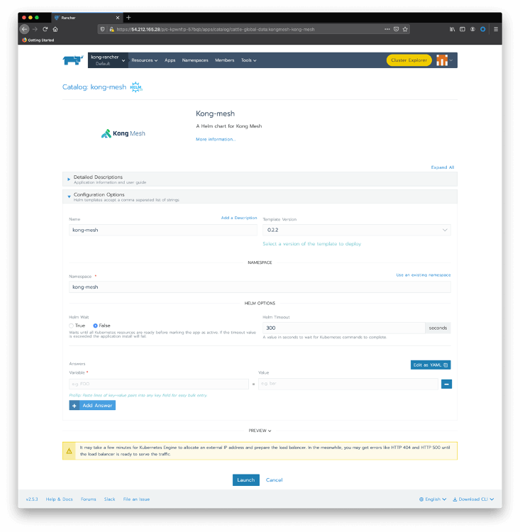

   Click on **Use an existing namespace** and choose the one we just created. There are [several parameters](https://artifacthub.io/packages/helm/kong-mesh/kong-mesh) to configure Kong Mesh, but we’re going to keep all the default values. After clicking on **Launch** , you should see the Kong Mesh application deployed:

   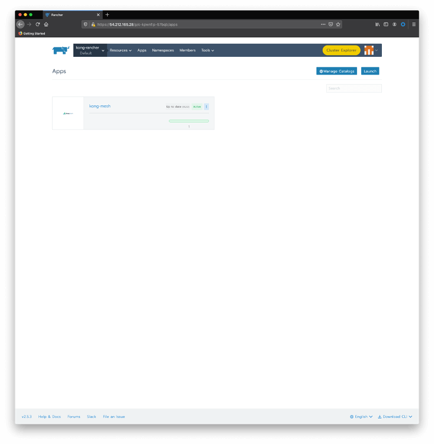

   And you can check the installation using Rancher Cluster Explorer again. Click on **Pods** on the left menu and choose **kong-mesh-system** namespace:

   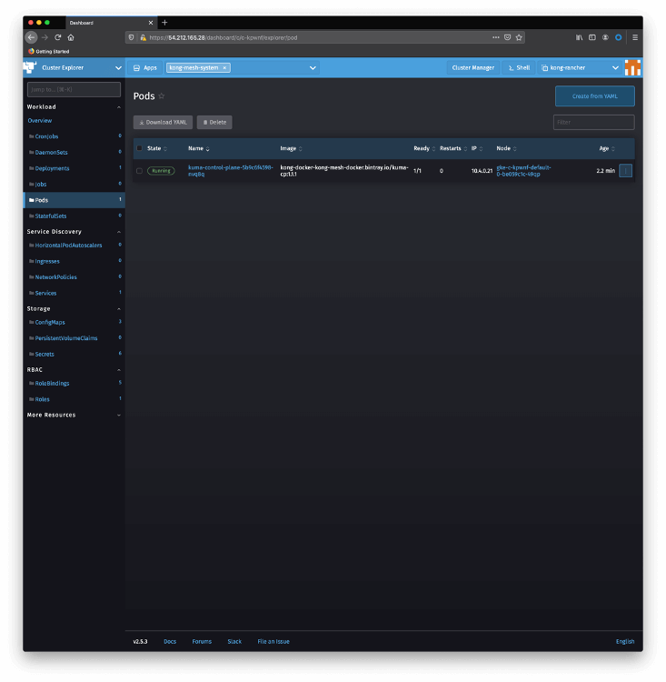

   You can use kubectl as well like this:

   ```
   NAMESPACE          NAME                                                      READY   STATUS    RESTARTS   AGE
   cattle-system      cattle-cluster-agent-785fd5f54d-r7x8r                     1/1     Running   0          75m
   fleet-system       fleet-agent-77c78f9c74-f97tv                              1/1     Running   0          75m
   kong-mesh-system   kuma-control-plane-5b9c6f4598-nvq8q                       1/1     Running   0          16m
   kube-system        event-exporter-gke-666b7ffbf7-n9lfl                       2/2     Running   0          76m
   kube-system        fluentbit-gke-xqsdv                                       2/2     Running   0          76m
   kube-system        gke-metrics-agent-gjrqr                                   1/1     Running   0          76m
   kube-system        konnectivity-agent-4c4hf                                  1/1     Running   0          76m
   kube-system        kube-dns-66d6b7c877-tq877                                 4/4     Running   0          76m
   kube-system        kube-dns-autoscaler-5c78d65cd9-5hcxs                      1/1     Running   0          76m
   kube-system        kube-proxy-gke-c-kpwnf-default-0-be059c1c-49qp            1/1     Running   0          76m
   kube-system        l7-default-backend-5b76b455d-v6dvg                        1/1     Running   0          76m
   kube-system        metrics-server-v0.3.6-547dc87f5f-qntjf                    2/2     Running   0          75m
   kube-system        prometheus-to-sd-fdf9j                                    1/1     Running   0          76m
   kube-system        stackdriver-metadata-agent-cluster-level-68d94db6-64n4r   2/2     Running   1          75m
   ```
3. Microservices deployment

   Our Service Mesh deployment is based on a simple microservice-to-microservice communication scenario. As we’re running a canary release, the called microservice has two versions.

   - “magnanimo”: exposed through Kong for Kubernetes ingress controller.
   - “benigno”: provides a “hello” endpoint where it echoes the current datetime. It has a canary release that sends a slightly different response.

   The figure below illustrates the architecture:

   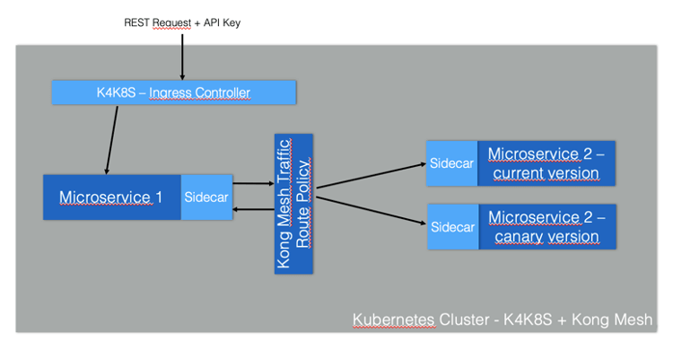

   Create a namespace with the sidecar injection annotation. You can use the Rancher Cluster Manager again: choose your cluster and click on **Projects/Namespaces**. Click on **Add Namespace**. Type “kong-mesh-app” for name and include an annotation with a “kuma.io/sidecar-injection” key and “enabled” as its value:

   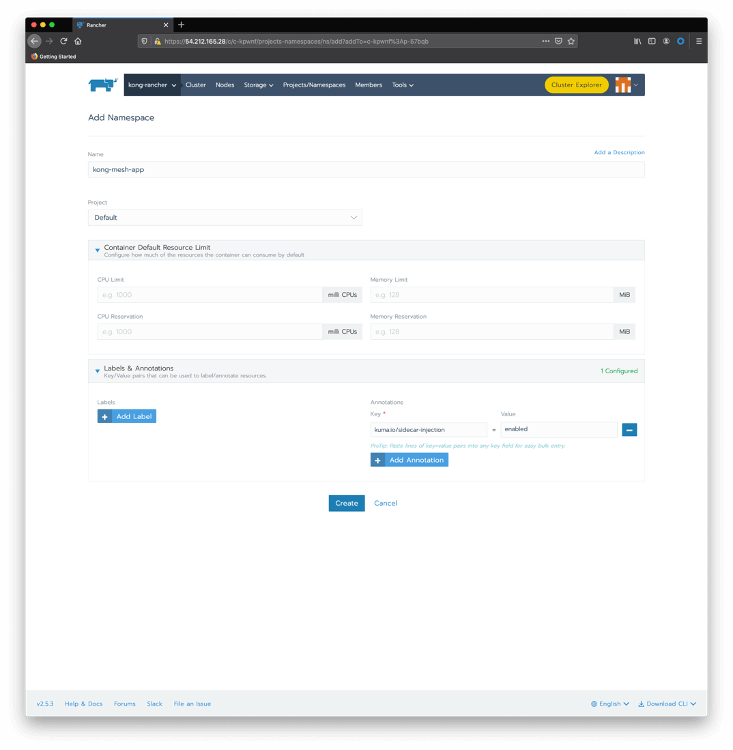

   Again, you can use kubectl as an alternative

   ```
   kubectl create namespace kong-mesh-app

   kubectl annotate namespace kong-mesh-app kuma.io/sidecar-injection=enabled

   Submit the following declaration to deploy Magnanimo injecting the Kong Mesh data plane

   cat <<EOF | kubectl apply -f -

   apiVersion: apps/v1

   kind: Deployment

   metadata:

   name: magnanimo

   namespace: kong-mesh-app

   spec:

   replicas: 1

   selector:

   matchLabels:

   app: magnanimo

   template:

   metadata:

   labels:

   app: magnanimo

   spec:

   containers:

   - name: magnanimo

   image: claudioacquaviva/magnanimo

   ports:

   - containerPort: 4000

   ---

   apiVersion: v1

   kind: Service

   metadata:

   name: magnanimo

   namespace: kong-mesh-app

   labels:

   app: magnanimo

   spec:

   type: ClusterIP

   ports:

   - port: 4000

   name: http

   selector:

   app: magnanimo

   EOF
   ```

   Check your deployment using Rancher Cluster Manager. Pass the mouse over the **kong-rancher** menu and click on the **Default** project to see the current deployments:

   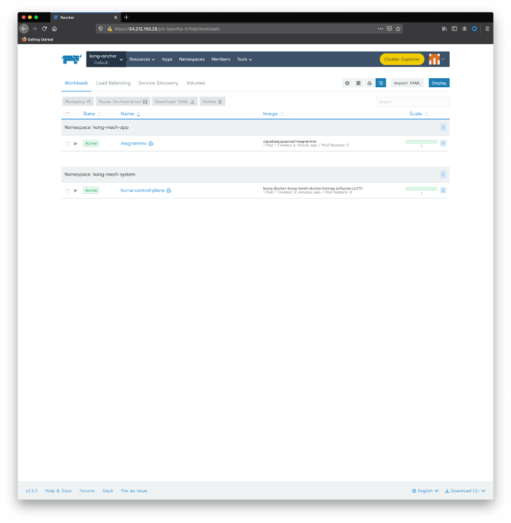

   Click on **magnanimo** to check details of the deployment, including its pods:

   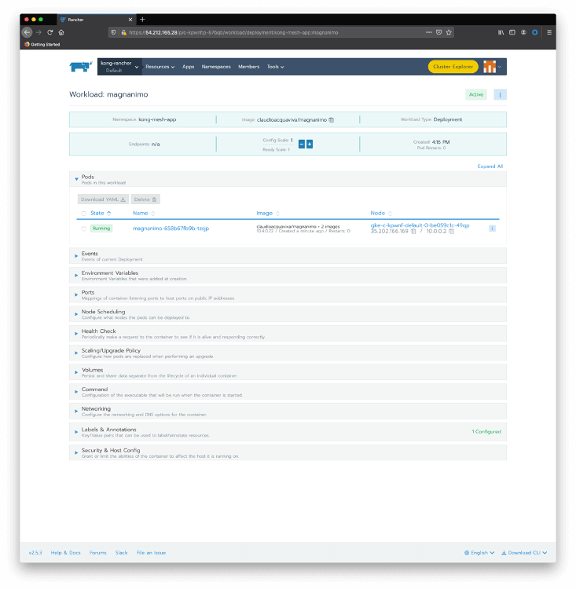

   Click on the **magnanimo** pod to check the containers running inside of it.

   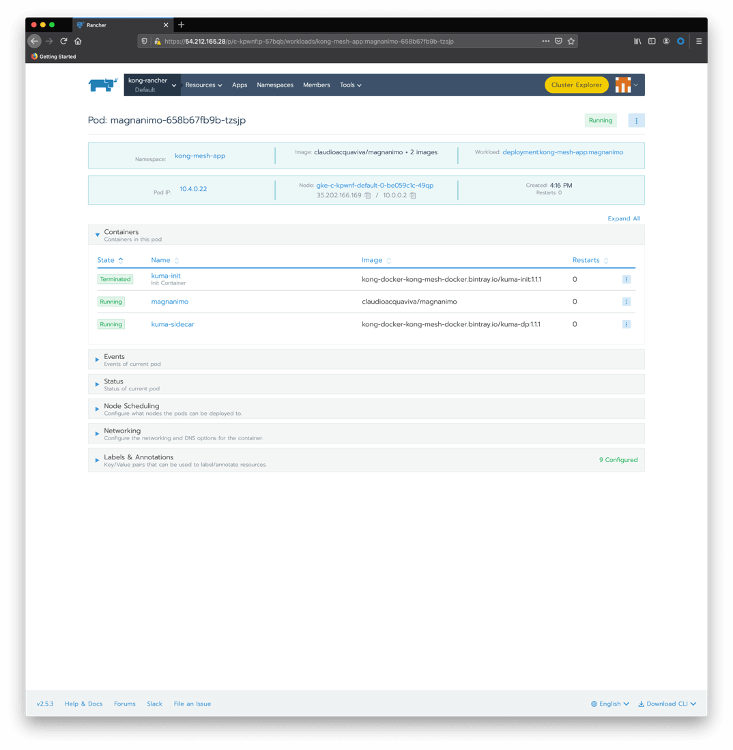

   As we can see, the pod has two running containers:

   - magnanimo: where the microservice is actually running
   - kuma-sidecar: injected during deployment time, playing the Kong Mesh data plane role.

   Similarly, deploy Benigno with its own sidecar:

   ```
   cat <<EOF | kubectl apply -f -

   apiVersion: apps/v1

   kind: Deployment

   metadata:

   name: benigno-v1

   namespace: kong-mesh-app

   spec:

   replicas: 1

   selector:

   matchLabels:

   app: benigno

   template:

   metadata:

   labels:

   app: benigno

   version: v1

   spec:

   containers:

   - name: benigno

   image: claudioacquaviva/benigno

   ports:

   - containerPort: 5000

   ---

   apiVersion: v1

   kind: Service

   metadata:

   name: benigno

   namespace: kong-mesh-app

   labels:

   app: benigno

   spec:

   type: ClusterIP

   ports:

   - port: 5000

   name: http

   selector:

   app: benigno

   EOF

   And finally, deploy Benigno canary release. Notice that the canary release will be abstracted by the same Benigno Kubernetes Service created before:

   cat <<EOF | kubectl apply -f -

   apiVersion: apps/v1

   kind: Deployment

   metadata:

   name: benigno-v2

   namespace: kong-mesh-app

   spec:

   replicas: 1

   selector:

   matchLabels:

   app: benigno

   template:

   metadata:

   labels:

   app: benigno

   version: v2

   spec:

   containers:

   - name: benigno

   image: claudioacquaviva/benigno_rc

   ports:

   - containerPort: 5000

   EOF
   ```

   Check the deployments and pods with:

   ```
   $ kubectl get pod --all-namespaces
   NAMESPACE          NAME                                                      READY   STATUS    RESTARTS   AGE
   cattle-system      cattle-cluster-agent-785fd5f54d-r7x8r                     1/1     Running   0          75m
   fleet-system       fleet-agent-77c78f9c74-f97tv                              1/1     Running   0          75m
   kong-mesh-app      benigno-v1-fd4567d95-drnxq                                2/2     Running   0          110s
   kong-mesh-app      benigno-v2-b977c867b-lpjpw                                2/2     Running   0          30s
   kong-mesh-app      magnanimo-658b67fb9b-tzsjp                                2/2     Running   0          5m3s
   kong-mesh-system   kuma-control-plane-5b9c6f4598-nvq8q                       1/1     Running   0          16m
   kube-system        event-exporter-gke-666b7ffbf7-n9lfl                       2/2     Running   0          76m
   kube-system        fluentbit-gke-xqsdv                                       2/2     Running   0          76m
   kube-system        gke-metrics-agent-gjrqr                                   1/1     Running   0          76m
   kube-system        konnectivity-agent-4c4hf                                  1/1     Running   0          76m
   kube-system        kube-dns-66d6b7c877-tq877                                 4/4     Running   0          76m
   kube-system        kube-dns-autoscaler-5c78d65cd9-5hcxs                      1/1     Running   0          76m
   kube-system        kube-proxy-gke-c-kpwnf-default-0-be059c1c-49qp            1/1     Running   0          76m
   kube-system        l7-default-backend-5b76b455d-v6dvg                        1/1     Running   0          76m
   kube-system        metrics-server-v0.3.6-547dc87f5f-qntjf                    2/2     Running   0          75m
   kube-system        prometheus-to-sd-fdf9j                                    1/1     Running   0          76m
   kube-system        stackdriver-metadata-agent-cluster-level-68d94db6-64n4r   2/2     Running   1          75m

   $ kubectl get service --all-namespaces
   NAMESPACE          NAME                   TYPE        CLUSTER-IP    EXTERNAL-IP   PORT(S)                                                AGE
   default            kubernetes             ClusterIP   10.0.16.1     <none>        443/TCP                                                79m
   kong-mesh-app      benigno                ClusterIP   10.0.20.52    <none>        5000/TCP                                               4m6s
   kong-mesh-app      magnanimo              ClusterIP   10.0.30.251   <none>        4000/TCP                                               7m18s
   kong-mesh-system   kuma-control-plane     ClusterIP   10.0.21.228   <none>        5681/TCP,5682/TCP,443/TCP,5676/TCP,5678/TCP,5653/UDP   18m
   kube-system        default-http-backend   NodePort    10.0.19.10    <none>        80:32296/TCP                                           79m
   kube-system        kube-dns               ClusterIP   10.0.16.10    <none>        53/UDP,53/TCP                                          79m
   kube-system        metrics-server         ClusterIP   10.0.20.174   <none>        443/TCP                                                79m
   ```

   You can use Kong Mesh console to check the microservices and data planes also. On a terminal run:

   ```
   kubectl port-forward service/kuma-control-plane -n kong-mesh-system 5681
   ```

   Redirect your browser to http://localhost:5681/gui. Click on **Skip to Dashboard** and **All Data Plane Proxies** :

   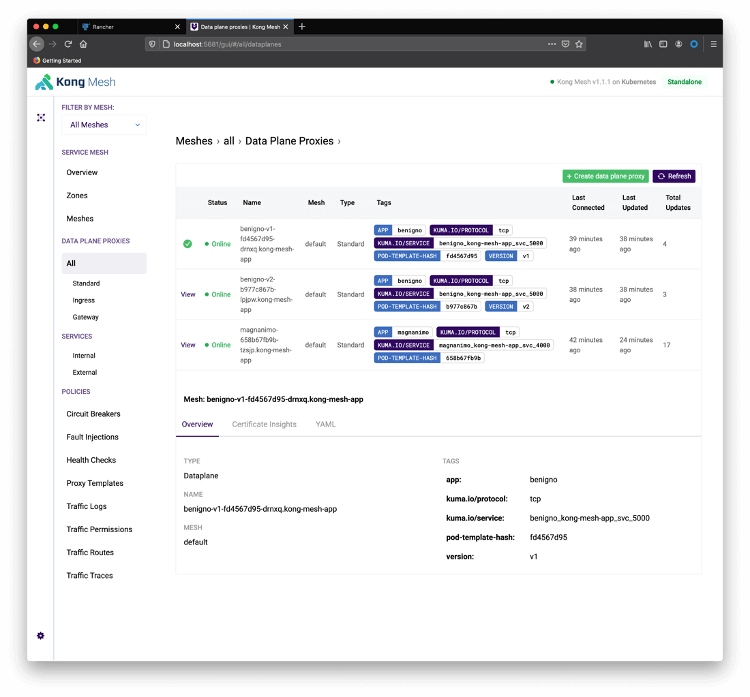

   Start a loop to see the canary release in action. Notice the service has been deployed as ClusterIP type, so you need to expose them directly with “port-forward”. The next step will show how to expose the service with the Ingress Controller.

   On a local terminal run:

   ```
   kubectl port-forward service/magnanimo -n kong-mesh-app 4000
   ```

   Open another terminal and start the loop. The request is going to port 4000 provided by Magnanimo. The path “/hw2” routes the request to Benigno Service, which has two endpoints behind it related to both Benigno releases:

   ```
   while [1]; do curl http://localhost:4000/hw2; echo; done
   ```

   You should see a result similar to this:

   ```
   Hello World, Benigno: 2020-11-20 12:57:05.811667
   Hello World, Benigno: 2020-11-20 12:57:06.304731
   Hello World, Benigno, Canary Release: 2020-11-20 12:57:06.789208
   Hello World, Benigno: 2020-11-20 12:57:07.269674
   Hello World, Benigno, Canary Release: 2020-11-20 12:57:07.755884
   Hello World, Benigno, Canary Release: 2020-11-20 12:57:08.240453
   Hello World, Benigno: 2020-11-20 12:57:08.728465
   Hello World, Benigno: 2020-11-20 12:57:09.208588
   Hello World, Benigno, Canary Release: 2020-11-20 12:57:09.689478
   Hello World, Benigno, Canary Release: 2020-11-20 12:57:10.179551
   Hello World, Benigno: 2020-11-20 12:57:10.662465
   Hello World, Benigno: 2020-11-20 12:57:11.145237
   Hello World, Benigno, Canary Release: 2020-11-20 12:57:11.618557
   Hello World, Benigno: 2020-11-20 12:57:12.108586
   Hello World, Benigno, Canary Release: 2020-11-20 12:57:12.596296
   Hello World, Benigno, Canary Release: 2020-11-20 12:57:13.093329
   Hello World, Benigno: 2020-11-20 12:57:13.593487
   Hello World, Benigno, Canary Release: 2020-11-20 12:57:14.068870
   ```
4. Controlling the Canary Release

   As we can see, the request to both Benigno microservice releases is uses a round-robin policy. That is, we’re not in control of the canary release consumption. Service Mesh allows us to define when and how we want to expose the canary release to our consumers (in our case, the Magnanimo microservice).

   To define a policy to control the traffic going to both releases, use this following declaration. It says that 90 percent of the traffic should go to the current release, while only 10 percent should be redirected to the canary release.

   ```
       cat <<EOF | kubectl apply -f -
       apiVersion: kuma.io/v1alpha1
       kind: TrafficRoute
       mesh: default
       metadata:
       namespace: default
       name: route-1
       spec:
       sources:
       - match:
       kuma.io/service: magnanimo_kong-mesh-app_svc_4000
       destinations:
       - match:
       kuma.io/service: benigno_kong-mesh-app_svc_5000
       conf:
       split:
       - weight: 90
       destination:
       kuma.io/service: benigno_kong-mesh-app_svc_5000
       version: v1
       - weight: 10
       destination:
       kuma.io/service: benigno_kong-mesh-app_svc_5000
       version: v2
       EOF
   ```

   After applying the declaration, you should see a result like this:

   ```
   Hello World, Benigno: 2020-11-20 13:05:02.553389
   Hello World, Benigno: 2020-11-20 13:05:03.041120
   Hello World, Benigno: 2020-11-20 13:05:03.532701
   Hello World, Benigno: 2020-11-20 13:05:04.021804
   Hello World, Benigno: 2020-11-20 13:05:04.515245
   Hello World, Benigno, Canary Release: 2020-11-20 13:05:05.000644
   Hello World, Benigno: 2020-11-20 13:05:05.482606
   Hello World, Benigno: 2020-11-20 13:05:05.963663
   Hello World, Benigno, Canary Release: 2020-11-20 13:05:06.446599
   Hello World, Benigno: 2020-11-20 13:05:06.926737
   Hello World, Benigno: 2020-11-20 13:05:07.410605
   Hello World, Benigno: 2020-11-20 13:05:07.890827
   Hello World, Benigno: 2020-11-20 13:05:08.374686
   Hello World, Benigno: 2020-11-20 13:05:08.857266
   Hello World, Benigno: 2020-11-20 13:05:09.337360
   Hello World, Benigno: 2020-11-20 13:05:09.816912
   Hello World, Benigno: 2020-11-20 13:05:10.301863
   Hello World, Benigno: 2020-11-20 13:05:10.782395
   Hello World, Benigno: 2020-11-20 13:05:11.262624
   Hello World, Benigno: 2020-11-20 13:05:11.743427
   Hello World, Benigno: 2020-11-20 13:05:12.221174
   Hello World, Benigno: 2020-11-20 13:05:12.705731
   Hello World, Benigno: 2020-11-20 13:05:13.196664
   Hello World, Benigno: 2020-11-20 13:05:13.680319
   ```
5. Install Kong for Kubernetes

   Let’s go back to Rancher to install our Kong for Kubernetes Ingress Controller and control the service mesh exposition. In the Rancher Catalog page, click the **Kong** icon. Accept the default values and click **Launch** :

   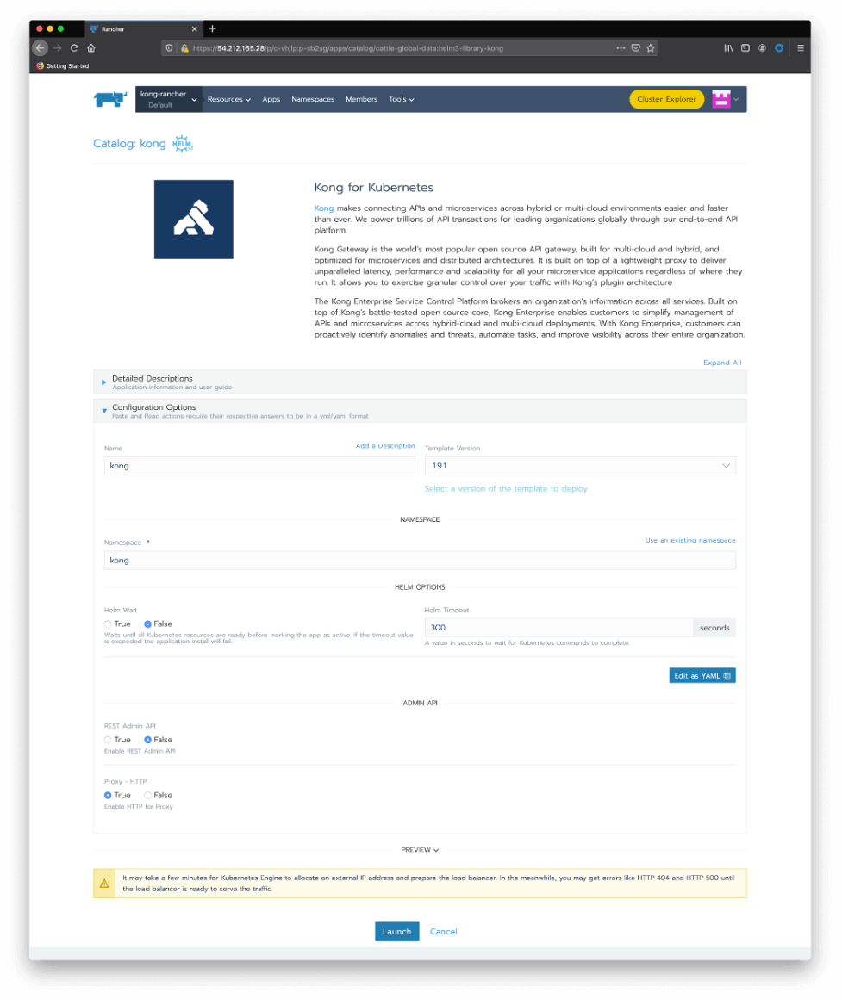

   You should see both applications, Kong and Kong Mesh, deployed:

   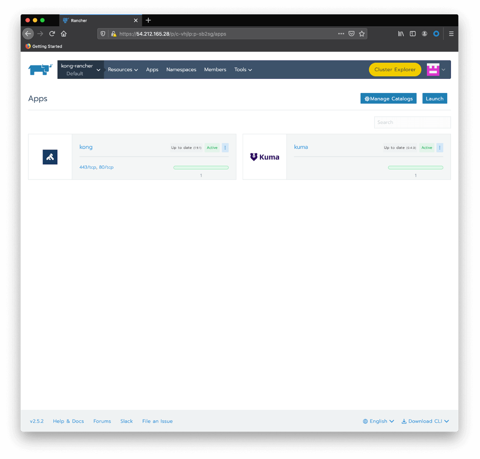

   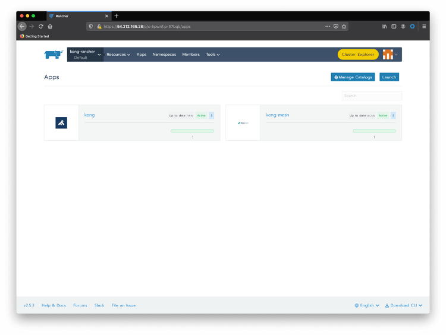

   Again, check the installation with kubectl:

   ```
   $ kubectl get pod --all-namespaces
   NAMESPACE          NAME                                                      READY   STATUS    RESTARTS   AGE
   cattle-system      cattle-cluster-agent-785fd5f54d-r7x8r                     1/1     Running   0          84m
   fleet-system       fleet-agent-77c78f9c74-f97tv                              1/1     Running   0          83m
   kong-mesh-app      benigno-v1-fd4567d95-drnxq                                2/2     Running   0          10m
   kong-mesh-app      benigno-v2-b977c867b-lpjpw                                2/2     Running   0          8m47s
   kong-mesh-app      magnanimo-658b67fb9b-tzsjp                                2/2     Running   0          13m
   kong-mesh-system   kuma-control-plane-5b9c6f4598-nvq8q                       1/1     Running   0          24m
   kong               kong-kong-754cd6947-db2j9                                 2/2     Running   1          72s
   kube-system        event-exporter-gke-666b7ffbf7-n9lfl                       2/2     Running   0          85m
   kube-system        fluentbit-gke-xqsdv                                       2/2     Running   0          84m
   kube-system        gke-metrics-agent-gjrqr                                   1/1     Running   0          84m
   kube-system        konnectivity-agent-4c4hf                                  1/1     Running   0          84m
   kube-system        kube-dns-66d6b7c877-tq877                                 4/4     Running   0          84m
   kube-system        kube-dns-autoscaler-5c78d65cd9-5hcxs                      1/1     Running   0          84m
   kube-system        kube-proxy-gke-c-kpwnf-default-0-be059c1c-49qp            1/1     Running   0          84m
   kube-system        l7-default-backend-5b76b455d-v6dvg                        1/1     Running   0          85m
   kube-system        metrics-server-v0.3.6-547dc87f5f-qntjf                    2/2     Running   0          84m
   kube-system        prometheus-to-sd-fdf9j                                    1/1     Running   0          84m
   kube-system        stackdriver-metadata-agent-cluster-level-68d94db6-64n4r   2/2     Running   1          84m

   $ kubectl get service --all-namespaces
   NAMESPACE          NAME                   TYPE           CLUSTER-IP    EXTERNAL-IP     PORT(S)                                                AGE
   default            kubernetes             ClusterIP      10.0.16.1     <none>          443/TCP                                                85m
   kong-mesh-app      benigno                ClusterIP      10.0.20.52    <none>          5000/TCP                                               10m
   kong-mesh-app      magnanimo              ClusterIP      10.0.30.251   <none>          4000/TCP                                               13m
   kong-mesh-system   kuma-control-plane     ClusterIP      10.0.21.228   <none>          5681/TCP,5682/TCP,443/TCP,5676/TCP,5678/TCP,5653/UDP   24m
   kong               kong-kong-proxy        LoadBalancer   10.0.26.38    35.222.91.194   80:31867/TCP,443:31039/TCP                             78s
   kube-system        default-http-backend   NodePort       10.0.19.10    <none>          80:32296/TCP                                           85m
   kube-system        kube-dns               ClusterIP      10.0.16.10    <none>          53/UDP,53/TCP                                          85m
   kube-system        metrics-server         ClusterIP      10.0.20.174   <none>          443/TCP                                                85m
   ```
6. Ingress Creation

   With the following declaration, we’re going to expose Magnanimo microservice through an Ingress and its route “/route1”.

   ```
       cat <<EOF | kubectl apply -f -
       apiVersion: extensions/v1beta1
       kind: Ingress
       metadata:
       name: route1
       namespace: kong-mesh-app
       annotations:
       konghq.com/strip-path: "true"
       spec:
       rules:
       - http:
       paths:
       - path: /route1
       backend:
       serviceName: magnanimo
       servicePort: 4000
       EOF
   ```

   Now the temporary “port-forward” exposure mechanism can be replaced by a formal Ingress. And our loop can start consuming the Ingress with similar results:

   ```
   while [1]; do curl http://35.222.91.194/route1/hw2; echo; done
   ```

## Join the Master Class

Rancher and Kong are excited to present a Master Class that will explore API management combined with universal Service Meshes and how they support hybrid and multi-cloud deployments. By combining Rancher with a service connectivity platform, composed of an API Gateway and a Service Mesh infrastructure, we’ll demonstrate how companies can provision, monitor, manage and protect distributed microservice and deployments across multiple Kubernetes Clusters.

The Master Class will explore some of these questions:

- Why is the Service Mesh architecture pattern important?
- Why is implementing Service Mesh in Kubernetes even more important?
- What can an API gateway and Rancher do for you?
Join the Master Class: Using Hybrid and Multi-Cloud Service Mesh Based Applications for Highly Distributed Environment Deployments[Join the Master Class on Jan. 12](https://info.rancher.com/kubernetes-master-class-jan12-2020-kong)
