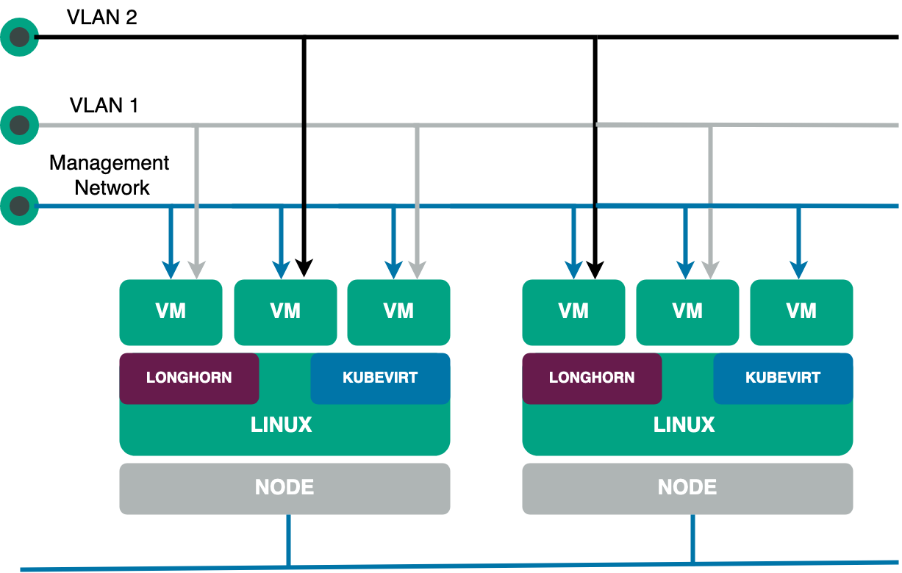

Companies face multiple challenges when migrating their applications and services to the cloud, and one of them is infrastructure management.

The ideal scenario would be that all workloads could be containerized. In that case, the organization could use a [Kubernetes](https://kubernetes.io/)-based service, like Amazon Web Services (AWS), Google Cloud or Azure, to deploy and manage applications, services and storage in a cloud native environment.

Unfortunately, this scenario isn't always possible. Some legacy applications are either very difficult or very expensive to migrate to a microservices architecture, so running them on virtual machines (VMs) is often the best solution.

Considering the current trend of adopting multicloud and hybrid environments, managing additional infrastructure just for VMs is not optimal. This is where a hyperconverged infrastructure (HCI) can help. Simply put, HCI enables organizations to quickly deploy, manage and scale their workloads by virtualizing all the components that make up the on-premises infrastructure.

That being said, not all HCI solutions are created equal. In this article, you'll learn more about what an HCI is and then explore [Harvester](https://markdownlivepreview.com/%E2%80%8B%E2%80%8Bhttps://harvesterhci.io), an enterprise-grade HCI software that offers you unique flexibility and convenience when managing your infrastructure.

## What is HCI?

Hyperconverged infrastructure (HCI) is a type of data center infrastructure that virtualizes computing, storage and networking elements in a single system through a hypervisor.

Since virtualized abstractions managed by a hypervisor replaces all physical hardware components (computing, storage and networking), an HCI offers benefits, including the following:

- Easier configuration, deployment and management of workloads.
- Convenience since software-defined data centers (SDDCs) can also be easily deployed.
- Greater scalability with the integration of more nodes to the HCI.
- Tight integration of virtualized components, resulting in fewer inefficiencies and lower [total cost of ownership (TCO)](https://www.gartner.com/en/information-technology/glossary/total-cost-of-ownership-tco).

However, the ease of management and the lower TCO of an HCI approach come with some drawbacks, including the following:

- Risk of vendor lock-in when using closed-source HCI platforms.
- Most [HCI solutions](https://www.suse.com/c/the-complete-hyperconverged-infrastructure-solutions-guide/) force all resources to be increased in order to increase any single resource. That is, new nodes add more computing, storage and networking resources to the infrastructure.
- You can't combine HCI nodes from different vendors, which aggravates the risk of vendor lock-in described previously.

Now that you know what HCI is, it's time to learn more about Harvester and how it can alleviate the limitations of HCI.

## What is Harvester?

According to the [Harvester website](https://harvesterhci.io/), "Harvester is a modern hyperconverged infrastructure (HCI) solution built for bare metal servers using enterprise-grade open-source technologies including Kubernetes, KubeVirt and Longhorn." Harvester is an ideal solution for those seeking a Cloud native HCI offering — one that is both cost-effective and able to place VM workloads on the edge, driving IoT integration into cloud infrastructure.

Because Harvester is open source, this automatically means you don't have to worry about vendor lock-in. Furthermore, since it's built on top of Kubernetes, Harvester offers incredible scalability, flexibility and reliability.

Additionally, Harvester provides a comprehensive set of features and capabilities that make it the ideal solution for deploying and managing enterprise applications and services. Among these characteristics, the following stand out:

- Built on top of Kubernetes.
- Full VM lifecycle management, thanks to [KubeVirt](https://kubevirt.io/).
- Support for VM cloud-init templates.
- VM live migration support.
- VM backup, snapshot and restore capabilities.
- Distributed block storage and storage tiering, thanks to [Longhorn](https://www.suse.com/products/longhorn/).
- Powerful monitoring and logging since Harvester uses [Grafana](https://grafana.com/) and [Prometheus](https://prometheus.io/) as its observability backend.
- [Seamless integration with Rancher](https://ranchermanager.docs.rancher.com/integrations-in-rancher/harvester), facilitating multicluster deployments as well as deploying and managing VMs and Kubernetes workloads from a centralized dashboard.



Now that you know about some of Harvester's basic features, let's take a more in-depth look at some of the more prominent features.

## How Rancher and Harvester can help with Kubernetes deployments on HCI

Managing multicluster and hybrid-cloud environments can be intimidating when you consider how complex it can be to monitor infrastructure, manage user permissions and avoid vendor lock-in, just to name a few challenges. In the following sections, you'll see how Harvester, or more specifically, the synergy between Harvester and [Rancher](https://www.rancher.com/), can make life easier for ITOps and DevOps teams.

### Straightforward installation

There is no one-size-fits-all approach to deploying an HCI solution. Some vendors sacrifice features in favor of ease of installation, while others require a complex installation process that includes setting up each HCI layer separately.

However, with Harvester, this is not the case. From the beginning, Harvester was built with ease of installation in mind without making any compromises in terms of scalability, reliability, features or manageability.

To do this, Harvester treats each node as an HCI appliance. This means that when you install Harvester on a bare-metal server, behind the scenes, what actually happens is that a [simplified version of SLE Linux](https://github.com/rancher/elemental-toolkit) is installed, on top of which Kubernetes, KubeVirt, Longhorn, [Multus](https://github.com/k8snetworkplumbingwg/multus-cni) and the other components that make up Harvester are installed and configured with minimal effort on your part. In fact, the manual installation process is no different from that of a modern Linux distribution, save for a few notable exceptions:

- **Installation mode:** Early on in the installation process, you will need to choose between creating a new cluster (in which case the current node becomes the management node) or joining an existing Harvester cluster. This makes sense since you're actually setting up a Kubernetes cluster.
- **Virtual IP:** During the installation, you will also need to set an IP address from which you can access the main node of the cluster (or join other nodes to the cluster).
- **Cluster token:** Finally, you should choose a `cluster token` that will be used to add new nodes to the cluster.

When it comes to installation media, you have two options for deploying Harvester:

- **ISO installation:** This consists of [downloading the latest Harvester ISO image](https://github.com/harvester/harvester/releases) and then installing it manually on a bare-metal server. The documentation includes a [complete walkthrough of the Harvester installation](https://docs.harvesterhci.io/v1.1/install/iso-install) that includes a video showing the step-by-step process.
- **PXE boot installation:** This is the ideal option to install Harvester automatically using iPXE boot scripts. To learn more about the PXE installation procedure and prerequisites, check out [this documentation](https://docs.harvesterhci.io/v1.1/install/pxe-boot-install/).

It should be noted that, regardless of the deployment method, you can use a [Harvester configuration](https://docs.harvesterhci.io/v1.1/install/harvester-configuration/) file to provide various settings. This makes it even easier to automate the installation process and enforce the infrastructure as code (IaC) philosophy, which you'll learn more about later on.

For your reference, the following is what a typical configuration file looks like (taken from the official documentation):

```
scheme_version: 1
server_url: https://cluster-VIP:443
token: TOKEN_VALUE
os:
  ssh_authorized_keys:
    - ssh-rsa AAAAB3NzaC1yc2EAAAADAQAB...
    - github:username
  write_files:
  - encoding: ""
    content: test content
    owner: root
    path: /etc/test.txt
    permissions: '0755'
  hostname: myhost
  modules:
    - kvm
    - nvme
  sysctls:
    kernel.printk: "4 4 1 7"
    kernel.kptr_restrict: "1"
  dns_nameservers:
    - 8.8.8.8
    - 1.1.1.1
  ntp_servers:
    - 0.suse.pool.ntp.org
    - 1.suse.pool.ntp.org
  password: rancher
  environment:
    http_proxy: http://myserver
    https_proxy: http://myserver
  labels:
    topology.kubernetes.io/zone: zone1
    foo: bar
    mylabel: myvalue
install:
  mode: create
  management_interface:
    interfaces:
    - name: ens5
      hwAddr: "B8:CA:3A:6A:64:7C"
    method: dhcp
  force_efi: true
  device: /dev/vda
  silent: true
  iso_url: http://myserver/test.iso
  poweroff: true
  no_format: true
  debug: true
  tty: ttyS0
  vip: 10.10.0.19
  vip_hw_addr: 52:54:00:ec:0e:0b
  vip_mode: dhcp
  force_mbr: false
system_settings:
  auto-disk-provision-paths: ""
```

All in all, Harvester offers a straightforward installation on bare-metal servers. What's more, out of the box, Harvester offers powerful capabilities, including a convenient host management dashboard (more on that later).

### Host management

Nodes, or hosts, as they are called in Harvester, are the heart of any HCI infrastructure. As discussed, each host provides the computing, storage and networking resources used by the HCI cluster. In this sense, Harvester provides a modern UI that gives your team a quick overview of each host's status, name, IP address, CPU usage, memory, disks and more. Additionally, your team can perform all kinds of routine operations intuitively just by right-clicking on each host's hamburger menu:

- **Node maintenance:** This is handy when your team needs to remove a node from the cluster for a long time for maintenance or replacement. Once the node enters the maintenance node, all VMs are automatically distributed across the rest of the active nodes. This eliminates the need to live migrate VMs separately.
- **Cordoning a node:** When you cordon a node, it's marked as "unschedulable," which is useful for quick tasks like reboots and OS upgrades.
- **Deleting a node:** This permanently removes the node from the cluster.
- **Multi-disk management:** This allows adding additional disks to a node as well as assigning storage tags. The latter is useful to allow only certain nodes or disks to be used for storing Longhorn volume data.
- **KSMtuned mode management:** In addition to the features described earlier, Harvester allows your team to tune the use of [kernel same-page merging (KSM)](https://en.wikipedia.org/wiki/Kernel_same-page_merging) as it deploys the KSM Tuning Service `ksmtuned` on each node as a DaemonSet.

To learn more on how to manage the run strategy and threshold coefficient of `ksmtuned`, as well as more details on the other host management features described, check out [this documentation](https://docs.harvesterhci.io/v1.1/host/).

As you can see, managing nodes through the Harvester UI is really simple. However, your ops team will spend most of their time managing VMs, which you'll learn more about next.

### VM management

Harvester was designed with great emphasis on simplifying the management of VMs' lifecycles. Thanks to this, IT teams can save valuable time when deploying, accessing and monitoring VMs. Following are some of the main features that your team can access from the Harvester **Virtual Machines** page.

#### Harvester basic VM management features

As you would expect, the Harvester UI facilitates basic operations, such as [creating a VM](https://docs.harvesterhci.io/v1.1/vm/create-vm) (including [creating Windows VMs](https://docs.harvesterhci.io/v1.1/vm/create-windows-vm/)), [editing VMs](https://docs.harvesterhci.io/v1.1/vm/edit-vm/) and [accessing VMs](https://docs.harvesterhci.io/v1.1/vm/access-to-the-vm/). It's worth noting that in addition to the usual configuration parameters, such as VM name, disks, networks, CPU and memory, Harvester introduces the concept of the namespace. As you might guess, this additional level of abstraction is made possible by Harvester running on top of Kubernetes. In practical terms, this allows your Ops team to create isolated virtual environments (for example, development and production), which facilitate resource management and security.

Furthermore, Harvester also supports injecting custom cloud-init startup scripts into a VM, which speeds up the deployment of multiple VMs.

#### Harvester advanced VM management features

Today, any virtualization tool allows the basic management of VMs. In that sense, where enterprise-grade platforms like Harvester stand out from the rest is in their advanced features. These include [performing VM backup, snapshot and restore](https://docs.harvesterhci.io/v1.1/vm/backup-restore); [doing VM live migration](https://docs.harvesterhci.io/v1.1/vm/live-migration/); [adding hot-plug volumes](https://docs.harvesterhci.io/v1.1/vm/hotplug-volume/) to running VMs; [cloning VMs with volume data](https://docs.harvesterhci.io/v1.1/vm/clone-vm/); and [overcommitting CPU, memory and storage](https://docs.harvesterhci.io/v1.1/vm/resource-overcommit/).

While all these features are important, Harvester's ability to ensure the high availability (HA) of VMs is hands down the most crucial to any modern data center. This feature is available on Harvester clusters with three or more nodes and allows your team to migrate live VMs from one node to another when necessary.

Furthermore, not only is live VM migration useful for maintaining HA, but it is also a handy feature when performing node maintenance when a hardware failure occurs or your team detects a performance drop on one or more nodes. Regarding the latter, performance monitoring, Harvester provides out-of-the-box integration with Grafana and Prometheus.

### Built-in monitoring

Prometheus and Grafana are two of the most popular open source observability tools today. They're highly customizable, powerful and easy to use, making them ideal for monitoring key VMs and host metrics.

Grafana is a data-focused visualization tool that makes it easy to monitor your VM's performance and health. It can provide near real-time performance metrics, such as CPU and memory usage and disk I/O. It also offers comprehensive dashboards and alerts that are highly configurable. This allows you to customize Grafana to your specific needs and create useful visualizations that can help you quickly identify issues.

Meanwhile, Prometheus is a monitoring and alerting toolkit designed for large-scale, distributed systems. It collects time series data from your VMs and hosts, allowing you to quickly and accurately track different performance metrics. Prometheus also provides alerts when certain conditions have been met, such as when a VM is running low on memory or disk space.

All in all, using Grafana and Prometheus together provide your team with comprehensive observability capabilities by means of detailed graphs and dashboards that can help them to identify why an issue is occurring. This can help you take corrective action more quickly and reduce the impact of any potential issues.

### Infrastructure as Code

Infrastructure as code (IaC) has become increasingly important in many organizations because it allows for the automation of IT infrastructure, making it easier to manage and scale. By defining IT infrastructure as code, organizations can manage their VMs, disks and networks more efficiently while also making sure that their infrastructure remains in compliance with the organization's policies.

With Harvester, users can define their VMs, disks and networks in YAML format, making it easier to manage and version control virtual infrastructure. Furthermore, thanks to the [Harvester Terraform provider](https://registry.terraform.io/providers/harvester/harvester/latest), DevOps teams can also deploy entire HCI clusters from scratch using IaC best practices.

This allows users to define the infrastructure declaratively, allowing operations teams to work with developer tools and methodologies, helping them become more agile and effective. In turn, this saves time and cost and also enables DevOps teams to deploy new environments or make changes to existing ones more efficiently.

Finally, since Harvester enforces IaC principles, organizations can make sure that their infrastructure remains compliant with security, regulatory and governance policies.

### Rancher integration

Up to this point, you've learned about key aspects of Harvester, such as its ease of installation, its intuitive UI, its powerful built-in monitoring capabilities and its convenient automation, thanks to IaC support. However, the feature that takes Harvester to the next level is its integration with Rancher, the leading container management tool.

Harvester integration with Rancher allows DevOps teams to manage VMs and Kubernetes workloads from a single control panel. Simply put, Rancher integration enables your organization to combine conventional and Cloud native infrastructure use cases, making it easier to deploy and manage multi-cloud and hybrid environments.

Furthermore, Harvester's tight integration with Rancher allows your organization to streamline user and system management, allowing for more efficient infrastructure operations. Additionally, [user access control](https://ranchermanager.docs.rancher.com/pages-for-subheaders/manage-role-based-access-control-rbac) can be centralized in order to ensure that the system and its components are protected.

Rancher integration also allows for faster deployment times for applications and services, as well as more efficient [monitoring and logging](https://ranchermanager.docs.rancher.com/pages-for-subheaders/monitoring-alerting-guides) of system activities from a single control plane. This allows DevOps teams to quickly identify and address issues related to system performance, as well as easily detect any security risks.

Overall, Harvester integration with Rancher provides DevOps teams with a comprehensive, centralized system for managing both VMs and containerized workloads. In addition, this approach provides teams with improved convenience, observability and security, making it an ideal solution for DevOps teams looking to optimize their infrastructure operations.

## Conclusion

One of the biggest challenges facing companies today is migrating their applications and services to the cloud. In this article, you've learned how you can manage Kubernetes and VM-based environments with the aid of Harvester and Rancher, thus facilitating your application modernization journey from monolithic apps to microservices.

Both Rancher and Harvester are part of the rich [SUSE](https://www.suse.com/) ecosystem that helps your business deploy multi-cloud and hybrid-cloud environments easily across any infrastructure. Harvester is an open source HCI solution. [Try it for free](https://harvesterhci.io/) today.
