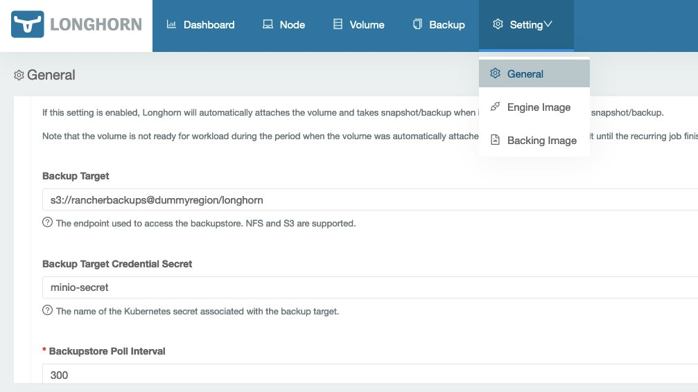
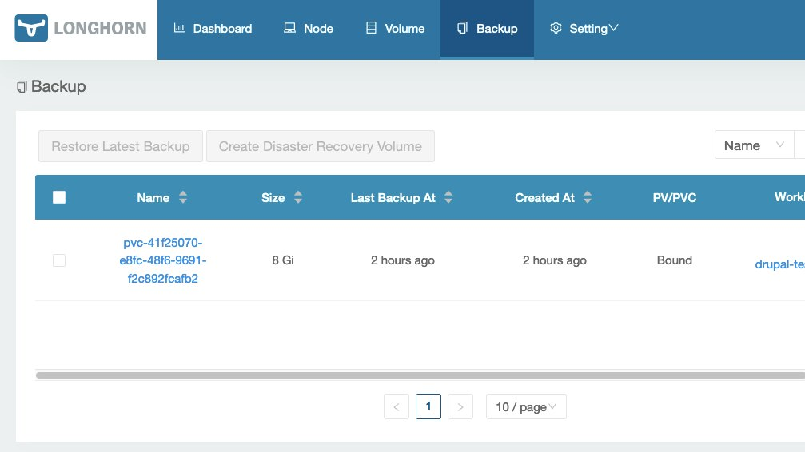
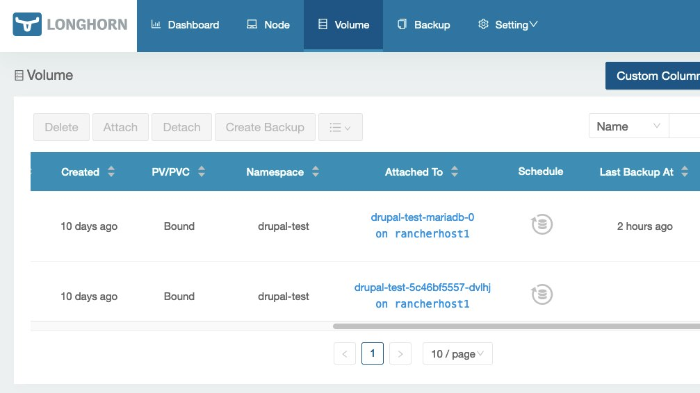

[Longhorn](https://longhorn.io/) is an open source rock solid container native storage solution created by [Rancher](https://rancher.com/) and donated to the [CNCF](https://www.cncf.io/sandbox-projects/). One of its key features is the full support for volume backups as it implements the CSI volume snapshot API. Longhorn includes native support to use S3 or NFS external storage systems as backup targets.

The backup functionality is not limited to S3/NFS. Third-party backup tools that can access the Kubernetes API and manage volume snapshots can be easily integrated with Longhorn for a failure-prof storage architecture, but we'll just focus here on the functionality bundled in Longhorn.

We'll not cover how to install MinIO and Longhorn (links to the install guides are available in the Resources section) to concentrate on properly configuring [MinIO](https://min.io/) to be used as the backup target using the S3 protocol.

The environment used for the deployment:

- MinIO version RELEASE.2021-08-17T20-53-08Z deployed as a container launched with Podman on a dedicated SUSE SLES 15 SP2 virtual machine
- Longhorn 1.1.1 deployed using Rancher's Application Catalog on an RKE cluster with Kubernetes version 1.20.9-rancher1-1

We'll create a dedicated user and bucket for those backups using [MinIO's command line tool "mc".](https://github.com/minio/mc)

Let's start configuring the mc alias needed to access our Minio installation located on [https://miniolab.rancher.one](https://miniolab.rancher.one/), and then we'll create all the required objects: bucket, folder, user and access policy.

```
#mc alias for Minio Root user
mc alias set myminio https://miniolab.rancher.one miniorootuser miniorootuserpassword

#Bucket and folder
mc mb myminio/rancherbackups
mc mb myminio/rancherbackups/longhorn
```

The final step on the Minio side is to create the user that we will use to access that bucket and also define the proper permissions, so the access is limited only to that bucket end the objects contained in it.

```
mc admin user add myminio rancherbackupsuser mypassword

cat > /tmp/rancher-backups-policy.json <<EOF
{
  "Version": "2012-10-17",
      "Statement": [
    {
      "Action": [
        "s3:PutBucketPolicy",
        "s3:GetBucketPolicy",
        "s3:DeleteBucketPolicy",
        "s3:ListAllMyBuckets",
        "s3:ListBucket"
      ],
      "Effect": "Allow",
      "Resource": [
        "arn:aws:s3:::rancherbackups"
      ],
      "Sid": ""
    },
    {
      "Action": [
        "s3:AbortMultipartUpload",
        "s3:DeleteObject",
        "s3:GetObject",
        "s3:ListMultipartUploadParts",
        "s3:PutObject"
      ],
      "Effect": "Allow",
      "Resource": [
        "arn:aws:s3:::rancherbackups/*"
      ],
      "Sid": ""
    }
  ]
}
EOF

mc admin policy add myminio rancher-backups-policy /tmp/rancher-backups-policy.json

mc admin policy set myminio rancher-backups-policy user=rancherbackupsuser
```

Now we are ready to configure Longhorn's backup target.

First, we must create the secret that will hold the credentials and endpoint to access our MinIO environment. The secret will be created in the **longhorn-system** namespace.

We'll use an Opaque secret, so we need to convert first all the values to base64.

```
echo -n https://miniolab.rancher.one:443 | base64
# aHR0cHM6Ly9taW5pb2xhYi5yYW5jaGVyLm9uZTo0NDM=
echo -n rancherbackupsuser | base64
# cmFuY2hlcmJhY2t1cHN1c2Vy
echo -n mypassword | base64
# bXlwYXNzd29yZA==
```

In our case, the MinIO endpoint used a well know SSL certificate created by Let's Encrypt. If you are using a certificate with a custom CA you should also encode your custom CA certificate and add it to the AWS\_CERT variable.

```
apiVersion: v1
kind: Secret
metadata:
  name: minio-secret
  namespace: longhorn-system
type: Opaque
data:
  AWS_ACCESS_KEY_ID: cmFuY2hlcmJhY2t1cHN1c2Vy
  AWS_SECRET_ACCESS_KEY: bXlwYXNzd29yZA==
  AWS_ENDPOINTS: aHR0cHM6Ly9taW5pb2xhYi5yYW5jaGVyLm9uZTo0NDM=
  #AWS_CERT: your base64 encoded custom CA certificate goes here
```

Now we need to build our backup target endpoint URL that should follow this format: "s3://bucket\_name@region/folder". In our MinIO test environment, we don't use regions, but we must include something; otherwise, the URL parser will fail. It should be enough to enter a dummy text as a region. Based on that format, the backup target URL will be:
> *s3://**rancherbackups**@dummyregion/**longhorn***

Once we have the backup target URL and the backup target secret can go to Longhorn's web interface and configure the backup options:



Now the backup option will be enabled for our volumes.

We'll be able to manage our backups using the UI:



And we can check the backup status and define schedules for all our volumes in the Volume menu:



If there's any error in the configuration, it will be shown in the UI. The most common errors that can happen are:

- Not properly base64 encoded values in the secret (remember to always use echo -n to avoid adding carriage returns to the encoded value)
- Not properly built Target URL
- Issues at MinIO server: incorrect bucket, missing permissions in policies, .... Those can be debugged trying to uploads files to the bucket/folder either using MinIO's web console or a s3 compatible command line tool like **mc**
- I used Nginx as a reverse proxy in front of MinIO to handle the SSL termination in my environment. This means that you should properly configure the **client\_max\_body\_size directive** directive as, otherwise, you may have issues uploading big files as the default value is quite small (1 MiB)

## **Resources**

[MinIO Quickstart Guide](https://docs.min.io/docs/minio-quickstart-guide.html)

[Longhorn Installation](https://longhorn.io/docs/1.1.2/deploy/install/)
