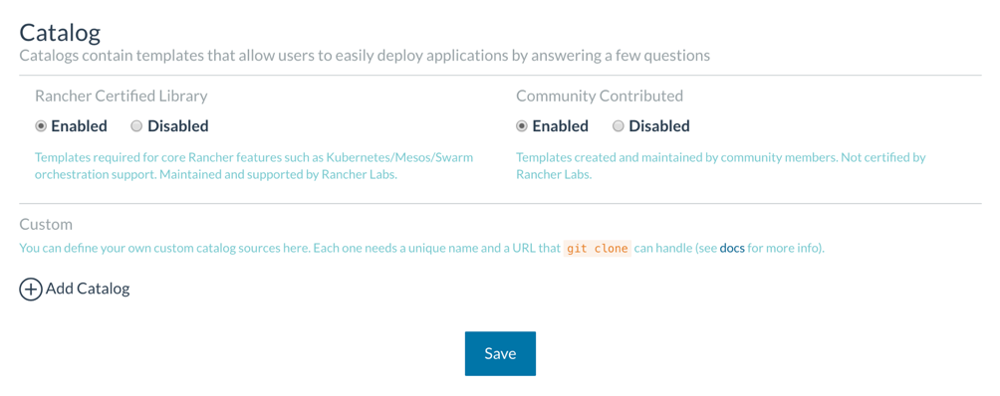
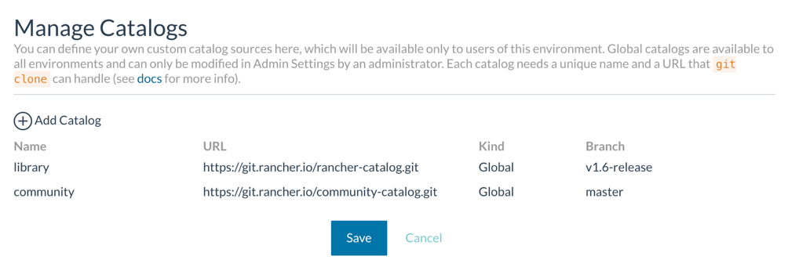
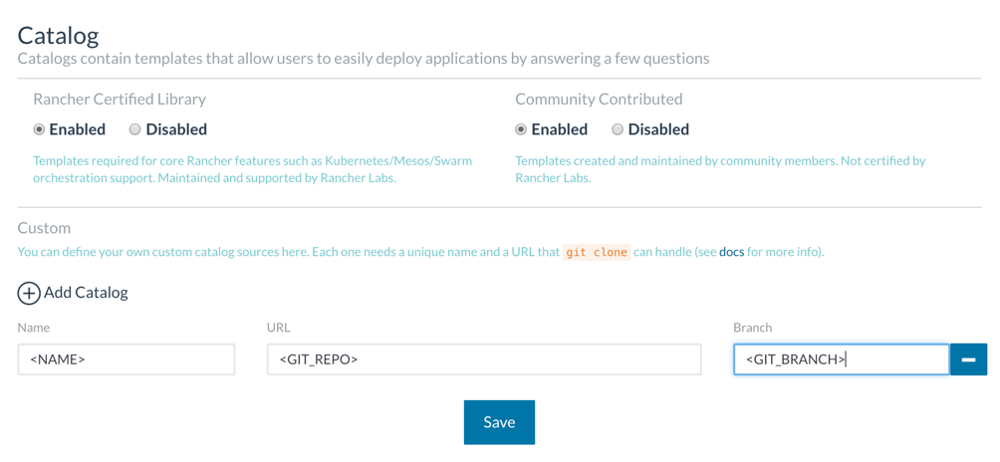
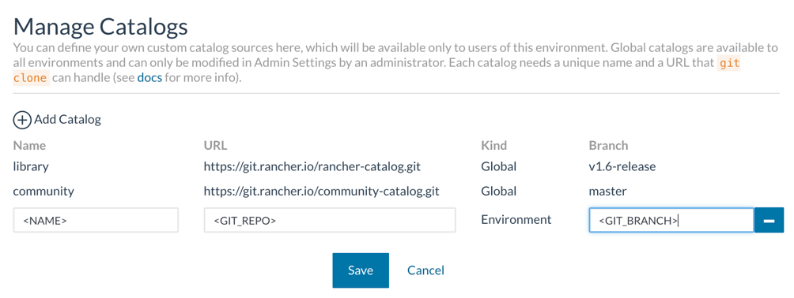
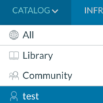

If you use Rancher 1.6, you probably already know about Rancher Catalog,
which lets your Rancher system users create and share application
templates without the need for any technical knowledge about the
applications. In this tutorial, you’ll learn how to:

- Create productive and reproducible private catalog templates
- Provide templates in a self-service portal
- Share services between distinct development teams
- Manage versions and updates of your services
- Offer your private templates to all Rancher users and customers

## Catalog Repositories

You can configure Rancher Catalog with different catalog repositories
(repos) to get distinct templates. A catalog repo is just a Git repo
with a specific structure. By default, Rancher Catalog includes
templates for two public catalog repos:

- **[Rancher Certified
  Library](https://github.com/rancher/rancher-catalog)** — This repo
  provides templates for core and infrastructure services. It’s
  maintained and certified by Rancher Labs.
- **[Community
  Catalog](https://github.com/rancher/community-catalog)** — This
  repo provides templates for any application. Templates are created
  and maintained by the Rancher Community, not certified by Rancher
  Labs.

 Rancher enables
these catalogs by default, but the admin can disable them on the **Admin
> Settings** page.

## Private Repos

One of the coolest features inside Rancher Catalog is the ability to
generate and add your own catalog repos to your Rancher system.

### Why use private repos?

This feature is especially useful when you want to:

- Make your own developed services deployment productive and
  repeatable
- Publish your own developed services for your users to consume
- Manage the life cycle and control the updates of your deployed
  services
- Share released services between distinct development teams

## Kinds of Catalog Repos

There are two different kinds of Rancher Catalog repos:

- **Global** — This kind of catalog repo is available to all Rancher
  environments. To manage global catalogs, go to the **Admin >
  Settings** page.
  
- **Environment** — This kind is available only to the current
  Rancher environment. To manage environment catalogs, click
  **Catalog > Manage**.
  

## Creating a Private Catalog Repo

As a basic example, let’s suppose you already have your
`docker-compose` and `rancher-compose` files. For example:

- `docker-compose.yml`

  ```
  version: '2'
  services:
    test:
      image: rawmind/web-test
      tty: true
      labels:
        io.rancher.container.hostname_override: container_name
        io.rancher.scheduler.affinity:container_label_ne: io.rancher.stack_service.name=$${stack_name}/$${service_name}
    lb:
      image: rancher/lb-service-haproxy:v0.7.6
      ports:
      - 8080:8080/tcp
      labels:
        io.rancher.container.agent.role: environmentAdmin
        io.rancher.container.create_agent: 'true'
  ```
- `rancher-compose.yml`

  ```
  version: '2'
  services:
    test:
      scale: 2
      retain_ip: true
      start_on_create: true
      health_check:
        healthy_threshold: 2
        response_timeout: 2000
        port: 8080
        unhealthy_threshold: 3
        initializing_timeout: 60000
        interval: 2000
        strategy: recreate
        request_line: GET "/" "HTTP/1.0"
    lb:
      scale: 1
      start_on_create: true
      lb_config:
        certs: []
        port_rules:
        - hostname: ''
          priority: 1
          protocol: http
          service: test
          source_port: 8080
          target_port: 8080
      health_check:
        healthy_threshold: 2
        response_timeout: 2000
        port: 42
        unhealthy_threshold: 3
        initializing_timeout: 60000
        interval: 2000
        reinitializing_timeout: 60000
  ```

### To Create a Private Catalog Repo

1. Initialize an empty Git repo.
2. Create a basic directory structure that consists of different
   folders for each package type:
   - **templates** — A folder for adding Cattle template packages
   - **swarm-templates** — A folder for adding Swarm template
     packages
   - **mesos-templates** — A folder for adding Mesos template
     packages
   - **machine-templates** — A folder for adding machine-driver
     template packages
   - **infra-templates** — A folder for adding infrastructure
     services template packages
   - **README.md** — A file for describing your catalog repo
3. Create a package structure inside each folder type:

   1. Create a folder with the package name, such as *myservice*,
      where you’ll save files.
   2. Create a `config.yml` file to describe the package:

      ```
      name: # The name of the Catalog entry
      description: |
        # A description of the Catalog entry
      version: #The default version of the package to use (must match any folder in the rancher-compose version)
      category: # The category to use when searching for Catalog entries
      maintainer: # The maintainer of the Catalog entry
      license: # The license
      projectURL: # The URL related to the Catalog entry
      ```
   3. To display an icon for the Catalog entry, create an image file
      prefixed with “catalogIcon-,” such as
      *catalogIcon-myservice.svg*. The preferred image format is SVG,
      but PNG and JPG are allowed.
   4. Create a folder for every package version. The package name has
      to be a number. Use “0” for the first version, “1” for the
      second version, and so on. Inside every version folder, you need
      to add these files:

      - **docker-compose.yml** — Set your `questions` variable
        values, if needed.

        ```
        version: '2'
        services:
          test:
            image: rawmind/web-test
            tty: true
            labels:
              io.rancher.container.hostname_override: container_name
              io.rancher.scheduler.affinity:container_label_ne: io.rancher.stack_service.name=$${stack_name}/$${service_name}
          lb:
            image: rancher/lb-service-haproxy:v0.7.6
            ports:
            - ${PUBLISH_PORT}:${PUBLISH_PORT}/tcp
            labels:
              io.rancher.container.agent.role: environmentAdmin
              io.rancher.container.create_agent: ‘true'
        ```
      - **rancher-compose.yml** — Add a `catalog` section and
        `questions` to this file.

        ```
        version: '2'
        catalog:
          name: "myservice"
          version: “0.1"
          description: "Package example to show private repo"
          questions:
            - variable: "PUBLISH_PORT"
              label: "Publish port"
              description: |
                Select port to publish service
              required: true
              default: "8080"
              type: int
        services:
          test:
            scale: 2
            retain_ip: true
            start_on_create: true
            health_check:
              healthy_threshold: 2
              response_timeout: 2000
              port: 8080
              unhealthy_threshold: 3
              initializing_timeout: 60000
              interval: 2000
              strategy: recreate
              request_line: GET "/" "HTTP/1.0"
          lb:
            scale: 1
            start_on_create: true
            lb_config:
              certs: []
              port_rules:
              - hostname: ''
                priority: 1
                protocol: http
                service: test
                source_port: 8080
                target_port: 8080
            health_check:
              healthy_threshold: 2
              response_timeout: 2000
              port: 42
              unhealthy_threshold: 3
              initializing_timeout: 60000
              interval: 2000
              reinitializing_timeout: 60000
        ```
      - **README.md** — Optionally, we recommend adding this file
        to describe how the package works.

      Your Git repo folder structure should look like this:

      ```
      templates
      |_ myservice
         |_ config.yml
         |_ catalogIcon-myservice.svg
         |_ 0
            |_ docker-compose.yml
            |_ rancher-compose.yml
            |_ README.md
      ```
4. Add, commit, and push your files into your Git repo.
5. To update to a new package version, create a folder with the next
   version number inside your catalog folder, and then add new
   `docker-compose` and `rancher-compose` files.

Congrats! You created your first private catalog.

## Using Your Private Catalog Repo

Once you’ve created your first catalog repo, you can use or share it. To
use it, just add your **< GIT\_REPO >** URL and **< GIT\_BRANCH >**
to your Rancher system as a catalog kind:

- **Global** — For global catalogs, enter the URL and branch on the
  **Admin > Settings** page.
  
- **Environment** — For environment catalogs, enter the URL and
  branch by clicking **Catalog > Manage**.
  

 Rancher Server
clones the Git repo automatically, and you can access your catalog repo
packages from the **Catalog > < NAME >** menu.

## Conclusion

This blog entry taught you how to create a private catalog repo to
provide templates for your users or customers. For more information, see
our [Catalog docs](https://rancher.com/docs/rancher/v1.6/en/catalog/).
You can also read our best practices for Catalog packages on
[GitHub](https://github.com/rancher/community-catalog/wiki/Best-practices).

### About the Author

Raul Sanchez Liebana is a DevOps Lead at Rancher Labs.
