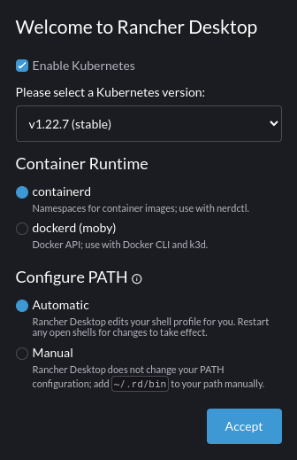
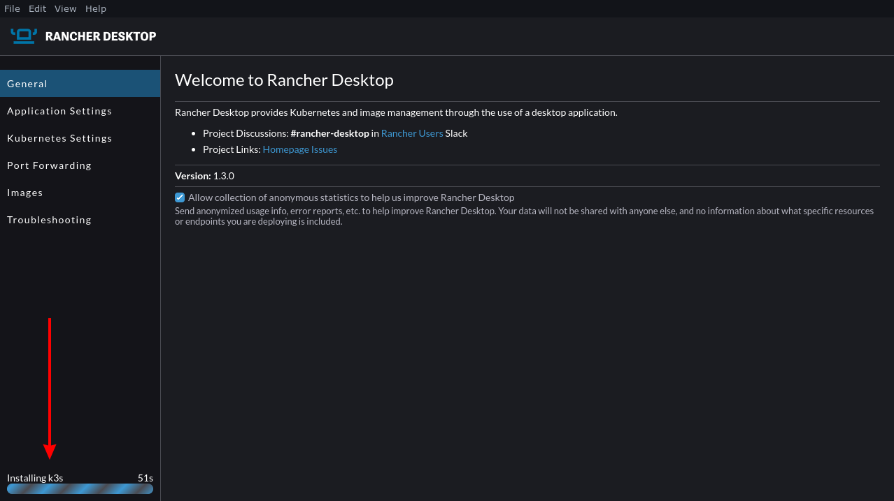
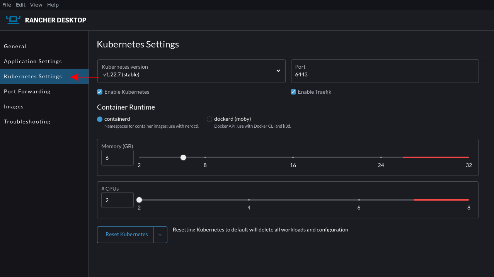
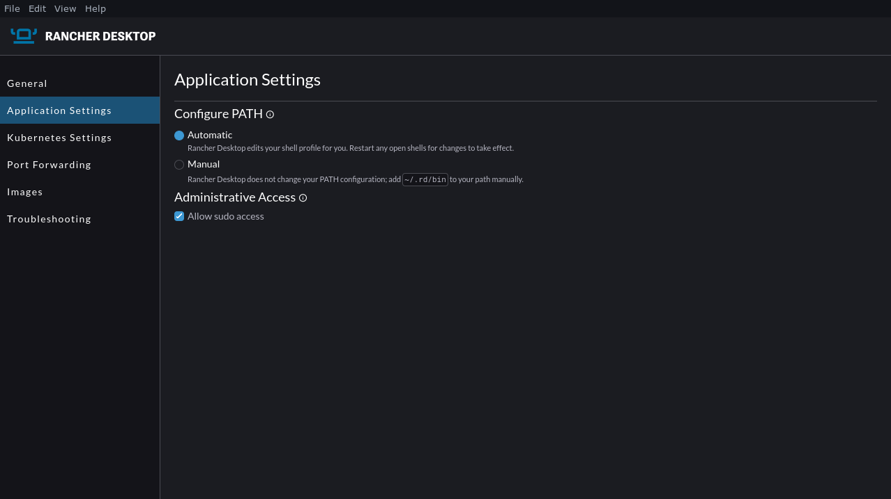
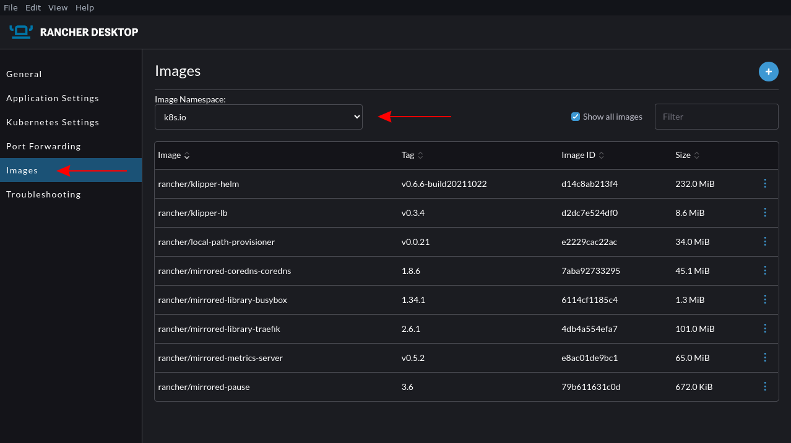
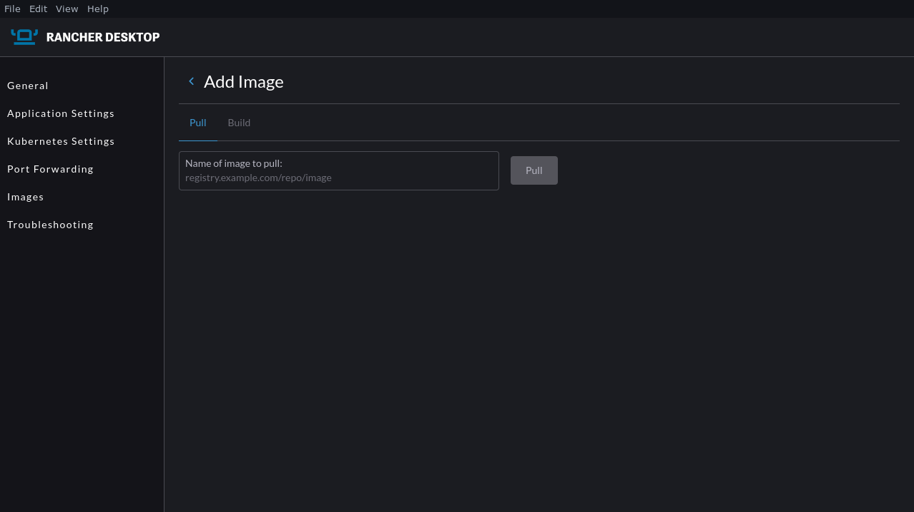
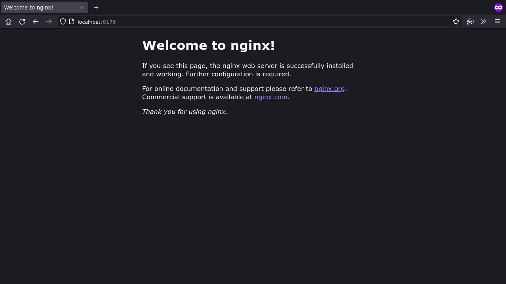
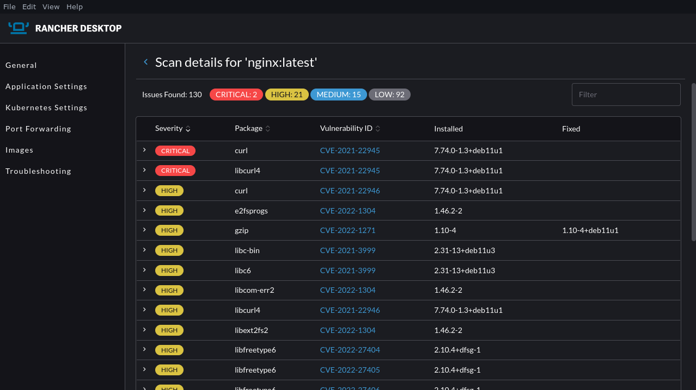
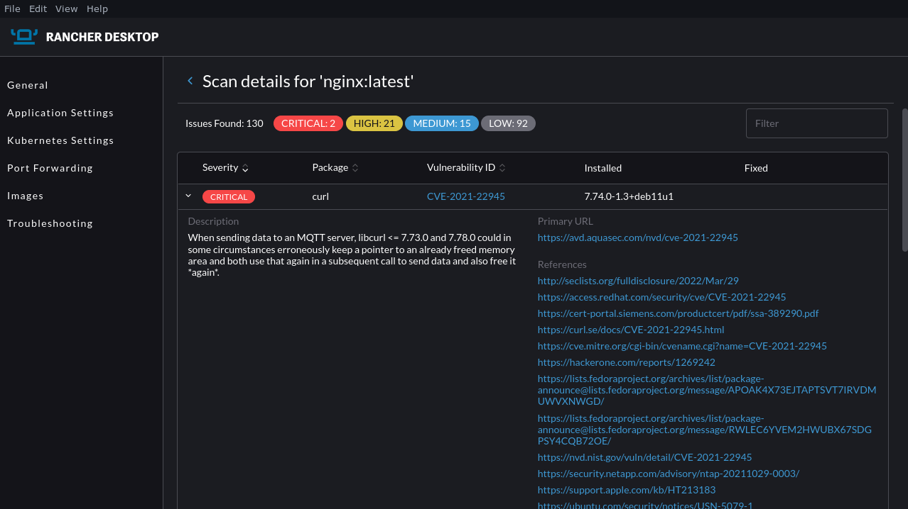

Rancher Desktop is an all-in-one solution for container management on your desktop workstation. It provides an easily maintained Kubernetes installation that runs on your local machine and streamlines setting up containerized workflows in development.

Assembling a Kubernetes cluster from scratch can be daunting, because multiple components must work in unison. With Rancher Desktop, you get everything preconfigured with one software download.

Rancher Desktop also lends itself to multiple use cases. It includes a full toolchain for building and running containers. You can easily configure your environment, set up [port forwarding](https://docs.rancherdesktop.io/getting-started/features#port-forwarding-windows) rules, change [Kubernetes versions](https://docs.rancherdesktop.io/getting-started/features#kubernetes-version) and [scan images](https://docs.rancherdesktop.io/getting-started/features#scanning-images) for security problems. You can even [“factory reset” your installation](https://docs.rancherdesktop.io/getting-started/features#factory-reset) if your cluster ends up in a bad state.

To demonstrate the streamlining capability of Rancher Desktop, in this tutorial you’ll use it to run Kubernetes on your local machine without installing Docker Desktop.

## What Is Rancher Desktop?

Rancher Desktop, now in version 1.3, is a desktop-based container development environment for Windows, macOS and Linux. It’s a Kubernetes-based solution that runs a lightweight [K3s cluster](https://k3s.io/) inside a virtual machine. Rancher also includes the `containerd` and `dockerd` container runtimes. On macOS and Linux systems, the VM is hosted by QEMU; Windows support is provided by Windows Subsystem for Linux v2.

Rancher Desktop wraps established container toolchain components to create a batteries-included development experience. Its Kubernetes cluster and container runtime are packaged into its virtual machine. You can use Rancher’s included `nerdctl` CLI and Kubernetes-compatible tools like [kubectl](https://kubernetes.io/docs/tasks/tools) and [Helm](https://helm.sh/) to interact with these components and start new containers.

A Rancher Desktop installation is ideal for developers who want to build containerized software without manually maintaining all the components. You can build container images, deploy them into a Kubernetes cluster, and test workloads locally before you move into production.

Rancher Desktop’s approach is similar to that of Docker Desktop. Unlike Docker’s product, however, Rancher Desktop is a free and open source solution developed by SUSE. It’s designed around Kubernetes, whereas Docker Desktop implemented support later in the project. This can make it a closer likeness to established production environments.

## Using Rancher Desktop for Local Kubernetes Development

You’re going to install and set up Rancher Desktop to create a local Kubernetes cluster, then configure your environment and perform basic operations with containers and images.

## Installing Rancher Desktop

There are a few different ways to add Rancher Desktop to your system. If you’re running Windows or macOS, download and run the appropriate installer [from GitHub](https://github.com/rancher-sandbox/rancher-desktop) after checking the [system requirements](https://docs.rancherdesktop.io/getting-started/installation) for your platform.

On Linux machines you need 4 CPU cores, 8 GB of RAM, and an x86\_64 processor with Intel VT-x or AMD-V virtualization enabled in your system BIOS. Follow your motherboard vendor’s documentation to enable this feature if needed. Before using Rancher Desktop, you need to make sure your user account has permissions to access `/dev/kvm`. You can check by running this command:

```
[ -r /dev/kvm ] && [ -w /dev/kvm ] || echo 'insufficient privileges'
```

You lack the necessary permissions if “insufficient privileges” is displayed in your terminal. You can fix this by running the following command to add yourself to the `kvm` user group:

```
sudo adduser “$USER” kvm
```

Reboot your machine to apply the changes.

### Installing on Debian Systems

Rancher Desktop has an APT repository that you can use to install it on Debian-based systems. Run the commands below to add the repository and its signing key:

```
$ curl -s https://download.opensuse.org/repositories/isv:/Rancher:/stable/deb/Release.key | gpg --dearmor | sudo dd status=none of=/usr/share/keyrings/isv-rancher-stable-archive-keyring.gpg
$ echo 'deb [signed-by=/usr/share/keyrings/isv-rancher-stable-archive-keyring.gpg] https://download.opensuse.org/repositories/isv:/Rancher:/stable/deb/ ./' | sudo dd status=none of=/etc/apt/sources.list.d/isv-rancher-stable.list
$ sudo apt update
```

Next install the package with the following command:

```
$ sudo apt install rancher-desktop
```

### Installing on OpenSUSE

Use the following command sequence to install Rancher Desktop as an `.rpm` package on OpenSUSE systems:

```
$ sudo zypper addrepo https://download.opensuse.org/repositories/isv:/Rancher:/stable/rpm/isv:Rancher:stable.repo
$ sudo zypper install rancher-desktop
```

The `.rpm` doesn't work properly with RHEL and Fedora, since they distribute QEMU differently. If you’re using one of these operating systems, run Rancher as an AppImage instead (see below) so it can successfully create a QEMU virtual machine.

### Using Rancher’s AppImage

Rancher is also available as an AppImage for all Linux systems. This is a self-contained binary format that executes without dependencies. To run Rancher Desktop in this way, download the AppImage and make it executable:

```
$ wget https://download.opensuse.org/repositories/isv:/Rancher:/stable/AppImage/rancher-desktop-latest-x86_64.AppImage
$ chmod +x rancher-desktop-latest-x86_64.AppImage
```

Start Rancher Desktop by running the downloaded binary:

```
$ ./rancher-desktop-latest-x86_64.AppImage
```

To remove Rancher Desktop in the future, follow the guidance [in the documentation](https://docs.rancherdesktop.io/faq/#q-how-can-i-perform-a-clean-uninstall-of-rancher-desktop) to perform a factory reset and uninstall the app. This will ensure that everything added to your system gets cleaned up properly.

## Getting Started

When you first run Rancher Desktop, you’ll need to perform some initial configuration to set up your environment. On the landing page, use the dropdown box to select the Kubernetes version you want to use. It’s best to leave this at the default “stable” release unless you need to match an existing environment.



Next select the runtime to use for containers started outside of Kubernetes. Selecting `containerd` gives you access to all Rancher’s container management features, including namespaces and `nerdctl`. Selecting `dockerd` will use the runtime that’s shipped with Docker, via its regular Unix socket.

If you don’t plan to use the Kubernetes features, you can clear the “Enable Kubernetes” checkbox to proceed without them. You’ll still be able to build and start container images with `nerdctl` and the selected container runtime.



You’ll be taken to the Rancher Desktop homepage after you click **Accept**. Rancher will download your chosen Kubernetes release, then create your virtual machine and start up the installation. You can check its progress in the status area in the bottom left. Be patient—this first run might take a while. Your installation will be ready to use when the progress bar disappears.

## Exploring the GUI

Rancher’s GUI gives you an overview of your installation and exposes some management controls. The default General tab shows your Rancher version, provides links to related resources and offers a checkbox for opting out of anonymous usage metrics collection.



Switching to the Kubernetes Settings tab lets you manage your Kubernetes cluster. Here you can switch between Kubernetes versions, alter the control plane’s port number, and change the container runtime (`containerd` or `dockerd`) used for your containers. Sliders at the bottom of the page modify the hardware resource limits that your Rancher VM can use.

The bottom of the screen includes a **Reset Kubernetes** button to restore your cluster to a clean slate. This is convenient when you’re experimenting with Rancher or running new workloads that you want to quickly remove. To reset your entire Rancher Desktop installation, head to the Troubleshooting screen and press the **Factory Reset** button.



The Application Settings screen controls how Rancher Desktop adds its bundled `docker`, `helm`, `kubectl`, and `nerdctl` commands to your `PATH`. These utilities are provided in the `~/.rd/bin` directory within your home folder. Rancher’s “Automatic” PATH configuration mode modifies your shell profile to include `~/.rd/bin` for you.

Switching to manual mode leaves your shell profile file intact. You’ll need to manually add `~/.rd/bin` to your path before you can run commands like `docker` and `nerdctl` in your shell. This can help avoid conflicts if you’re already using standalone installations of some of these utilities.

The “Allow sudo access” checkbox determines whether Rancher Desktop tries to acquire administrative privileges when it starts. This is required to use features such as access to your host’s Docker socket and bridged networking support. You can turn it off to run Rancher Desktop with fewer system privileges.

## Working with Images

Use `nerdctl` to pull an image to your Rancher installation:

```
$ nerdctl pull nginx:latest
docker.io/library/nginx:latest:                                                   resolved       |++++++++++++++++++++++++++++++++++++++|
index-sha256:4ed64c2e0857ad21c38b98345ebb5edb01791a0a10b0e9e3d9ddde185cdbd31a:    done           |++++++++++++++++++++++++++++++++++++++|
manifest-sha256:1a763cbd30ef4dbc7f8e3fa2e6670fd726f4bddb0ef58868a243c0cb8b35cde1: done           |++++++++++++++++++++++++++++++++++++++|
config-sha256:f2f70adc5d89aa922836e9cc6801980a12a7ff9012446cc6edf52ef8798a67bd:   done           |++++++++++++++++++++++++++++++++++++++|
layer-sha256:be0c016df0be98964bf62fc97d820463c5228ed3ceef321cb4bedc5b86eb7660:    done           |++++++++++++++++++++++++++++++++++++++|
layer-sha256:dca7733b187e4e05ef6a71f40eb02380dde472b7e3da6dcffcafcfded823352b:    done           |++++++++++++++++++++++++++++++++++++++|
layer-sha256:352e5a6cac2644c979e06a33493d883694ad0716bab021561da45e2f4afd84cd:    done           |++++++++++++++++++++++++++++++++++++++|
layer-sha256:9eaf108767c796d28e8400fe30b87d5624b985847173bb20587ae85bc7179e3a:    done           |++++++++++++++++++++++++++++++++++++++|
layer-sha256:ae13dd57832654086618a81dbc128846aa092489260c326ee95429b63c3cf213:    done           |++++++++++++++++++++++++++++++++++++++|
layer-sha256:6c0ee9353e13944dca360479cb7eecfa65c6726948c1b85db3f8b57b68631a3b:    done           |++++++++++++++++++++++++++++++++++++++|
elapsed: 8.0 s                                                                    total:  54.1 M (6.8 MiB/s)
```

View the downloaded image with the `nerdctl images` command:

```
$ nerdctl images
REPOSITORY    TAG       IMAGE ID        CREATED               PLATFORM       SIZE         BLOB SIZE
nginx         latest    4ed64c2e0857    About a minute ago    linux/amd64    149.1 MiB    54.1 MiB
```

When you’ve selected the `containerd` runtime, you can use namespaces to separate resources by their purpose or function. This mechanism has a similar role to Kubernetes namespaces. Using `nerdctl` works with the `default` namespace when you don’t specify another. Use the `-n` command to target a specific namespace:

```
# No images in this namespace yet
$ nerdctl -n demo-namespace images
REPOSITORY    TAG    IMAGE ID    CREATED    PLATFORM    SIZE    BLOB SIZE

# Pull an image into a namespace
$ nerdctl -n demo-namespace pull nginx:latest

# Now the image exists in the namespace
$ nerdctl -n demo-namespace images
nginx         latest    4ed64c2e0857    About a minute ago    linux/amd64    149.1 MiB    54.1 MiB
```



You can also view your images in the GUI. Head to the Images tab in the left sidebar, then select the correct namespace from the dropdown menu. To pull a new image, click the blue + icon in the top right, then paste your image’s registry URL into the text field.



## Starting Containers in Your Cluster

You can start a container instance with `nerdctl`:

```
$ nerdctl run -d -p 8176:80 nginx:latest
66d5a724732dd42a5daeb2d0349413e4ef14c899d03bbfdab51fccf645251d56
```

The container will be added to the `default` namespace as no `-n` flag was included.

You can check that the container is running using `nerdctl ps`:

```
$ nerdctl ps
CONTAINER ID    IMAGE                             COMMAND                   CREATED           STATUS    PORTS                   NAMES
ec408d49bd92    docker.io/library/nginx:latest    "/docker-entrypoint.…"    32 seconds ago    Up        0.0.0.0:8176->80/tcp    nginx-ec408
```

Since a port has been bound to the container, you can also visit localhost:8176 in your web browser to see the default NGINX landing page.



You can stop the container by passing its ID to the `nerdctl stop` command:

```
$ nerdctl stop 66d5a7
66d5a724732dd42a5daeb2d0349413e4ef14c899d03bbfdab51fccf645251d56
```

## Using kubectl

Now run a container with Kubernetes. Create a basic manifest for your Kubernetes pod:

```
apiVersion: v1
kind: Pod
metadata:
  name: rancher-pod
spec:
  containers:
    - name: nginx
      image: nginx:latest
      ports:
        - containerPort: 80
          hostPort: 8176
```

Use the kubectl provided by Rancher Desktop to add this pod to your Kubernetes cluster:

```
$ kubectl apply -f pod.yml
pod/rancher-pod created
```

Check that the pod has been created successfully with the `get pods` command:

```
$ kubectl get pods
NAME          READY   STATUS    RESTARTS   AGE
rancher-pod   1/1     Running   0          49s
```

Visiting localhost:8176 should show the NGINX landing page again. The container should be running inside Rancher’s Kubernetes cluster. Once your application is working in your Rancher-powered development cluster, you can take the same Kubernetes manifests and apply them to your production environment.


Remove your Kubernetes pod with the `delete` command:

```
$ kubectl delete pod/rancher-pod
pod "rancher-pod" deleted
```

## Scanning Images for Security Issues

Development isn’t complete until you’ve taken care of security. Rancher Desktop integrates a [Trivy-powered](https://github.com/aquasecurity/trivy) image-scanning solution you can use to find vulnerabilities within your local environment before moving to production. This can be found on the Images page of the GUI.



Click the three dots icon to the right of any image in the list and select **Scan** from the menu that appears. The scan may take a few moments to complete. You’ll see vulnerability details shown as a list, ordered by severity with clear colorization. Selecting any of the rows shows detailed information about the threat.



You can use this tool to check the safety of your images after you build them. The graphical presentation can be easier to digest than terminal-based reports.

## Conclusion

As this tutorial demonstrated, Rancher Desktop streamlines provisioning new development environments that can build and run containers. The open source container management solution uses `containerd`, `dockerd` and a K3s-based Kubernetes cluster to easily spin up Kubernetes for your local environment.

Rancher Desktop is part of SUSE’s broader Rancher-branded container platform. The [Rancher management system](https://www.suse.com/products/suse-rancher) unifies multi-cluster Kubernetes environments to simplify day-to-day operations such as monitoring, logging, and access control. SUSE is also known for its [Linux Enterprise Server](https://www.suse.com/products/server) distribution, an operating system designed for cloud-agnostic deployments.

For more on what SUSE offers, check its [documentation](https://documentation.suse.com/). You can find content specific to [Rancher](https://rancher.com/docs/) and [Rancher Desktop](https://docs.rancherdesktop.io/) on their respective documentation sites.

## Next Steps

There are several next steps you can take:

- Star [Rancher Desktop on GitHub](https://github.com/rancher-sandbox/rancher-desktop) to show that you like it. This lets us know that you want to see development continue.
- [Install the v1.3.0 release](https://rancherdesktop.io/).
- Provide feedback in the [issue queue](https://github.com/rancher-sandbox/rancher-desktop/issues).
*James Walker is the founder of Heron Web, a UK-based software development agency. He has experience managing complete end-to-end web development workflows with DevOps, CI/CD, Docker and Kubernetes. James also writes technical articles on programming and the software development lifecycle.*
