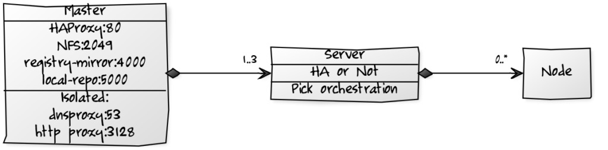
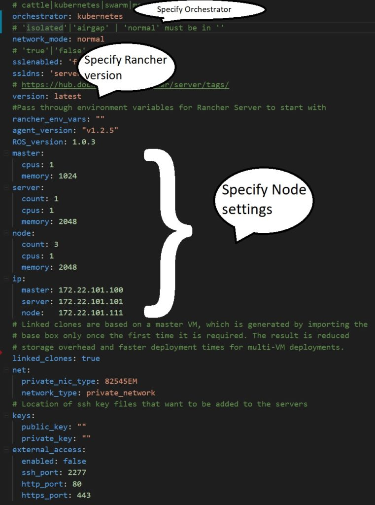

I spend a large amount of my time helping clients implement Rancher
successfully. As Rancher is involved in just about every vertical, I
come across a large number of different infrastructure configurations,
including (but not limited to!) air-gapped, proxied, SSL, HA Rancher
Server, and non-HA Rancher Server.

## Scenario & Criteria

What I wanted was a way to quickly emulate an environment to allow me to
more closely test or replicate an issue. Now this could be done in a
number of ways, but the solution I wanted had to meet the following
criteria:

- **Run locally** — Yes, it can be done in the cloud, but running
  services in the cloud costs money, so I wanted to keep the cost
  down.
- **Be local host OS agnostic** — So others can use it, I didn’t
  want to tie it to Windows, MacOS or Linux.
- **Emulate multiple infrastructure scenarios** — As in the criteria
  above, but I must also be able to use it as a basis for doing local
  application development and testing of containers.
- **Minimise bandwidth**
- **Be easy to configure** — So that anyone can use it.

## The Solution

To fulfill the first two criteria, I needed a hypervisor (preferably
free) that could run on all platforms locally. Having had a reasonable
amount of experience with
[VirtualBox](https://www.virtualbox.org/wiki/Downloads) (and it meeting
my preferably free criterion), I decided to use it. The third criterion
was to allow me to emulate environments locally that had the following
configurations:

- **Air gap** — Where there was no connection to the internet to
  install Rancher Server and nodes
- **Proxied** — Where the Internet access was via a proxy server
- **SSL** — Where the connection to the Rancher Server SSL
  terminated
- **HA** — The ability to stand up Rancher Server in a HA
  configuration with an externalized database and a configurable
  number of nodes

To meet the fourth criterion to minimise bandwidth, I decided to run a
registry mirror. It allowed me to destroy the setup and start afresh
quickly as all the VMs had Docker engine set to pull via the mirror. Not
only does it save bandwidth, but it also significantly speeds up
rebuilds. Files for the mirror persist to the local disk to preserve
them between rebuilds. For the final criterion of easy configuration, I
decided that I was going to use Vagrant. For those reading who haven’t
used Vagrant:

- It’s open-source software that helps you build and maintain
  portable, virtual software development environments.
- It provides the same, easy workflow regardless of your role as a
  developer, operator, or designer. It leverages a declarative
  configuration file which describes all your software requirements,
  packages, operating system configuration, users, and more.
- It works on Mac, Linux, Windows, and more. Remote development
  environments force users to give up their favorite editors and
  programs. Vagrant works with tools on your local system with which
  you’re already familiar.

After you [download Vagrant](https://www.vagrantup.com/), you can
specify that it consumes its config from a separate file. For this
setup, all configurable options are externalized into a **config.yaml**
file that is parsed at startup. This means that you can configure and
use it without having to have a deep, technical understanding of
Vagrant. I also added an NFS server to the solution, running on the
master node so that services could be tested with persistent storage.
So, what does the final solution look like?
[](https://cdn.rancher.com/wp-content/uploads/2017/11/06070805/localranchervagrant.png)
The master node runs a bunch of supporting services like MYSQL and
HAProxy to help all of this hang together. In true Docker style, all of
these supporting services are containerised!

## Minimum Setup

To run this solution, the setup will create a minimum of three VMs.
There is a master, a minimum of one Rancher Server, and one node. Below
is an example of the **config.yaml** file with the main parts that you
will change highlighted:
[](https://cdn.rancher.com/wp-content/uploads/2017/10/06093755/Vagrant-config.jpg)
You can find more detail on the config options in our [repository for
this setup](https://github.com/rancher/vagrant).

## Quick Start

For those of you wanting a Quick Start, you need the following software
installed:

- **VirtualBox** — If you don’t already have it installed, you can
  [download VirtualBox
  here](https://www.virtualbox.org/wiki/Downloads).
- **Vagrant** — [Download it
  here](https://www.vagrantup.com/downloads.html).
- **Git** — If you don’t have a Git client for version control, you
  can [download one here](https://git-scm.com/downloads).

Then, it is as simple as dropping to a command prompt and running the
following commands:

```
git clone https://github.com/rancher/vagrant
cd vagrant
vagrant up
```

Rancher Server will start running Cattle with three nodes. This Quick
Start also supports [Rancher 2.0](https://rancher.com/rancher2-0/), so if
you want to check out the Tech Preview with the minimum of effort, run:

```
git clone https://github.com/rancher/vagrant
cd vagrant
git checkout 2.0
vagrant up
```

Thanks to my colleague James, for helping me enhance this solution to
what it has become.

### About the Author

Chris Urwin works
as a field engineer for Rancher Labs based out of the UK. He spends his
days helping our enterprise clients get the most out of Rancher, and his
nights wishing he had more hair on his head!
