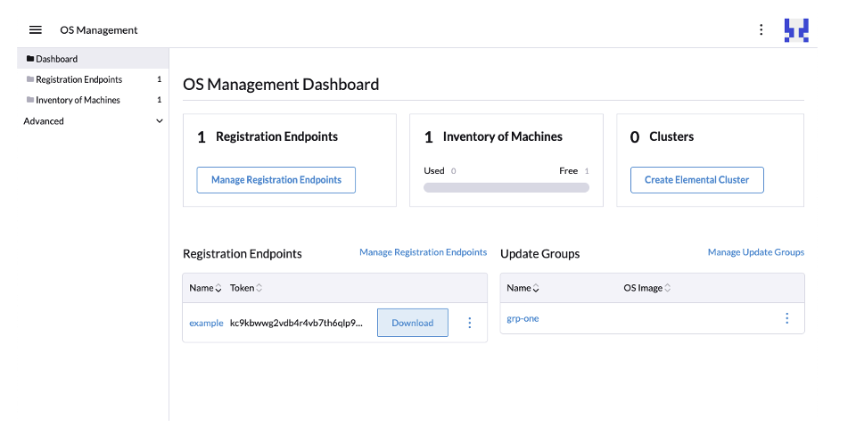
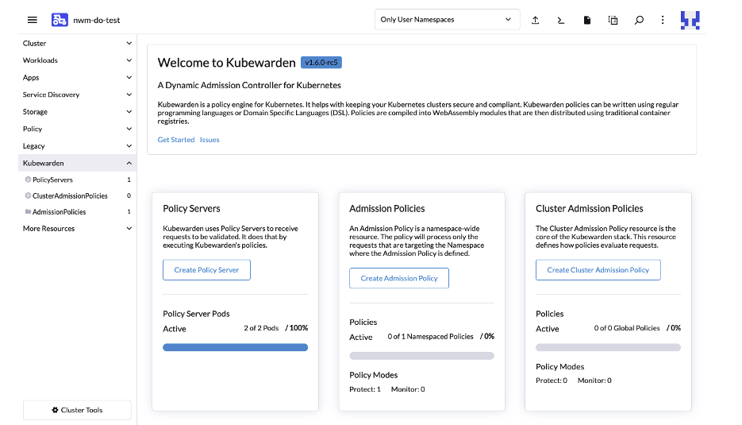
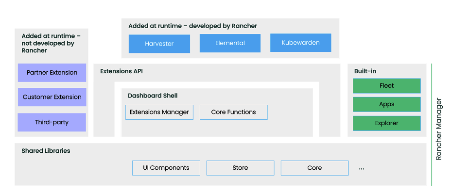
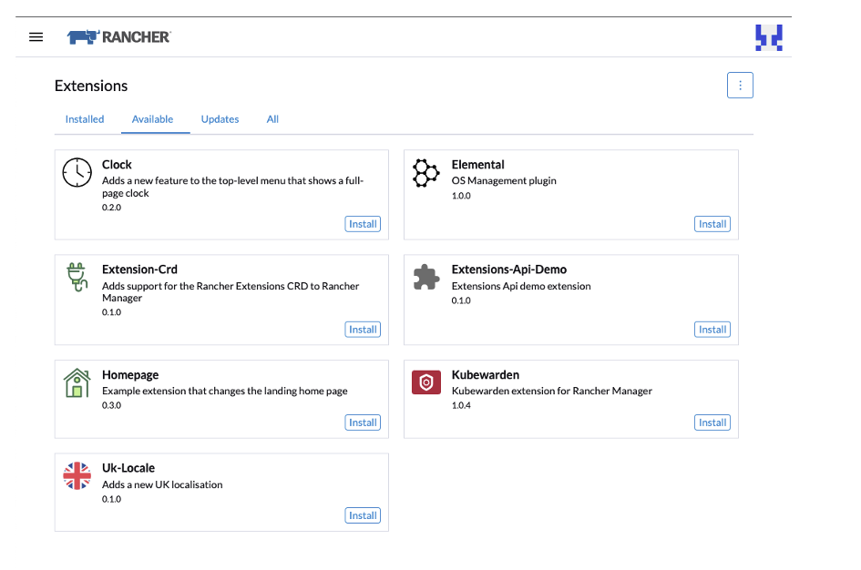

**What are Rancher Extensions?**
The Rancher by SUSE team wants to accelerate the pace of development and open Rancher to partners, customers, developers and users, enabling them to build on top of it to extend its functionality and further integrate it into their environments.
With Rancher Extensions, you can develop your own extensions to the Rancher UI. Completely independently of Rancher. The source code lives in your own repository. You develop, build and release it whenever you like. You can add your extension to Rancher at any time. Extensions are versioned by you and have their own independent release cycle.
Think Chrome browser extensions – but for Rancher.
Could this be the best innovation in Rancher for some time? It might just be!
**What can you do?**
Rancher defines several extension points which developers can take advantage of to provide extra functionality, for example:
> 1. Add new UI screens to the top-level side navigation
> 2. Add new UI screens to the navigation of the Cluster Explorer UI
> 3. Add new UI for Kubernetes CRDs
> 4. Extend existing views in Rancher Manager by adding panels, tabs and actions
> 5. Customize the landing page

We’ll be adding more extension points over time.
Our goal is to enable deep integrations into Rancher. We know how important graphical user interfaces are to users, especially in helping users of all abilities to understand and manage complex technologies like Kubernetes. Being able to bring together data from different systems and visualize them within a single-pane-of-glass experience is extremely powerful for users.
With extensions, if you have a system that provides monitoring metadata, for example, we want to enable you to see that data in the context of where it is relevant – if you’re looking at a Kubernetes Pod, for example, we want you to be able to augment Rancher’s Pod view so you can see that data right alongside the Pod information.
**Extensions, Extensions, Extensions**
The Rancher by SUSE teams is using the Extensions mechanism to develop and deliver our own additions to Rancher – initially with extensions for Kubewarden and Elemental. We also use Extensions for our Harvester integration. Over time we’ll be adding more.
Over the coming releases, we will be refactoring the Rancher UI itself to use the extensions mechanism. We plan to build out and use the very same extension mechanism and APIs internally as externally developed extensions will use. This will help ensure those extension points deliver on the needs of developers and are fully supported and maintained.
**Elemental**
Elemental is a software stack enabling centralized, full cloud native OS management with Kubernetes.
With the Elemental extension for Rancher, we add UI capability for Elemental right into the Rancher user interface.

*Image 1: Elemental Extension*

The Elemental extension is an example of an extension that provides a new top-level “product” experience. It adds a new “OS Management” navigation item to the top-level navigation menu which leads to a new experience for managing Elemental. It uses the Rancher component library to ensure a consistent look and feel. [Learn more here](https://elemental.docs.rancher.com/) or visit the [Elemental Extension GitHub repository](https://github.com/rancher/elemental-ui)
**Kubewarden**
Kubewarden is a policy engine for Kubernetes. Its mission is to simplify the adoption of policy-as-code.
The Kubewarden extension for Rancher makes it easy to install Kubewarden into a downstream cluster and manage Kubewarden and its policies right from within the Rancher Cluster Explorer user interface.

*Image 2: Kubewarden Extension*

The Kubewarden extension is a great example of an extension that adds to the Cluster Explorer experience. It also showcases how extensions can assist in simplifying the installation of additional components that are required to enable a feature in a cluster.
Unlike Helm charts, extensions have no parameters at install time – there's nothing to configure – we want extensions to be super simple to install. [Learn more here](https://www.kubewarden.io/) or visit the [Kubewarden Extension GitHub repository.](https://github.com/kubewarden/ui)
**Harvester**
The Harvester integration into Rancher also leverages the UI Extensions framework. This enables the management of Harvester clusters right from within Rancher.
Because of the de-coupling that UI Extensions enables, the Harvester UI can be updated completely independently of Rancher. [Learn more here](https://harvesterhci.io/) or visit the [Harvester UI GitHub repository](https://github.com/harvester/dashboard).
**Under the Hood**
The diagram below shows a high-level overview of Rancher Extensions.
A lot of effort has gone into refactoring Rancher to modularize it and establish the API for extensions.
The end goal is to slim down the core of the Rancher Manager UI into a “Shell” into which Extensions are loaded. The functionality that is included by default will be split out into several “Built-in” extensions.

*Image 3: Architecture for Rancher UI*

We are also in the process of splitting out and documenting our component library, so others can leverage it in their extensions to ensure a common look and feel.
A Rancher Extension is a packaged Vue library that provides functionality to extend and enhance the Rancher Manager UI. You’ll need to have some familiarity with Vue to build an extension, but anyone familiar with React or Angular should find it easy to get started.
Once an extension has been authored, it can be packaged up into a simple Helm chart, added to a Helm repository, and then easily installed into a running Rancher system.
Extensions are installed and managed from the new “Extensions” UI available from the Rancher slide-in menu:

*Image 4: Rancher Extensions Menu*

Rancher shows all the installed Extensions and the available extensions from the Helm repositories added. Extensions can also be upgraded, rolled back and uninstalled. Developers can also enable the ability to load extensions easily during development without the need to build and publish the extension to a Helm repository.
**Developers**
To help developers get started with Rancher extensions, we’ve published [developer documentation](https://rancher.github.io/dashboard/extensions/introduction), and we’re building out a set of [example extensions](https://github.com/rancher/ui-plugin-examples).
Over time, we will be enhancing and simplifying some of our APIs, extending the documentation, and adding even more examples to help developers get started.
We have also set up a Slack channel exclusively for extensions – check out the [#extensions channel](https://rancher-users.slack.com/archives/C04PPGWAWNR) on the Rancher User’s Slack.
**Join the Party**
We’re only just getting started with Rancher Extensions. We introduced them in Rancher 2.7. You can use them today and get started developing your own!
We want to encourage as many users, developers, customers and partners out there as possible to take a look and give them a spin. Join me on the 3rd of May at 11 am US EST where I’ll be going through the Extension Framework live as part of the Rancher Global Online Meetup – you can [sign up here](https://more.suse.com/FY23Q1_CY_ECM_SR_ECMC_WEB_Global_Online_Meetup_Rancher_Extensions_RG_GLB_RegistrationPage-NEW.html).
As we look ahead, we’ll be augmenting the Rancher extensions repository with a partner repository and a community repository to make it easier to discover extensions. Reach out to us via Slack if you have an extension you’d like included in these repositories.
Fasten your seat belts. This is just the beginning. We can’t wait to see what others do with Rancher Extensions!
