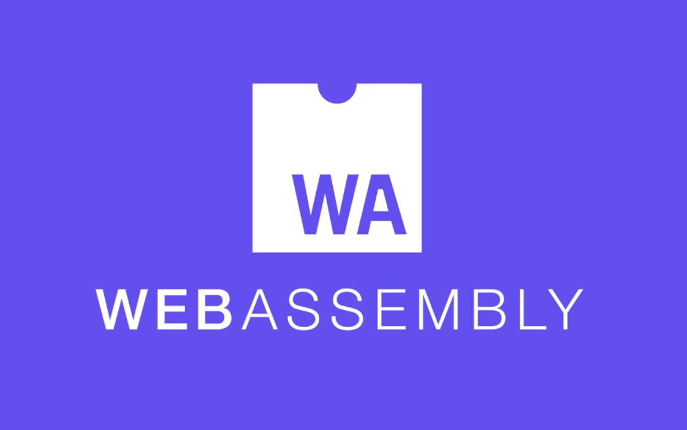
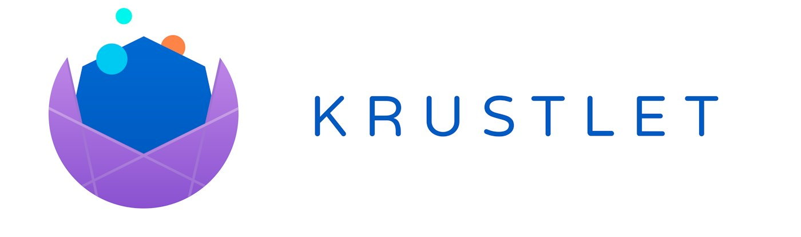

*Post originally published on*[*Kubewarden’s blog*](https://kubewarden.io/blog) *by Flavio Castelli, Distinguished Engineer at SUSE*Is the title of this post a pun inspired by Christmas or by the Games of Thrones? I can’t decide…

Are my dad jokes as bad as my daughters claim? Probably…

Is WebAssembly spreading inside of the Cloud Native ecosystem? ? I have no doubts about that!

First, why am I so excited about seeing WebAssembly flourish inside the Cloud Native ecosystem? Well, it’s no secret that I’m a huge fan of it. After all, WebAssembly is at the heart of Kubewarden.

**WebAssembly is flexible.** It grants Kubewarden policy authors the freedom to pick their favorite languages and tools to write policies. WebAssembly allows developers to tap into the huge ecosystem of programming languages such as Rust, Go, and many others to produce portable “build once, run everywhere” units of code.

**WebAssembly is interoperable.** This opens interesting scenarios to Kubewarden operators, too. Did you know that [Rego-based policies](https://www.openpolicyagent.org/docs/latest/policy-language/), such as Open Policy Agent and Gatekeeper, can be built as WebAssembly modules? We are currently working on a way to run Rego-based policies on top of Kubewarden. This will allow operators to have a single policy platform to operate. We will talk more about that in a future post -- stay tuned for updates!

**WebAssembly is secure.** It has been designed with a strong focus on security since the beginning. Each WebAssembly module runs inside a dedicated sandbox, with no access to other WebAssembly processes or the host system. Kubewarden is a project operating in the security space, making it even more important to ensure our policies cannot be turned into an attack vector.

Thankfully, WebAssembly and its runtime already do the heavy lifting for us.

---

So, I kept talking about WebAssembly and how much I love it. I gave you some reasons, but I didn’t dig into the details. Luckily, [The New Stack](https://thenewstack.io/) has recently published not one, but **two articles** featuring WebAssembly.

These articles do a great job at explaining [why everybody keeps talking about WebAssembly](https://thenewstack.io/what-is-webassembly/) and [how WebAssembly can even change some computing assumptions](https://thenewstack.io/webassembly-aims-to-eliminate-the-file-system/).

Take some time and give them a read. I’m sure you will find them interesting. Plus, the cherry on top is they both feature Kubewarden.

But we’re not over yet; more exciting things happened this week. The following projects started the process to get included in the [CNCF sandbox](https://www.cncf.io/sandbox-projects/): [Krustlet](https://krustlet.dev/) (see [here](https://github.com/cncf/toc/issues/690)), [wasmCloud](https://wasmcloud.com/) (see [here](https://github.com/cncf/toc/issues/693)) and [ORAS](https://oras.land/) (see [here](https://github.com/cncf/toc/issues/692)).

Let’s take a closer look at them!

---

[Krustlet](https://krustlet.dev/) registers itself against a Kubernetes cluster as a Kubelet instance. However, the Krustlet Kubelet does not run regular containers; instead, it executes WebAssembly programs.

Krustlet leverages [OCI registries](https://opencontainers.org/) to distribute the WebAssembly modules to execute. This is the same approach Kubewarden adopts to distribute its policies.

As a matter of fact, the Krustlet and Kubewarden teams are collaborating on the [oci-distribution](https://crates.io/crates/oci-distribution) crate. This is the Rust library that Krustlet and Kubewarden use to retrieve Wasm modules from OCI registries.

---

[wasmCloud](https://wasmcloud.com/) is a project with a strong focus on the developer experience. wasmCloud provides a way to write portable code that can be deployed everywhere: from the cloud to your edge devices. As the name of the project suggests, wasmCloud leverages WebAssembly, too.

Once more, as Kubewarden developers, we are also connected to the wasmCloud community. Both Kubewarden and wasmCloud are contributors to the [waPC](https://wapc.io/) project. This is the glue that allows our WebAssembly guest code to interact with the host.

---

Last but not least, let’s talk about [ORAS](https://oras.land/). This project turns [OCI container registries](https://opencontainers.org/) into generic artifact stores.

On the surface, this project doesn’t seem to be related to WebAssembly. However, without ORAS, neither Krustlet nor Kubewarden could store WebAssembly modules inside OCI Container registries.

---

On behalf of the Kubewarden developers, let me congratulate all the teams behind these projects. Thanks for inspiring us and paving the way for WebAssembly inside of CNCF!

Who knows, Kubewarden might join your ranks one day!
