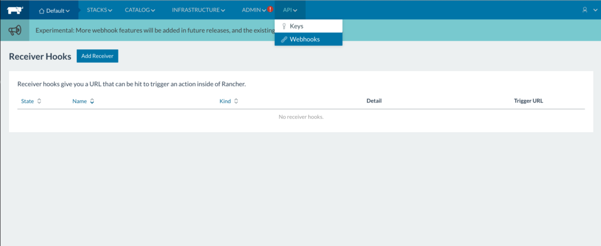
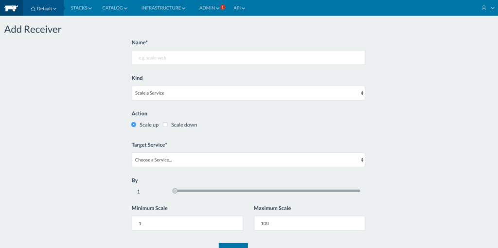
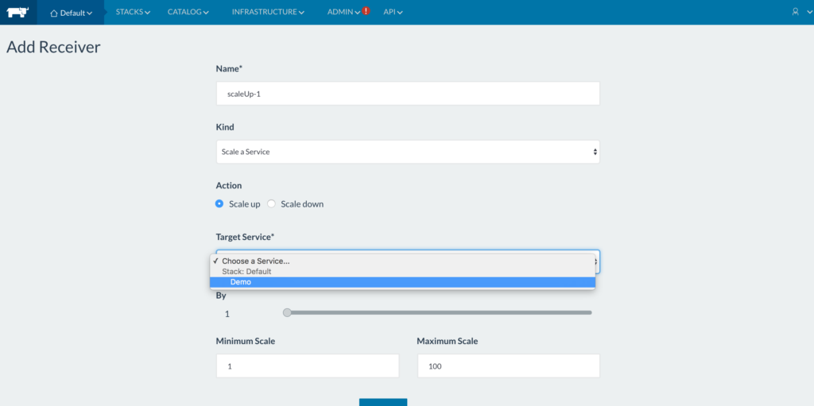
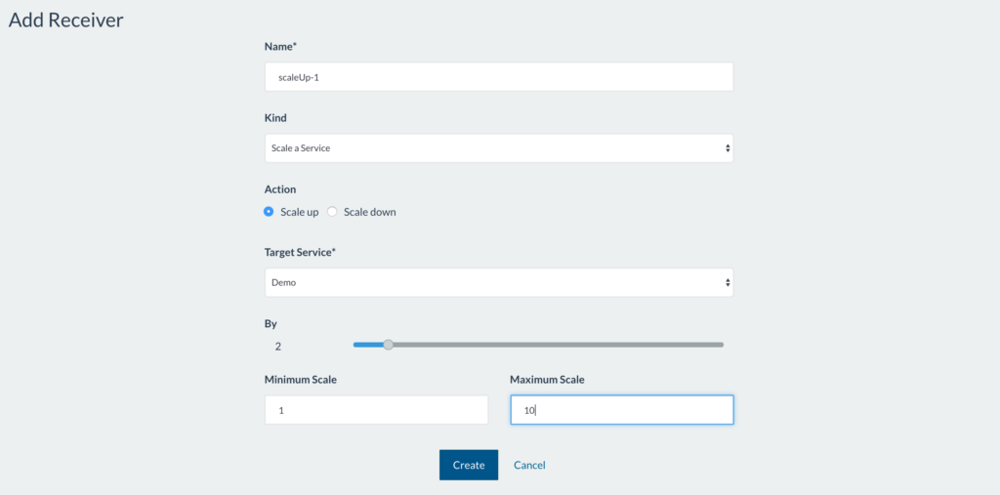
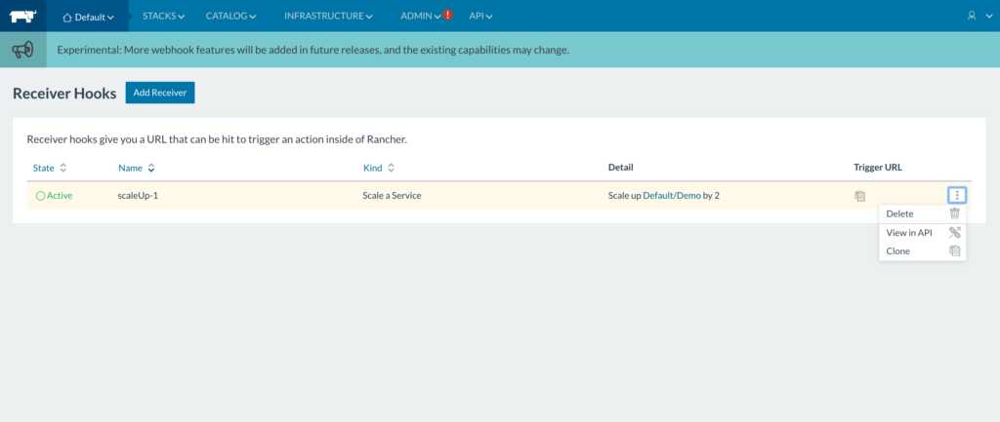

Rancher has added a [new feature in
1.4](https://rancher.com/rancher-1-4/) for webhooks, with an initial
driver to handle scaling. A key concept for implementing webhooks is
that of a ‘Receiver’, which lets you register a webhook and provides a
URL used to trigger an action inside of Rancher. We have implemented
webhooks with our new microservice, called
[webhook-service](https://github.com/rancher/webhook-service). I will
explain the feature using our current driver, scaleService. The
scaleService driver allows users to create a receiver hook for scaling a
service up or down. A classic use case for this is integrating with a
monitoring system to watch load balancer traffic, and calls this
receiver hook when response times or requests per second reach a certain
threshold. I will go through the steps of creating the receiver hooks in
Rancher.

### Adding a Receiver Hook

Navigate to the **API -> Webhooks** in the UI. This is where all the
receiver hooks you create for the selected environment will be listed,
under `Receiver Hooks`

Click on `Add Receiver`. You will see fields to be entered:

On this page, fields to be entered are as follows:

**Name**: Every receiver hook should be given a unique name so it can be
easily identified

\*\*Kind: \*\*The `Kind` dropdown gives a list of all drivers available in
webhook-service. Select a driver from this list (only `Scale a Service`
is available for v1.4 - more drivers based on community input and
requests to come!)

**Action**: This field lets you specify the action specific to the
driver. For the scaleService driver, the only two actions are `up` (to
increase the number of containers) and `down` (to decrease the number of
containers).

The fields after this are specific to the scaleService driver: **Target
Service**: Select the service to be scaled from this dropdown (below)

**By**: This field asks the user to enter the amount by which the
selected service should be scaled **Minimum Scale** and **Maximum
Scale**: The minimum and maximum number of containers your service can
be allowed to have. Scaling the service beyond these values using
webhooks won’t be allowed. Click on `Create` once all fields are
entered:

The created receiver hook will now be listed on the webhooks page. The
`Trigger URL` is used to actually execute scaling up and down. Next to
this field, there’s also options for deleting or cloning a receiver
hook:

### Using the Receiver Hook

The `Trigger URL` will execute the action for the driver. To use the
trigger URL, you will need to do a POST to the specific URL. There is no
authentication or body needed to POST to the URL. This URL consists of
an API endpoint and a token. The token contains all the information for
the created receiver hook, such as selected driver, service, action
(up/down), and amount that the service should be scaled by. The API
endpoint uses this token to make Cattle API calls and complete the
action specified in the created receiver hook.

### Using webhook-service for autoscaling

The scaleService driver from webhook-service can be used to autoscale a
service based on container metrics. To do so, the webhook service must
be used with an external monitoring service. Once you create a service,
add a webhook for it, using the above steps. Then copy the Trigger URL
and to use in the monitoring service: send a `POST` request to this
trigger url when a particular metric, such as response time, crosses a
specified threshold. Monitoring services such as Prometheus have a field
called `webhook_configs` to specify such URLs that need a `POST` request
sent to them. Once you have this configured, scaling the service will be
handled by webhook-service.

### Upcoming Drivers and Contributions

We plan on adding more drivers to webhook-service. For future releases,
we are working on adding drivers for scaling up/down hosts and
redeploying services based on DockerHub webhooks. We would also love to
get contributions for new drivers as well. You can refer to these
[steps](https://github.com/mrajashree/Webhook-blog/blob/master/Steps.md)
for adding new drivers and submit pull requests to our
[webhook-service](https://github.com/rancher/webhook-service)
repository.

\*\*Learn more about using webhooks for scaling - and more tips and tricks
for running containers - in our upcoming online meetup, Tuesday,
February 28. [Register online
here](https://info.rancher.com/february-2017-more-tips-and-tricks). \*\*
