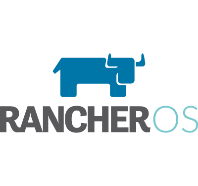

Version
v0.7.0 of RancherOS, which mainly contains bug fixes and enhancements,
was recently released and is now available on our [releases
page](https://github.com/rancher/os/releases). Since there hasn’t been a
blog post since the v0.5.0 release, this post also includes some of the
key features implemented as part of v0.6.0 and v0.6.1. In addition to
switching the default Docker version to 1.12.1 and kernel version to
4.4.21, the following features have been implemented.

### Better Support for Switching Docker Engines

It has always been part of the design of RancherOS to run two instances
of Docker. The first is System Docker, which runs as PID 1 and is
responsible for managing system services. The other, which we typically
call User Docker or just Docker, is actually run as a container managed
by System Docker. Starting with v0.6.0, the process for changing the
User Docker container has been made much easier. To support this feature
we added the “rancher.docker.engine” cloud-config key, which can be used
to specify the Docker version when launching a RancherOS instance. In
addition, it’s also possible to easily change the Docker version on a
live system with the “ros engine” command. For example, Docker 1.10.3
could be used by running “ros engine switch docker-1.10.3”. RancherOS
comes with multiple versions of Docker already packaged, but this same
process can be used to easily package and run custom Docker builds. More
information on this feature can be found in our documentation.

### Easier Docker Configuration

Docker daemon arguments were previously configured as a list of
arguments. This made it difficult to update existing arguments and
extend default parameters. As of v0.7.0, Docker daemon arguments can be
configured individually and then RancherOS will generate the
corresponding command to start the Docker daemon. For example, the
storage driver used for Docker can now be switched with “ros config set
rancher.docker.storage\_driver overlay2”. More information on this
feature can be found in our documentation.

### Extending ‘write\_files’ to all system services

By default, the ‘write\_files’ cloud-config key will be applied in the
console container. This is a reasonable default and works for most use
cases, but it can also be useful to write files in other system
services. As of v0.6.0, the ‘container’ subkey of ‘write\_files’ can be
used to write files into any default system service. This is a very
general feature and can be used for performing actions such as writing a
custom NTP configuration. More information on this feature can be found
in our documentation as well.

### ‘runcmd’ cloud-config key

RancherOS reads and executes ‘/opt/bin/rancher/bin/start.sh’ and
‘/etc/rc.local’ on boot. The former method for running arbitrary
commands on boot was to use ‘write\_files’ to write scripts to one of
these locations. As the v0.6.0, the standard cloud-init ‘runcmd’ key is
supported. This makes embedding arbitrary commands in a cloud-config
cleaner and more compatible with the standard cloud-init project. More
information on this feature can be found our documentation.

### Conclusion

Many of the features from the last three releases are general in scope
and can be applied in many different scenarios. Together these are able
to address a lot of features that RancherOS users have requested. To try
out some of these features or to get started with RancherOS in general,
check out our [documentation page](https://docs.rancher.com/os/). If you
have questions or issues, please head over to our
[Github](https://github.com/rancher/os) page or to the [RancherOS
forums](https://forums.rancher.com/c/rancher-os).
