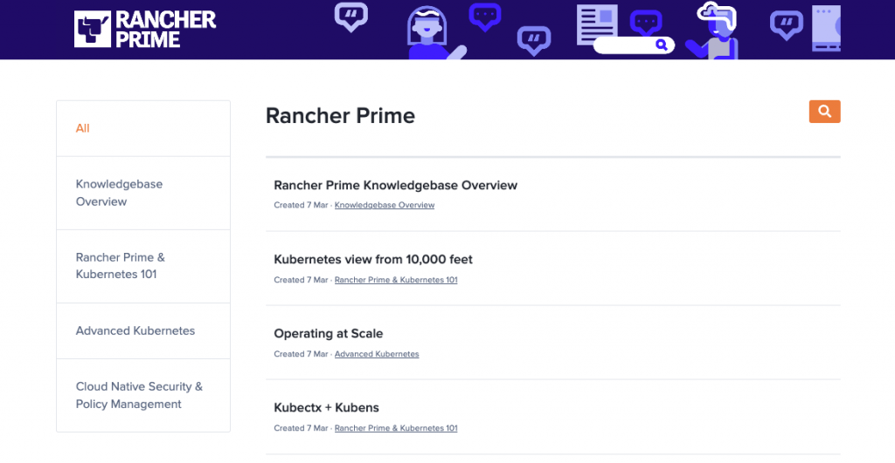
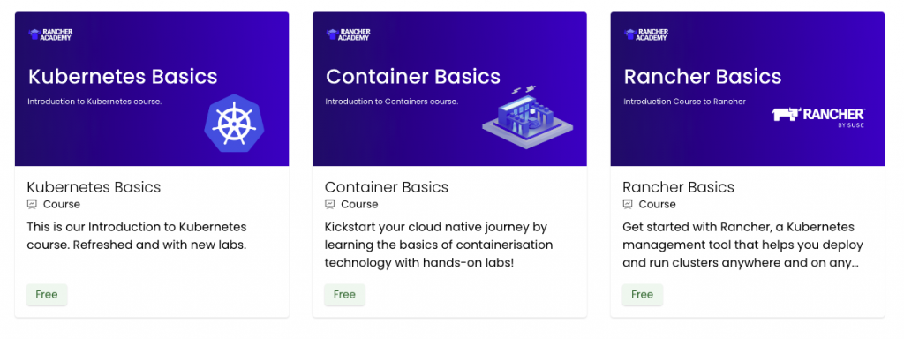

We’re on a mission to build the industry’s most open, secure and interoperable Kubernetes management platform. Over the past few months, the team has made significant advancements across the entire Rancher portfolio that we are excited to share today with our community and customers.
**Introducing the Rancher UI Extensions Framework**
In November last year, we announced the release of v2.7.0, where we took our first steps into developing Rancher into a truly interoperable, extensible platform with the introduction of our extensions catalog. With the [release of Rancher v2.7.2](https://github.com/rancher/rancher/releases) today, we’re proud to announce that we’ve expanded our extensibility capabilities by releasing our ‘User Interface (UI) Extensions Framework.’
Users can now customize their Kubernetes experience. They can build on their Rancher platform and manage their clusters using custom, peer-developed or Rancher-built extensions.

*Image 1: Installation of Kubewarden Extension*

Supporting this, we’ve also now made three Rancher-built extensions available, including:
> 1. Kubewarden Extension delivers a comprehensive method to manage the lifecycle of Kubernetes policies across Rancher clusters.
> 2. Elemental Extension provides operators with the ability to manage their cloud native OS and Edge devices from within the Rancher console.
> 3. Harvester Extension helps operators load their virtualized Harvester cluster into Rancher to aid in management

Building a rich community remains our priority as we develop Rancher. That’s why as part of this release, the new UI Extensions Framework has also been implemented into the [SUSE One Partner Program](https://www.suse.com/partners/). Technology partners are key to our thriving ecosystem and by validating and supporting extensions, we’re eager to see the innovation from our partner community.
You can learn more about the new [Rancher UI Extension Framework in this blog](https://www.suse.com/c/rancher_blog/utilizing-rancher-ui-extensions/) by Neil MacDougall, Director of UI/UX. Make sure to join him and our community team at our next [Global Online Meetup](https://more.suse.com/FY23Q1_CY_ECM_SR_ECMC_WEB_Global_Online_Meetup_Rancher_Extensions_RG_GLB_RegistrationPage-NEW.html) as he deep dives into the UI Framework.
**Adding more value to Rancher Prime and helping customers elevate their performance**
In December 2022, we announced the launch of Rancher Prime – our new enterprise subscription, where we introduced the option to deploy Rancher from a trusted private registry. Today we announce the new components we’ve added to the subscription to help our customers improve their time-to-value across their teams, including:
> 1. SLA-backed enterprise support for Policy and OS Management via the Kubewarden and Elemental Extensions
> 2. The launch of the [Rancher Prime Knowledgebase](https://www.suse.com/c/rancher_blog/suse-launches-dedicated-rancher-prime-knowledgebase) in our SUSE Collective customer loyalty program

> *Image 2: Rancher Prime Knowledgebase in SUSE Collective*

We’ve added these elements to help our customers improve their resiliency and performance across their enterprise-grade container workloads. [Read this blog from Utsav Sanghani,](https://www.suse.com/c/rancher_blog/rancher-prime-spring-release-2023/) Director of Product – Enterprise Container Management, for a detailed overview of the upgrades we made in Rancher and Rancher Prime and the value it derives for customers.
**Empowering a community of Kubernetes innovators**

*Image 3: Rancher Academy Courses*

Our community team also launched our free online education platform, Rancher Academy, at KubeCon Europe 2023. The cloud native community can now access expert-led courses on demand, covering important topics including fundamentals in containers, Kubernetes and Rancher to help accelerate their Kubernetes journey. [Check out this blog from Tom Callway](https://www.suse.com/c/rancher_blog/welcome-to-rancher-academy/), Vice President of Product Marketing, as he shares in detail the launch and future outlook for Rancher Academy.

**Achieving milestones across our open source projects**
Finally, we’ve also made milestones across our innovation projects, including these updates:
[Rancher Desktop 1.8](https://github.com/rancher-sandbox/rancher-desktop/releases) now includes configurable application behaviors such as auto-start at login. All application settings are configurable from the command line and experimental settings give access to Apple’s Virtualization framework on macOS Ventura.
[Kubewarden 1.6.0](https://github.com/kubewarden/policy-server) now allows DevSecOps teams to write Policy as Code using both traditional programming languages and domain-specific languages.
[Opni 0.9](https://github.com/rancher/opni) has several observability feature updates as it approaches its planned GA later in the year.
[S3GW (S3 Gateway)](https://s3gw.io/) 0.14.0 has new features such as lifecycle management, object locking and holds and UI improvements.
[Epinio 1.7](https://github.com/epinio/epinio/releases) now has a UI with Dex integration, the identity service that uses OpenID Connect to drive authentication for other apps, and SUSE’s S3GW.
Keep up to date with all our product release cadences on [GitHub](https://github.com/rancher/rancher/releases/), or connect with your peers and us via [Slack](https://slack.rancher.io/).
