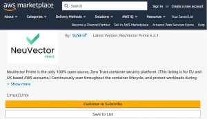

The Rancher by SUSE team has been dedicated to fortifying the Rancher platform to be the most interoperable and adaptable platform for our customers and the wider community over the past year.
In late 2022, we introduced the 'Extensions Catalog.', and earlier this year at KubeCon Europe in Amsterdam, we revealed our [Rancher UI Extensions framework](https://www.suse.com/c/rancher_blog/utilizing-rancher-ui-extensions/). Continuing this momentum, we are thrilled to announce the release of Rancher 2.8 and Rancher Prime 2.0.
The release of Rancher 2.8 at KubeCon North America 2023 is a significant stride towards reinforcing the platform. It assists users in minimizing operational gaps and streamlining infrastructure resources and workflows with:
> **Enhanced Kubernetes Support:** We've upgraded support for Kubernetes 1.27, ensuring users can confidently build container workloads in alignment with Kubernetes enhancements. Support for Kubernetes 1.28 is set to follow soon.
> **New Self-Service Public API:** This API empowers Rancher users with advanced customization capabilities for deployments from the platform via a secure API. The Public API incorporates 'Custom Resource Definitions' (CRDs), enabling users to build automation workflows using GitOps principles across the Rancher platform's services.
> **Improved GitOps Workflows:** The introduction of the Cluster API (CAPI) extension, currently in beta, enables users to manage numerous clusters in a declarative GitOps-friendly manner. Additionally, the Fleet project offers advanced reconciliation and detection capabilities to ensure that Rancher users match their clusters' actual and desired states, maintaining the Git Repository as the single source of truth.

Delve deeper into the [Cluster API on Rancher, in this blog](https://www.suse.com/c/capi-fleet-and-gitops-a-new-way-for-orchestrating-kubernetes-clusters-with-rancher) by Raul Mahiques Martinez - Technical Marketing Manager at SUSE and learn more about the Rancher 2.8 release [here](https://github.com/rancher/rancher/releases).
For our enterprise customers, Rancher Prime continues to evolve, aiding in optimizing Kubernetes deployments in the release of Rancher Prime 2.0:
> **New UI Extensions:** These extensions enable tighter portfolio and ecosystem integration into the Rancher Prime console. This includes NeuVector, delivering a comprehensive container security solution accesible from Rancher Prime console, alongside the Cluster API UI extension in beta released as part of Rancher 2.8.
> **Rancher Prime Application Collection:** A curated library of developer and infrastructure applications built and packaged with SUSE Linux Enterprise (SLE) Base Container Images, allowing enterprise customers to swiftly launch and utilize these applications within their stack while ensuring zero-trust principles and secure software supply chain guarantees.
> **Rancher Prime Customer Assistant:** Now generally available, powered by generative AI, providing insights and guidance via Rancher Prime customer Slack across installation, configuration, performance, and troubleshooting.
> **Long-Term Service Support (LTSS) and Benchmarking:** Documented performance benchmarking for enterprise customers, with LTSS available for RKE2 users, extending application and production lifecycles by up to two years.
> **New Route to Market:** Rancher Prime and NeuVector accessible via AWS and Microsoft Azure marketplaces, offering a simpler pathway for deploying and optimizing Kubernetes deployments.

*Image 2: NeuVector Prime on AWS Marketplace*

To learn more about the Rancher 2.8 release and catch up with our team and news from KubeCon NA 2023, join our [Global Online Meetup on November 16th, 2023, at 11 am EST](https://www.linkedin.com/events/7123496996245508096).
Stay updated on all our product releases on [GitHub](https://github.com/rancher/rancher), or connect with your peers and us via [Slack](https://slack.rancher.io/).
