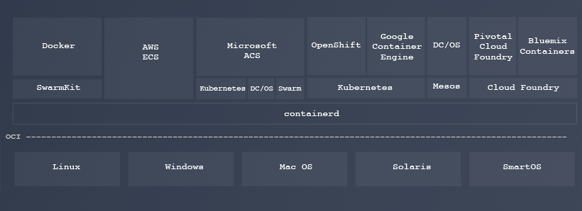

I am heading to Copenhagen this week to attend DockerCon Europe 2017

you can still register for the conference[here](https://europe-2017.dockercon.com/).

Because we created Rancher to serve the market needs resulting from the

widespread adoption of Docker technology, we have maintained a strong

presence at every DockerCon conference over the last three years.

DockerCon is special—not only is it a

gathering place for major industry players, it is one of the few events

that brings together far more users than vendors. The opportunity to

meet so many users in one place makes attending and sponsoring the

conference a worthwhile investment. Talking to our users and hearing

their ideas motivates us to work harder and improve the Rancher

product.

The Docker technology evolution is

at a critical juncture, so I am particularly interested in what Docker,

Inc. will announce at this year’s DockerCon EU. We recently announced

the technical preview of [Rancher 2.0](https://rancher.com/announcing-rancher-2-0/),

where we transitioned Rancher from a product built on Docker to a

product built on Kubernetes. As much success as Docker has achieved as

an application packaging and runtime standard, Kubernetes has overtaken

Docker in terms of container infrastructure, orchestration, and

ecosystem.

### Container infrastructure

Infrastructure goes beyond packaging and runtime; it includes storage,

networking, load balancing, and security. When we started Rancher three

years ago, we expected Docker to define industry standard plugin

interfaces for container networking and storage. Despite the excellent

work done by Docker and other early pioneers like SocketPlane (later

acquired by Docker), Weaveworks, and ClusterHQ as well as plenty of

support from industry leaders such as Cisco, EMC, and NetApp, Docker

interfaces like libnetwork, Container Network Model (CNM), and Docker

volume plugin failed to become viable standards. We tried very hard to

work with CNM and Docker volume plugins at Rancher, but we ran into

insurmountable challenges:

1. We never figured out how to make CNM work outside of Docker’s

   built-in networking implementation. We were not able to, for

   example, create our own implementation of CNM that worked without

   Swarm mode.
2. We were unable to make the Rancher implementation of Docker volume

   plugin work reliably with the Docker daemon. I remember a

   particularly challenging issue,

   #[18504,](https://github.com/moby/moby/issues/18504)

   which caused the Docker daemon to lock up from time to time. We

   were not able to get this issue fixed, nor were we able to find a

   workaround.

We solved these problems in Rancher 1.2 (released December 2016) by

switching to Kubernetes Container Network Interface (CNI) and Kubernetes

Flexvolume storage framework. Since Rancher 2.0 builds on Kubernetes,

any networking, storage, load balancer, and security solutions that

integrate with Kubernetes now work with Rancher out of the

box.

### Container orchestration

We developed a container orchestrator for Rancher, called Cattle, to

add a number of features missing from early Docker Swarm, including

service discovery, DNS, service upgrade, and a load balancer. We hoped

Cattle would eventually be superseded by Swarm as Swarm becomes more

full featured.

When Rancher 1.0 was released in March 2016, however, Swarm was still not quite ready. At the

time, Kubernetes was also still immature and the future of container

orchestration was uncertain. Therefore, we decided that Rancher 1.0

should provide support for multiple orchestrators: Cattle, Swarm,

Kubernetes, and Mesos. Our users loved the idea of being able to adopt

one product without having to commit to a particular container

orchestrator.

We were really excited in June 2016 when Docker announced Swarm Mode. Swarm Mode offered many

features missing from early Docker Swarm and was much closer to what

Cattle could do. We quickly added Swarm Mode support in

Rancher.

By early 2017, however, it became apparent that Swarm Mode was not gaining traction. Perhaps early Swarm

mode implementations had quality issues, or perhaps Kubernetes

development was already too far ahead. A vast majority of Rancher users

were selecting Cattle or Kubernetes.

Rancher 2.0 builds on the industry-standard Kubernetes orchestrator.

Cattle is not gone—we will continue to develop it as it is now part of

the integrated Rancher experience. With 2.0, we provide a simple Docker

and Docker Compose user experience that builds on Kubernetes. Anyone

with basic understanding of Docker can get started with Rancher quickly,

and move to the more advanced native Kubernetes experience when they are

ready to do so.

### Container ecosystem

DockerCon Europe has an impressive list of sponsors, which are no doubt

attracted by the ever-growing number of Docker users. I always look for

the latest number of total pulls from DockerHub as a benchmark of Docker

growth. At DockerCon Austin in April 2017, that number was 12 billion,

and has no doubt grown since then.

The Kubernetes ecosystem consists of largely the same set of companies, but

the engagement model is quite different. Most ecosystem partners like us

view Docker as mature technology with a lot of users. The Kubernetes

ecosystem is far more vibrant because that’s where active development,

innovation, and integration is happening.

### Where will Docker go?

I have no real insight on what Docker will announce this week. And

that’s why I find I am really looking forward to attending this

DockerCon. Will Docker announce something this week that motivates

ecosystem partners to increase development efforts on Docker? Are they

going to announce any new projects or

initiatives?

Looking at the original [containerd blog](https://blog.docker.com/2016/12/introducing-containerd/)

Solomon Hykes published in December of 2016, I noticed one particular

figure:

](https://docs.google.com/document/d/1uRMajP8gKwG3Qkv1XUEXFOzZ663iPBcOi0d8QXpJc\_o/edit#)

In the new containerd world, Docker is positioned at the same level

as OpenShift (and Rancher 2.0), at a layer even higher than Kubernetes.

Perhaps there will be a new Docker built on Kubernetes? I can’t wait to

find out.

### Rancher at DockerCon

Please stop by our booth (G16) to say hello, get a demo of Rancher 2.0

and pick-up a coveted Rancher t-shirt. It would also be great to see

you in one of our speaking sessions:

**Kubernetes for Docker Users** Speaker: Darren Shepherd When: Tuesday,

17 October from 16:35 – 16:55 Where: Ecosystem B – Auditorium 12

**Using LinuxKit to Build Custom RancherOS Systems** Speaker: Sven

Dowideit When: Thursday, 19 October Where: Moby Summit

*Sheng is a co-founder and CEO of Rancher Labs. Prior to starting Rancher, Sheng was CTO of the Cloud Platforms group at Citrix Systems after their acquisition of Cloud.com, where he was co-founder and CEO. Sheng has more than 15 years of experience building innovative technology. He was a co-founder at Teros, which was acquired by Citrix in 2005 and led large engineering teams at SEVEN Networks, and Openwave Systems. Sheng started his career as a Staff Engineer in Java Software at Sun Microsystems, where he designed the Java Native Interface (JNI) and led the Java Virtual Machine (JVM) development for the Java 2 platform. Sheng has a B.S. from the University of Science and Technology of China and a Ph.D. from Yale University.*
