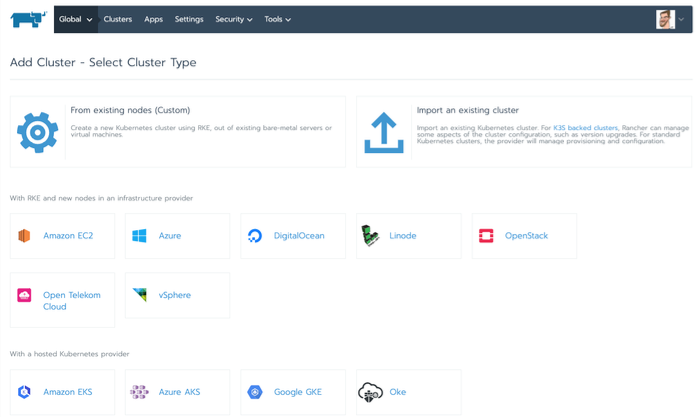

My favorite ice cream store is just off Richmond Green, close to where I live in West London. On sunny days, locals queue around the block to buy their fantastic gelatos and sorbets. Every one of their customers knows that they could easily nip into the supermarket around the corner to buy hermetically sealed chocolate ice cream, but they queue anyway. Why? Because my favorite ice cream store offers a huge selection of delicious flavors that customers can combine in innovative ways under the expert guidance of their friendly staff. If the store owners ever did a deal with a giant food company to sell only one type of ice cream, they’d lose the trust of their customers, many of whom would go elsewhere.

Yesterday’s exciting news about SUSE acquiring Rancher Labs isn’t any different. Most people in the Kubernetes community know Rancher Labs has built its success on offering maximum choice to its legions of loyal users and customers. We’re not just 100 percent open source, we’re 100 percent open with no vendor lock-in. SUSE is acquiring Rancher Labs because they’re the same.

## We’re Both OS Agnostic

If you prefer Centos to Ubuntu, no problem. If you’ve been a Red Hat customer for a decade and want to deploy on RHEL, that’s fine too. Both SUSE and Rancher Labs understand that organizations choose to standardize on a specific Linux distribution for a variety of reasons. Normally they’ve undertaken extensive evaluations of different providers to land on their OS selection. Sometimes their choice is based on nothing more than somebody in IT thinks one project or vendor is cooler than the rest.

As we go forward, SUSE and Rancher Labs will continue to respect these decisions because we’re focused on one thing alone – helping our customers be successful.

## We’re Both Infrastructure Agnostic

Sharing in this ethos, Rancher will continue to be infrastructure agnostic, giving our users the flexibility to deploy Kubernetes clusters on any major cloud provider. We even allow users to import existing Kubernetes clusters that pre-date their use of Rancher.

Rancher is also well known for treating cloud-hosted Kubernetes distributions like Google GKE, Amazon EKS and Microsoft AKS as first-class citizens. In fact, our users can run any CNCF-certified Kubernetes distribution from within Rancher, giving them the freedom to innovate on the best platform for their use case. Yes, we have two popular Kubernetes distributions of our own – RKE for consistency across hybrid cloud deployments and K3s for resource-constrained environments at the edge – but we won’t stop customers from doing their own thing. It’s not in anybody’s interest to change this commitment in the future.

## The Future

When the dust of the pandemic settles, I can’t wait to be sitting in the sun again on Richmond Green, watching the cricket while eating my favorite gelato combo – salted caramel and Stracciatella in a chocolate cone.

Similarly, when the dust from yesterday’s announcement settles and the SUSE acquisition is finalized, I can’t wait to join what I think will become the world’s most innovative and truly ‘open’ enterprise open source software company.

Learn more here: [SUSE Enters Into Definitive Agreement to Acquire Rancher Labs](https://rancher.com/blog/2020/suse-to-acquire-rancher)
