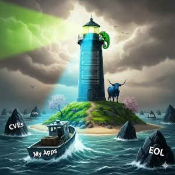

**SUSE Ra****ncher Prime delivers SUSE secure Application Collection and a complete Kubernetes platform, turning an industry crisis into your strategic upgrade.**

# **What is happening?**

For years, Kubernetes development and operations teams have relied on a vast ecosystem of freely available, containerised open-source applications. At the center of this ecosystem was Bitnami. It was a simple, unspoken agreement: the community received reliable, version-pinned software ready for Kubernetes, and the vendor built massive user bases. In what could be described as a textbook example of the [platform decay strategy](https://en.wikipedia.org/wiki/Enshittification), that agreement is now broken, and the fallout is disrupting workflows and budgets across the industry. Let’s break it down:

1. **Death by** ***“:latest”*****:** The core repository, docker.io/bitnami, is being stripped down. The new [free offering](https://hub.docker.com/u/bitnamisecure) will now only provide the *":latest"* tag for a small, curated set of hardened images. This change effectively eliminates one of the most critical practices for stable application development and maintenance: **version pinning**. The ability to pin a precise version like postgresql:13.17 is essential for preventing unexpected changes from breaking production deployments. Without it, teams are forced into a constant state of flux, testing against an ever-changing *":latest"* tag.
2. **The oblivion of “legacy”:** Everything else is being moved to a new [Bitnami Legacy repository](https://hub.docker.com/u/bitnamilegacy). The name itself is a warning. This repository will receive **zero updates**. Any application, database, or cache pulled from this legacy location will become a **ticking time bomb** of unpatched vulnerabilities. Every new vulnerability discovered in an application will remain unaddressed in these images, creating a significant and growing security risk for any system that uses them.

This industry-wide shift highlights a crucial lesson for modern IT operations. In this new landscape, the most valuable attribute of an application source is not just the software itself, but the **stability** and **trustworthiness** of the **partner** who delivers it.

# **Introd****ucing pre****dictability: The SUSE Application Collection**

There is a better, more stable way forward. While the ground shifts under public registries, SUSE provides a professionally managed, secure, and predictable source for enterprise applications: the **SUSE Application Collection**. It is designed from the ground up to solve the exact problems of instability and risk that teams are now facing.

## Curated for stability and predictability

The SUSE Application Collection is a curated set of trusted, compliant, and **continuously updated** applications for Kubernetes and containerized environments. It directly counters the pain points introduced by the Bitnami changes. Where Bitnami has abandoned version pinning for free users, the SUSE Application Collection provides access to **multiple, maintained versions of applications**, ensuring that teams can build and deploy with the confidence that comes from stable, predictable dependencies.

## Built on a foundation of enterprise trust

This **stability** is built on a foundation of enterprise trust. Each application is constructed on SUSE Linux Enterprise (SLE) container images, leveraging SUSE's 30-year track record as a leader in secure and reliable open source. This unmatched history in the Linux industry is concentrated into a **small-footprint, highly robust base image** that provides a secure foundation for every application. This is not a community project run by a vendor with shifting priorities; it is an enterprise-grade service from an established, **trusted partner.**

## Uncompromising security and compliance

Security is a core principle of the collection. **Automated CVE scanning** highlights a consistently **low-to-zero CVE** count, achieved by automated maintenance of dependencies which addresses the CVEs that often plague poorly maintained applications. Every artifact is delivered with comprehensive metadata, including a full Software Bill of Materials (**SBOM**) for transparency and SLSA provenance attestations— a testament to our [**SLSA Level 3**](https://slsa.dev/spec/v1.1/levels#build-l3) build process. This provides verifiable proof of the build process's integrity, giving security and compliance teams the assurance they need. 

## An investment in resilience

Adopting the SUSE Application Collection represents a strategic shift from being a passive *consumer* of a free, "as-is" resource to becoming an active *partner* with an enterprise vendor. The old model was a one-way street: you consumed free artifacts, and when the terms changed, you had no recourse. A partnership with SUSE, by contrast, is a two-way business relationship. This relationship is governed by Service Level Agreements (SLAs) and backed by world-class enterprise support. 

This reframes the entire value proposition. The investment is not merely for container images; it is an **investment in the operational stability, security, and resilience of your entire platform.**

# **More than trusted applications: It's an integrated part of Rancher Prime**

**SUSE Application Collection** is a powerful feature that comes included with a subscription to **SUSE Rancher Prime**, SUSE’s complete, enterprise-grade Kubernetes management platform.

In addition to Application Collection, SUSE Rancher Prime provides a single control plane to manage all of your Kubernetes clusters, whether they are running in the public cloud on EKS, AKS, and GKE, or on-premises in your own data center. When you adopt Rancher Prime to simplify your cluster management, you automatically gain access to the secure, stable world of the SUSE Application Collection. 

## Beyond the Application Collection: a complete cloud-native Platform

The benefits of Rancher Prime extend far beyond the application catalog, creating a holistic solution for managing and securing your entire modern infrastructure stack.

- **Simplified Lifecycle Management & Enterprise Support**: Streamline and automate complex operational tasks like cluster provisioning, version upgrades, and monitoring with a powerful, intuitive UI and CLI, all backed by 24/7, SLA-driven support from SUSE's world-class experts.
- **Full-Stack Observability**: Included with Rancher Prime, **SUSE Observability** provides a unified view across your entire Kubernetes environment by consolidating metrics, logs, and traces. It empowers you to shift from reactive troubleshooting to proactive problem-solving.
- **Self-Service Multi-Tenancy with Virtual Clusters**: Rancher Prime's deep integration with virtual clusters allows you to provide virtual Kubernetes clusters to your development teams. These virtual clusters run inside a namespace of a host cluster but appear to users as fully functional, isolated environments, dramatically increasing developer velocity without the operational overhead of managing hundreds of physical clusters.
- **Advanced Policy and Governance**: Rancher Prime integrates with Kubewarden, a powerful policy engine that allows you to enforce security and governance rules across all your clusters. You can write policies to prevent non-compliant workloads from being deployed, such as blocking images from untrusted registries or verifying image signatures, providing centralized, automated control to meet strict compliance requirements.

By integrating the Application Collection directly into the Rancher Prime platform, **SUSE makes security and stability the path of least resistance**. Platform engineering teams can solve the challenge of untrusted images by presenting a vetted catalog directly through the management interface developers already use. This makes deploying a secure, compliant version of PostgreSQL or Prometheus *easier* and *faster* than hunting for an alternative on Docker Hub. And by using the [Rancher Desktop UI extension](https://github.com/rancherlabs/application-collection-extension), they can even extend this experience to the developer desktop.

# **And there is more to it!**

For organizations ready to take the next step, **SUSE Rancher Suite** builds on the powerful foundation of Rancher Prime. The Suite bundles additional enterprise-grade capabilities, including **SUSE Security** for zero-trust container security, **SUSE Virtualization** for managing VMs and containers side-by-side, and **SUSE Storage** for persistent, enterprise-grade storage.

# **Your path Forward from the Chaos**

The recent turmoil in the open-source application landscape is a clear signal that the era of relying on unsupported, "free-as-in-beer" infrastructure is over. The risks of disruption, unpatched vulnerabilities, and sudden costs are too high for any serious enterprise. **It's time to move to a model built on stability, trust, and partnership.**

SUSE provides a clear path to regain control over your software supply chain and ensure the long-term stability of your applications.

- **Explore the collection**: Visit the [SUSE Application Collection](https://apps.rancher.io) online to browse the extensive catalog of available, enterprise-ready applications.
- **See it in action**: Request a personalized demo of [SUSE Rancher Prime](https://www.suse.com/products/rancher) to understand how the Application Collection is seamlessly integrated into a comprehensive Kubernetes management platform.
- **Plan your transition**: [Contact a SUSE expert today](https://www.rancher.com/contact). We can help you design a migration strategy that not only solves the immediate Bitnami problem but also addresses your broader challenges around multi-cluster management, security, and operational efficiency.
