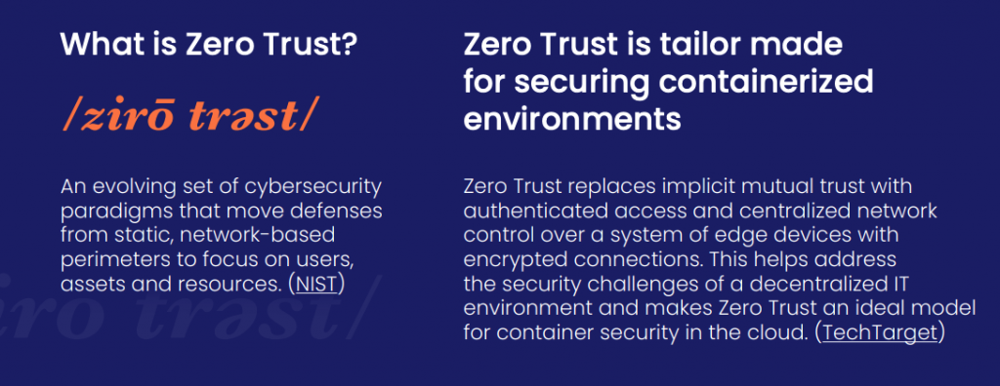
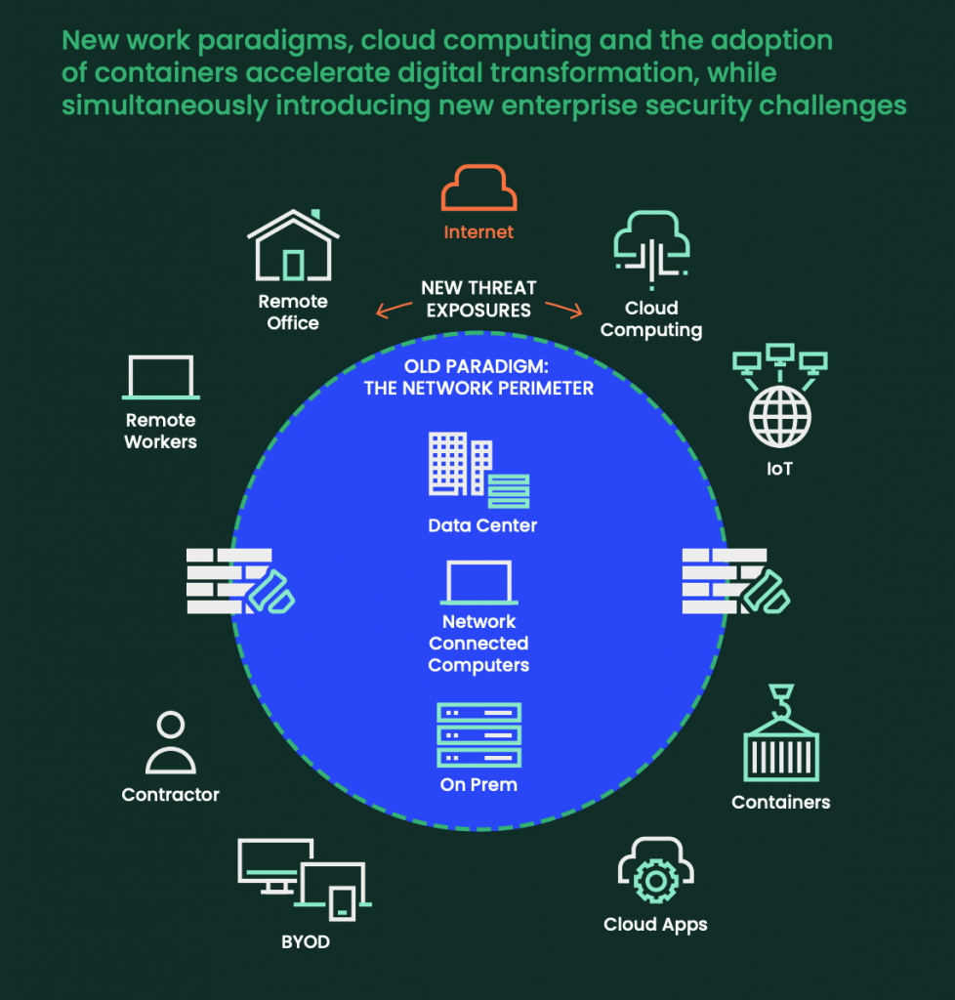
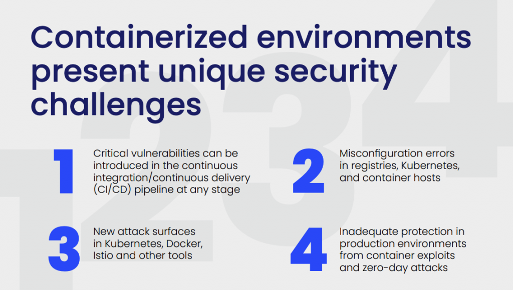
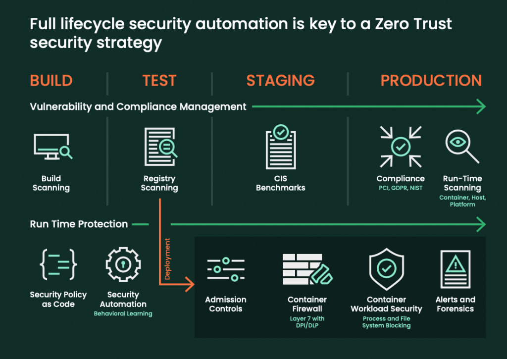

It seems like everyone is talking about Zero Trust these days. But what is it, and why is it important for container environments?

Containers and tools like Kubernetes allow you to automate many aspects of application development. But containerized environments are still vulnerable to attacks, exploits and insider threats. While containers are generally more secure than traditional applications, the threat landscape is changing as attack techniques evolve and attackers get more sophisticated by the day. This post will show you why Zero Trust makes sense for container environments. No time to read? [Get the infographic here](https://more.suse.com/rs/937-DCH-261/images/Suse_Zero_Trust_Infographic_final.pdf).

## **What is Zero Trust?**

 

Zero Trust is based on the concept of “Never trust, always verify.” Instead of inherently trusting traffic that is “inside” the network perimeter, Zero Trust security requires every entity on the corporate network to be positively identified and explicitly permitted to perform any action on the network. Zero Trust security takes a proactive approach to security.

Instead of relying on reactive, signature-based protections, Zero Trust security is based on a declarative model in which you define acceptable behavior and block everything else.

## **The disappearing network perimeter**

 

Cloud computing and container adoption have accelerated digital transformation, but they’ve also introduced security challenges. The traditional security perimeter has all but disappeared as infrastructure evolves from physical hardware in on-premises data centers to virtualized environments spanning data centers and public and private clouds. These changes, plus new work paradigms, have introduced new enterprise security challenges.

These new threat exposures make adopting Zero Trust for your containerized environments essential. Rather than implicitly trusting traffic inside the network perimeter, Zero Trust security requires every entity in the corporate network to be explicitly permitted to perform an action.

## **Unique security challenges for containers**

 

Kubernetes enables container orchestration and distributed workloads at scale. However, this exponentially increases the container attack surface to include service meshes, cluster-to-cluster communications, multi-cloud and hybrid cloud environments, functions, application programming interfaces (APIs), serverless and edge computing.

Traditional security approaches include protecting network perimeters and data centers with firewalls, intrusion detection/prevention (IDS/IPS), malware scans and even vulnerability (CVE) scanning. These actions focus on identifying and blocking known threats. The fundamental change in Zero Trust from traditional security is moving from a deny-list-based approach to an explicit allow-list-based approach.

## **Zero Trust: From pipeline to production**

 

To use Zero Trust to its fullest potential, you must activate its full lifecycle automation. This means starting with build scanning and moving to registry scanning, then staging CIS benchmarks and run-time scanning. From building to production, this creates a security system that includes admission controls, container firewall, container workload security, and alerts and forensics.

## **What's Next: Get Zero Trust Container Security for Dummies**

Download and read the [Zero Trust Container Security for Dummies eBook](https://more.suse.com/zero-trust-security-for-dummies.html?utm_source=marketo&utm_medium=email&utm_campaign=8_FY22Q3_DM_GLB_ECM_NEU_SCRTY_LP_Zero_Trust_Security_for_Dummies_mp_2022128&utm_content=blog_en&utm_term=blog) for a complete understanding of why Zero Trust is the best solution for containerized environments and how you can get started.

