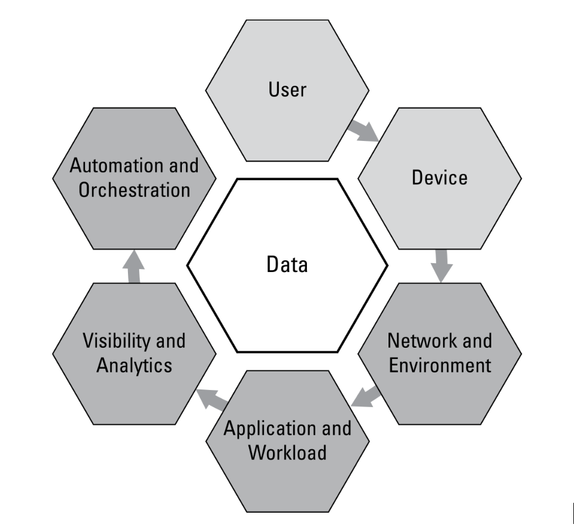
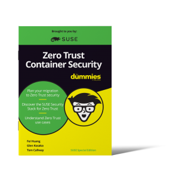

Zero Trust security is gaining attention and momentum as a security approach or mindset that can improve the security posture of enterprises as they continue to battle hackers. Because of this widespread attention on Zero Trust, every software security vendor seems to be jumping on the Zero Trust bandwagon. However, Zero Trust is not a product or service. No single product or vendor can sell you Zero Trust security. But certain products can help you implement security controls that are consistent with a Zero Trust approach to security. 

**What is Zero Trust?** 

The basic concept behind a Zero Trust security strategy is simple: don’t implicitly trust anything or anyone. Zero Trust security takes a proactive approach to security. Every access and action must be explicitly allowed.   

Zero Trust is not new – it's been around for more than 10 years. But the failures of traditional security models to protect us against attacks, combined with the emergence of cloud native applications that enable Zero Trust declarations, make Zero Trust a viable strategy today. 

Zero Trust affects seven primary areas of enterprise technology, as shown in the diagram below. 

 

  

**How is Zero Trust different from past security strategies?** 

The fundamental change in Zero Trust from traditional security is moving from a deny-list based approach to an explicit allow-list based approach to security. Traditional security approaches such as protecting network perimeters and data centers with firewalls, intrusion detection/prevention (IDS/IPS), malware scans and even vulnerability (CVE) scanning focused on identifying and blocking known threats. These relied on block lists, signatures, patterns and known exploit behaviors. The problem has always been that these traditional security controls are like looking in a rear-view mirror – they won’t protect you from new zero-day attacks or insider threats. 

**Zero Trust Example:** In a Kubernetes environment, each application workload has allowed behaviors declared prior to its deployment. These behaviors can define allowed network connections (including application protocols, sources, destinations and external connections), processes and file access activity within the workload. 

**Why is Zero Trust important?** 

Security perimeters are disappearing as public, private and hybrid cloud technologies enable applications and infrastructure to be instantly deployed anywhere. There isn’t the notion of a secure internal network and thus all networks and systems must be required to be secured as if they are publicly accessible, with the assumption that they may be compromised at some point.  

Implementing Zero Trust security controls is a key enabler for secure deployment of modern cloud native applications with automated CI/CD pipelines. The applications and pipelines require automated deployment of new or updated applications hundreds of times daily or weekly onto infrastructures that can reside anywhere and be temporal in nature. These characteristics preclude traditional security approaches from being applied effectively. 

**Cloud native Zero Trust controls** 

For public cloud, private cloud and hybrid cloud deployments, use technologies such as helm charts, Terraform and Kubernetes custom resource definitions (CRDs) to declare the desired state of the infrastructure and application workloads. These are key enablers for moving to a Zero Trust security model, where you can define access and allowed application behavior.  

Key areas to review for Zero Trust controls include role-based access controls (RBACs), registry access and workload behavior in production. 

**Is Zero Trust a replacement for traditional security?** 

It is always advisable to use a combination of security approaches to create “defense in depth,” which includes protections at many layers of infrastructure. Where possible, traditional security techniques such as web application firewalls (WAFs), host IDS/IPS and malware scanning should be applied in addition to Zero Trust based controls. However, in many cloud environments, traditional security approaches are impractical, not available or too costly.  

## **What's Next:**

First, download and read the [Zero Trust Container Security for Dummies eBook](https://more.suse.com/zero-trust-security-for-dummies.html?utm_source=marketo&utm_medium=email&utm_campaign=8_FY22Q3_DM_GLB_ECM_NEU_SCRTY_LP_Zero_Trust_Security_for_Dummies_mp_2022128&utm_content=blog_en&utm_term=blog). Then discuss and socialize the concepts within your organization. Form a tiger team to examine areas to apply Zero Trust and design a phased approach. 

When you’re ready to tackle Zero Trust controls for Kubernetes, containers and application workloads, evaluate the NeuVector container security platform from SUSE. It combines modern Zero Trust controls with traditional security such as WAF, CVE scanning and threat detection to provide a layered security solution across the CI/CD pipeline and into production.
